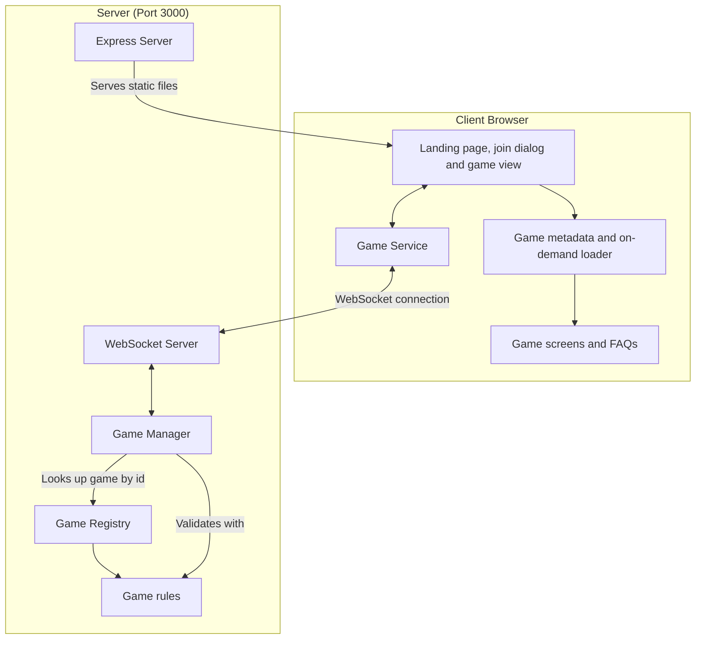

# Multiplayer Tabletop Games Architecture

One Express and WebSocket server hosts every game. The platform handles seating, turn order, undo, and the browser shell. Each game supplies its rules and its screen, and is registered once on the server and once in the browser, where the landing page has only each game's metadata and a game's code downloads when it is opened.



## The split between platform and game

**The platform owns:**

- Express static serving and SPA fallback, the WebSocket server, message parsing and routing, broadcast (`server/server.ts`)
- Every SVG piece and icon and every sound, served from one registry (`server/assets/`, see Assets)
- The in-memory game manager, keyed by game type and game ID (`server/games.ts`)
- Saving every started game to SQLite and loading them back on start (`server/store.ts`)
- Seating in join order up to the game's maximum, with names unique ignoring case, and refusing new names after the game has started (`shared/seating.ts`)
- Holding the seat of a player who disconnects after the first move (refresh, closed tab, lost connection or Back to games), rejoining by the same name with the seat's key, and dismissing a disconnected player by vote
- Turn rotation that skips dismissed players; a disconnected player's turn waits for them
- A heartbeat that closes the sockets of devices that drop off silently, and deleting a game 10 minutes after its last connected player leaves (a paused game is never deleted this way, see Pausing and resuming)
- House rules: every game also offers the platform Turn timer rule (`TURN_TIMER` in `shared/houseRules.ts`, Off, 30 seconds, 1, 2 or 5 minutes; a warning only, nobody's turn is skipped) unless its `GameInfo` sets `ownTurnLimit`, which means the game enforces its own turn limit or has no turns, so the platform turn timer is not offered (Pictionary and the puzzle games do); `rulesOf(info)` returns a game's own rules then the timer. A game declares options (toggles and choices; a rule may have a standard per seat count, `standardFor`, read through `standardOf(rule, seats)`, and a choice may have its own `offered(seats, values)`, listed by `offeredChoices`, so a value is neither kept nor accepted once its choice is no longer offered at the seat count) and may stretch the player count (`stretchedPlayers`), which the host sets as Most players; the host (the first seated player, passed on if they leave) sets them before play, every seated player must agree to the current revision before the first move, and any seat change clears the agreements. Rules are locked once play starts
- Out-of-turn moves for a game that allows them (`allowsOutOfTurn`), refused with "Someone else moved first" when the mover's `moveCount` is stale
  - Used by Catan's special build phase (`games/catan/specialBuild.ts`): the builder whose chance it is builds, buys or clicks Done building while the next player holds the turn
- Undo: the history of states before each move, requests, voting, and restoring the state once every connected player approves (a one-player table needs only its one seat; a game with `undoOwn` can also take back a seat's own last move at once, see Server)
- One-player games: a game whose `minPlayers` is 1 can start with one seat. A game that sets `continuesAlone` keeps going when the others leave: `removePlayer` (`shared/seating.ts`) does not make the last player the winner by default, and `onPlayerLeft` runs while one player remains. `shared/puzzleModes.ts` is the shared vocabulary of the puzzle games: `modeRule` (the Mode choice: Solo at 1 seat, Together and Race at 2 or more, plus any extra choices and a standard per seat count), `modeOf`, `playsAtOnce` (Together and Race, where moves are actions from any seat at any time), the Race helpers `visibleBoards` (during play only the viewer's own board, once over all of them) and `raceProgress` (whole percentages), and the Together count `addContribution`
- Uploaded images: `GameDefinition.imagesOf(state)` names the image IDs a state shows, and the platform stores, deletes and embeds them (see Server, Game store and Game files)
- Pausing and resuming: any player asks, every seated player must agree, and each player downloads a pause file of their own; the server keeps a paused game until it is resumed or for 30 days, and a game the server lost can be rebuilt from every seat's file (see Pausing and resuming)
- Calling the game's `toPublicState` for each player before anything is sent to them, so each player gets their own view
- The landing page, join dialog, rejoin button, game view header (Back to games, History, Share, Rules, Settings, theme toggle), Rules dialog and its markdown renderer, House rules tab (the form and the read-only list), undo vote panel, disconnected players bar, dismiss vote panel, connection hook and service, and the remembered game, in `src/`
- Docker, compose, launcher, CI, lint and TypeScript config

**Each game owns (`games/<id>/`):**

- Its metadata (`info.ts`, with its house rule declarations in `options.ts`, so neither imports rules code), state shape and types (`types.ts`, `index.ts`)
- Its rules: starting state, applying a move, extra non-move actions, who won, what happens when a player is seated or leaves (`rules.ts`)
- Its public view, `toPublicState`, which removes hidden information
- Its screen, read-only history board, move descriptions, FAQ content and styles (`client/`), with SCSS nested under `[data-game="<id>"]`
- Its rules tests
- Its `README.md`, with the rules and controls for players, linked from the main README and sent by the server to the Rules dialog

## Contracts

- `shared/gameDefinition.ts` defines `GameDefinition` and `GameInfo`, which the server uses
- `GameDefinition.finalStandings?(state)` returns the game's `Standing[]` (`{ seat, place, score? }`, place 1 first, ties share a place) ranked by the same quantity that chose `winners`, reading only what is public once the game is over. `shared/standings.ts` has `standingsOf(definition, state)`, which calls it and falls back to `rankStandings(state, compare, score?)` (winners at place 1, everyone else ranked by `compare`, a throwing `finalStandings` logged and replaced by the fallback), and `pointsText` for score text. `shared/types.ts` defines `Standing`, `GameResult` (what `onGameFinished` hears: archive ID, game type and ID, `startedAt`, `finishedAt`, `moveCount`, `standings`, `players`, `abandoned`) and the optional state fields `startedAt`, `finishedAt` and `gameNumber`, so older saved rooms still load; `BasePublicState.standings` is set once the game is over
- `games/registry.ts` lists every `GameDefinition`, and `games/infos.ts` lists every `GameInfo` as `GAME_INFOS`, in the same order, for the browser
- `shared/categories.ts` defines `GameCategory` (every `GameInfo` has one), `CATEGORIES` (the landing page groups, in order) and `groupByCategory`
- `src/clientGames.ts` defines `ClientGame` (`id`, `Screen`, `faq`, `HistoryBoard`, `describeMove`, `animateMove`, `gameLength`, `FinalRound`), `CLIENT_LOADERS` (one `import()` of each game's `client/index.ts`, read only through `loadClientGame`). Each game's landing page icon is a server drawing in `shared/svg/gameIcons.ts`, kept out of the game's chunk
- `GameDefinition` has the optional live simulation hooks `simulating(state)` and `simulate(state)`, and `shared/gameDefinition.ts` exports `SIMULATION_TICK_MS` (50 ms, so 20 ticks a second). Only Jenga uses them
- Jenga alone uses libraries: `three` (drawing the tower) and `@dimforge/rapier3d-deterministic-compat` (its physics, with the WASM inlined, so it loads the same in Node and in Vite). They are imported only from `games/jenga/physics.ts`, `games/jenga/index.ts` and `games/jenga/client/`, so they ship only in the Jenga chunk; nothing in `src/`, `shared/`, `server/` or another game imports them. Its `client/index.ts` exports `loadJengaClient()`, which awaits the WASM before returning the `ClientGame`, since a top-level await would break Vite's default build target
- `shared/houseRules.ts` defines the house rules model: `HouseRule` (`ToggleRule` or `ChoiceRule`, with `offered` for rules that depend on the seat count), `HouseRulesState`, `HouseRulesProposal`, and the pure functions `needsAgreement`, `houseRulesOf`, `houseRule`, `tableLimit`, `minimumToStart`, `afterSeatChange`, `setHouseRules`, `agreeToHouseRules`, `everyoneAgreed`, `describeHouseRules` and `targetScoreRule`. `GameInfo` has the optional `houseRules` and `stretchedPlayers` (the range the host may seat: Most players goes up to its maximum, and play may start at its minimum, a count below `minPlayers` listed as a "Players" house rule), `GameDefinition` has the optional `allowsOutOfTurn` and `recordsAction`, the timed-rule hooks `deadline`, `onDeadline` and `resumeClock`, and every game state carries `houseRules`
- The house rules each game declares (standard value first; the declarations are in each game's `options.ts`, and the stretched player-count range is `stretchedPlayers` in its `info.ts`):
  - Catan: points to win (10; 8, 12), friendly robber (off), special build phase (off, offered only with 5 or 6 seated); 2 to 6 players (2 play the normal board)
  - Chess: clock (off; 5, 10 or 15 minutes), increment per move (none; 2, 5 or 10 seconds, offered only with a clock)
  - Dominoes: set (double-six; double-nine), doubles open branches (every double; none, starting double only), Chickenfoot (off), trains (off), target score (100 for 2 players, 61 for 3 or 4; 61, 100, 150, 200)
  - Euchre: target score (10; 5, 15)
  - Farkle: target score (10,000; 5,000, 15,000, 20,000); 2 to 10 players
  - Go: board size (19x19; 9x9, 13x13)
  - Hearts: target score (100; 50, 75, 150), Jack of Diamonds worth minus 10 (off)
  - Mancala: play from the other side when yours is empty (on), avalanche (on, off plays Kalah)
  - Monopoly: Free Parking jackpot (off), $400 for landing exactly on GO (off), auctions (on)
  - Naval Battle: Salvo (a toggle, off by default; declared in games/naval/options.ts)
  - Phase 10: phases in any order (off); 2 to 8 players
  - Pictionary: time per turn (90 seconds; 30 seconds, 1, 2 or 3 minutes), word choices (3; 4, 5), draws per player (3; 1, 2, 4, 5)
  - Rack-O: target score (500; 250, 1,000)
  - Rook: target score (500; 300, 1,000), teams at 6 players (two of three; three of two), defending teams score (each its own counters; together, offered only for three teams); 4 to 7 players
  - Rummikub: Jokers move freely (off), add to melds on your first turn (off)
  - Scrabble: turn limit (off; 1, 2, 3 or 5 minutes)
  - Spades: target score (500; 250, 300)
  - Splendor: prestige to win (15; 10, 21)
  - UNO: target score (500; 250, 1,000), stack +2 and +4 (off), 7-0 (off), draw until you can play (off), jump-in (off, the out-of-turn move); 2 to 10 players
  - Texas Hold'em and Yahtzee: no rules, 2 to 10 players
  - Jenga: Free placement (a toggle, off by default; declared in `games/jenga/options.ts`), 2 to 8 players
  - Jigsaw: mode (Solo with one player, Together with more; Race, offered with two or more), pieces (48; 24, 96, 150); 1 to 8 players
  - Every other game declares no house rules and no stretched range of its own, but still shows the Turn timer rule; with it Off nobody has to press Agree
- `shared/messages.ts` defines the WebSocket messages (including `REQUEST_REMATCH`, `VOTE_REMATCH` and the server-only `LEFT_GAME`); `shared/types.ts` defines the base state types, among them `RematchVote` (`{ requestedBy: Seat; votes: Record<Seat, boolean> }`, `true` is Join and `false` is Drop; `BaseGameState.rematchVote` is optional and only used once the game is over) and `seatDevices` (the SHA-256 of the device ID each seat joined with, stripped from every view like `seatKeys`). `server/games.ts` exports `Reseat` (`{ from, to, seatKey }`, `to` null for a seat that left), which `ManagerHooks.reseated` receives
- Pausing: `GameDefinition.secretState?(state)` returns everything hidden from every player (draw piles, bags, Jenga's grips) as a pick of the state's own fields; a seat's own hand stays `privateSeatView`. `BaseGameState` has the optional `pauseVote` (`PauseVote`, `{ requestedBy: Seat; votes: Record<Seat, boolean> }`), `paused` and `pause` (a `PauseRecord`: the seal and one key share per seat), so rooms saved earlier still load; `pause` is stripped from every view like `seatKeys`. `shared/pause.ts` has the vote (`openPauseVote`, `castPauseVote`, `pauseVotePassed`), `shared/pauseFile.ts` the file format (`PAUSE_FILE_FORMAT`, `PAUSE_FILE_VERSION`, `parsePauseFile`, `pauseFileName`) and the `ResumeStatus` and `ResumeUpload` shapes, `server/pauseSeal.ts` the seal, `server/pauseFiles.ts` building and checking the files (`sealedRoomOf`, `pausePlainParts`, `buildPauseFile`, `checkPauseFiles`, `canonicalJson`), and `server/views.ts` the view functions the manager and the pause code share (`publicView`, `platformView`, `historyStep`). The messages are `REQUEST_PAUSE`, `VOTE_PAUSE { approve }` and `RESUME_GAME`; the routes are `GET /api/pause-file/<game type>/<game ID>/<seat>`, `POST /api/resume` and `GET /api/resume/<game type>/<game ID>`, plus the e2e hook `DELETE /api/e2e/room/<game type>/<game ID>`
- `shared/shuffle.ts` has `shuffle(items, random)`, and `shared/playingCards.ts` the standard deck (`PlayingCard`, `JokerCard`, `DeckCard`, `standardDeck`, `isJoker`, `rankValue`, `cardName`, `sameCard`), for any game to use; `standardDeck` takes `ranks`, `suits` and `jokers` options to build a smaller deck or add jokers
- `shared/tricks.ts` has the trick-taking rules (`canFollow`, `trickWinner`) that take each game's own suit and rank functions, and `describeTrickPlay` for the move description of a played card
- `shared/rounds.ts` has the between-rounds "everyone is ready" step: `acknowledge` and `everyoneReady` work on a game's own state through its `RoundAccess`, for a summary type that is `Acknowledgeable`
- `shared/partnerships.ts` has the four-seat partnership helpers (`FOUR_SEATS`, `nextSeat`, `teamOf`, `teamSeats`, `partnerOf`, `teamNames`, `partnershipBroken`)
- `shared/hands.ts` has `viewHand` (a viewer sees only their own hand), `handCounts` and `mapSeats`
- `shared/dice.ts` has `rollDie` and `rollDice`, which take the game's `Random`
- Every game declares a `category` in its `GameInfo`, which decides its landing page group: `card`, `dice`, `tile`, `classic`, `puzzle`, `strategy` or `party` ("Party games", after the strategy board games; Pictionary and Jenga are the party games; "Puzzles", where Jigsaw is, sits between the classic and strategy board games, and a group with no game is not shown)

Server code (`server/`, `shared/`, and the non-client files of each game) never imports from `src/` or any `games/<id>/client/`.

Pictionary's word list never reaches a browser: `games/pictionary/words.ts` is imported only by `games/pictionary/rules.ts`, and no file under `games/pictionary/client/` imports `rules.ts` or `words.ts`. What the browser and the server share is in `clock.ts` (timings, canvas size, palette) and `text.ts` (guess matching and the masked word), which import neither.

## Client

1. **React components (`/src/components`)**

   - `GameList.tsx` is the landing page. It owns the filter state (remembered through `loadLandingFilters` and `saveLandingFilters`) and renders `GameFilters.tsx` above the cards: a search box (name and description) and a Filter button. The button reads "Filter (n)" with `activeFilterCount` (picked categories, plus one for a player count; search and sort are not counted) and opens a panel under the row (`useDismiss`: a press outside or Escape closes it and Escape hands focus back to the button; changing a filter leaves it open) holding a sort (by category, or A to Z in one list), category chips, a Players filter (`supportsPlayers`, from the lower of `minPlayers` and the stretched minimum to the higher of `maxPlayers` and the stretched maximum, so it counts the player-count house rule; a card shown only through it, `needsHouseRule`, is marked "<n> with a house rule") and Clear filters when any filter is on. `arrangeGames` (`gameFilters.ts`) applies them; no match shows "No games match these filters" with its own Clear filters, so a filter hidden in the closed panel never empties the list without a way out. Cards sit in a responsive grid (one column on phones, up to four at 1240 px), a section per category (`groupByCategory`) alphabetical within a section
   - `OpenGames.tsx` is "Games happening now", above `GameList` in `App.tsx`, shown only when the server runs with `SHOW_OPEN_GAMES=true`. It polls `fetchOpenGames` (`src/services/openGames.ts`) on mount and every `OPEN_GAMES_REFRESH_MS` (5 s) while the tab is visible, and once more when the tab becomes visible; a 404 (`'off'`) stops it for good, a failure keeps the last list, and an empty, off or not yet loaded list renders nothing, not even the heading. Each entry is a `.lobby-game.open-game` button with the game's icon, its name, `ID <game ID>` and `describeOpenGame`'s line (`Waiting for players` for a lobby with nobody seated, `<names> in the lobby` or `<names> currently playing <game name>`); entries for a game type the site does not have are skipped. Names render as React text, and the text column breaks anywhere (`overflow-wrap: anywhere`), so a 20 character name wraps on a 320 px phone. Pressing an entry sets the game ID and opens that game's join dialog with the role `joinRoleFor` picks: Spectator for a game in progress or a lobby already at the game's `maxPlayers`, Player otherwise
   - `App.tsx` reads `/join/<game type>/<game ID>` once on load (`parseJoinLink`, `src/services/share.ts`), opens that game's join dialog with the ID filled in and the last name from `joinForm`, and replaces the address with `/`; an unknown game type opens the plain list. The landing page, the rejoin button and the dialog use `GAME_INFOS`; the game view is wrapped in `ClientGameGate` (see `/src/games` below), so a refresh straight into a game waits for the game's code
   - `JoinDialog.tsx` asks for a name and game ID, with a Player / Spectator / Pass and play / Table screen switch (`.join-role-switch`, a grid of equal buttons laid out by the width of the `.join-dialog` (a container query): one row at 560 px and up, two per row, one per row under 280 px; built from the `JOIN_ROLES` list of `{ role, label, button }`; the submit button reads "Join", "Watch" or "Show table"; Table screen hides the name box and `App.tsx` sends the name "Table screen", which the server replaces) and shows server errors inline. Pass and play is left out for a game whose `GameInfo.passAndPlay` is false, and a remembered Pass and play choice falls back to Player there. With Pass and play picked, inputs labelled `Player 1`, `Player 2`, ... (`.join-local-names`; two to start, Add player up to the game's `maxPlayers`, a Remove button on each past the second) replace "Your name"; the names are remembered with the form as `localNames` and checked by the server. After "Game is full" or "Game already in progress" for a player it offers "Watch instead". Opening it starts the game's download (`useClientGame`); its Rules button appears once the code has arrived, and `ClientGameNotice` above the buttons shows "Loading <game>..." or "Could not load <game>" meanwhile. Its Retry saves the form and opens a fresh page at the dialog's join link (or `/` with no game ID yet)
   - `GameView.tsx` is the header (Back to games, History, Share, Rules, Hide, Pause, Settings, GitHub link, theme toggle) around the game's own `Screen`. `HideButton.tsx` (`.hide-button`, icons `icon/eye-off` and `icon/eye`, not on a table screen) toggles `GameView`'s `hidden` state, which is per browser, never sent or stored, and sets `data-hidden` on `.game-root`; a rule outside `:where()` in `src/App.scss` makes every child except the header, `.hidden-cover` (the "Game hidden" section drawn after the header, styled like `.handoff-banner`) and `.history-overlay` `visibility: hidden`, so the screen stays mounted but cannot be seen, clicked or tabbed to, and History stays open while hidden. At 860 px or less (`$compact-header`, the width below which Quoridor's full header no longer fits beside its title), a rule outside `:where()` in `src/App.scss` puts Hide at the end of the title row (the title's flex basis leaves room for it and its padding keeps the title centered) and another hides the header's Share, Pause, GitHub link and theme toggle, so the header buttons fit one row (at 360 px or less another rule outside `:where()` narrows their padding and gaps, so the row fits at 320 px in every game, Azul and Quoridor included); `SettingsButton`'s `phoneControls` puts Share and the theme toggle in the Settings dialog instead (`.settings-phone-controls`, shown at that width only, with Pause). Pause's Settings row is `.settings-pause-row`. `ThemeToggle` reads the theme from the page's `data-theme`, so the two toggles always agree. On a pass-and-play device (`localSeats` from `useGameConnection`) with no shown seat it draws `HandoffScreen.tsx` instead of the `Screen`: the game's `HistoryBoard` with `viewer` `null`, dimmed and inert (`.handoff-table`), under a centered banner (`.handoff-banner`, sticky at the top). The first local seat in the view's `waitingOn` gets "Pass to <name>" and "I'm <name>, show my hand"; with none it reads "Waiting for <names>" (the seats waited on), or the game status when nobody is; every other local seat is an "I'm <name>" button under "Someone else?", so a wait the table does not report never sticks. With a shown seat, `PassAndPlayBar.tsx` ("Playing as <name>" and Pass the device, which sends `SHOW_SEAT` null) sits above the `Screen`, which is keyed by the seat so it remounts and no selection survives a handoff. Before the first move the House rules panel shows during a handoff too, as the local host seat when the host is on the device (so its controls work) and otherwise the shown or first local seat. During a handoff `PresenceBar` (`canReact` false) offers no reactions
   - `ShareButton.tsx` sends the game's `/join/<game>/<game ID>` link through the share sheet, else copies it and shows "Link copied", else shows the link to copy by hand; a cancelled share sheet does nothing
   - `RulesButton.tsx` is the Rules button in the game header and the join dialog. `RulesDialog.tsx` ("<Game> rules", `.modal.rules`) has a Rules / FAQ switch (`.rules-switch`, `aria-pressed`); the body (`.rules-body`) scrolls between the switch and Close, and Escape closes it. The Rules view fetches `/api/rules/<game type>` once per open ("Loading the rules...", or "Could not load the rules" with Retry), parses it with `parseMarkdown` (`src/markdown/parseMarkdown.ts`: headings, paragraphs, nested and numbered lists, pipe tables, fenced code, rules, bold, italic, code spans and links) and renders the tree with `Markdown.tsx` as React elements, so HTML in a README shows as text. The README's first `#` heading is dropped, since the title says it. An `http(s)` link opens in a new tab; a relative path opens that file on GitHub under `games/<id>/`; an `#anchor` or any other scheme shows as plain text. The FAQ view is `FaqList.tsx`, the game's FAQ items in a `.faq` list
   - `SettingsButton.tsx` and `SettingsDialog.tsx` are the gear in both headers and the per-browser preferences dialog (`.settings-button`, `.modal.settings`). The Notifications section (Notify me when it is my turn) is disabled with an explanation wherever `alertSupport` is not `ready` (see Turn alerts)
   - House rules live in the Rules dialog: on the game page `RulesButton` passes `houseRules` to `RulesDialog`, which adds a House rules tab (`RulesView` `houseRules`) between Rules and FAQ; the landing page's Rules has none. Before the first move, for a seated player or a pass-and-play device, the tab is `HouseRulesPanel.tsx`, the form (the host edits, everyone agrees); otherwise it is `HouseRulesSection.tsx`, the read-only list (`describeHouseRules`, a non-standard value marked "(house rule)", "Standard rules" only for an `ownTurnLimit` game with no rules of its own, `.house-rules-summary`). Every game lists at least the Turn timer. Nothing about house rules is on the game screen or in Settings. While this device still has to agree (`needsAgreement` and its seat not in `agreed`), `RulesButton`'s `agreeNeeded` sets `data-attention` (a red dot) and a screen-reader description "House rules need your agreement", and the dialog opens on the House rules tab. Until every seated player has agreed, `GameView` sets `data-awaiting-agreement` on `.game-root`, and a rule in `App.scss` (outside `:where()`) dims everything below the header and the disconnected players bar to half opacity, since the server refuses a move until then. The header's `h1` is the game name and `.game-header-id`, the game ID in smaller, quieter text
   - `GameOverDialog.tsx` is the game-over screen every game shows once `isGameOver` is true, for every player: the winner line (`winnerLine` in `gameOver.ts`: "Alice wins", "Alice and Bob win", or "Draw"), "<game> · Game <ID> · <length>" (`lengthText`: the game's `gameLength`, or the move count), the view's `standings` with an ordinal place, " (you)" for the viewer (a `YouTag`, so never for a spectator or table screen) and the score text when the game gives one, the game's `FinalRound` if it has one, then Rematch (only when `canRematch` and a handler are given; `canRematch` is the one place that allows it only for a seat in `activePlayers`), History, See the table and Back to games. The standings scroll inside the dialog. See the table and Escape close it; `GameView` then shows a Game summary button above the board to open it again, and an undo past the end resets it, so the next ending opens it again. `GameView` calls `useHistoryDialog` once, so the header History button and the game-over History open the same dialog, drawn above the game-over screen; Escape or Close in History returns to it
   - `HistoryButton.tsx` (`useHistoryDialog`) fetches the game's steps from `/api/history/<game type>/<game ID>` (always enabled) with the seat or spectator key as a Bearer credential and `HistoryDialog.tsx` shows them: a range slider over the steps, a label, and the game's read-only `HistoryBoard` for that step. The dialog is fixed at 90% of the window's width and height, so it never resizes between steps, and the board shrinks to fit the space left (`fitScale` in `fitScale.ts`), never enlarged. While the dialog is open the scale only goes down (`nextScale`), so a step with a smaller board never makes it bounce; it is computed again only when the board's box changes size (a window resize). A move label longer than two lines scrolls. Each step has a `historyStep` of `start` (the starting board, labelled "Start of the game"), `move` ("Move k of N: <the game's `describeMove`>") or `end` ("End of the game: <the game status>", drawn without a highlighted move). The slider opens on the latest step. Each step is wrapped in `StepErrorBoundary.tsx`, so a step whose board throws shows "This step could not be shown" and the slider keeps working. When the latest step is a finished game, the dialog offers Download game, which fetches the file from the server (see Game files) and saves it; if that fails it shows "Could not download the game". The live dialog has no "View as" picker and never shows hands. The row under the board is Play/Pause, the slider and a settings gear (`PlaybackSettings.tsx`), one constant-height row that never wraps. With Sounds on, a step forward plays its move, dice and game-over sounds through `useStateSounds` with no viewer, so the turn chime never plays here, and a slider jump or a step back plays nothing. The gear opens a panel above it holding Animations, Sounds (`historySounds`, off by default), Speed (0.5x, 1x, 2x, 4x of `PLAY_STEP_MS`) and, for a file with `views`, View as, whose choice is shown as "Viewing as <name>" under the slider; a press outside closes the panel. Play moves one step every `PLAY_STEP_MS` (1500 ms at 1x, `playback.ts`; `stepDelayMs` divides it by the speed) and stops on the last step. With Animations on, a step forward calls the game's optional `ClientGame.animateMove(change, viewer)` through `useMoveAnimation`; a step the game cannot animate snaps. It shows the history as of opening and changes nothing for other players
   - `OpenSavedGame.tsx` is the landing page's "Open a saved game" button: it reads a `.json` file in the browser, checks it with `parseGameFile` from `shared/gameFile.ts`, shows one plain error if it is not accepted, and otherwise, once `ClientGameGate` has the game's code, opens a `HistoryDialog` titled "Saved game: <game ID>" with that game's `HistoryBoard` and `describeMove` and no Download button. For a version 2 file the dialog has a "View as" picker ("Table only" plus one option per player) and draws each step from that player's `views` entry; a version 1 file has none, so the picker is hidden. Nothing is uploaded and a saved game cannot be played on
   - `ThemeToggle.tsx` switches light and dark; the choice is shared across the site
   - `UndoVote.tsx` shows a running undo vote
   - `RematchVote.tsx` shows the open rematch vote ("<name> wants a rematch") in `VotePanel`: every seat in `activePlayers` is listed, connected or not, with Join and Drop and the answers "waiting", "joined" or "dropped". A spectator only reads the list. Drop also leaves and forgets the game (`dropGame`). `GameView` hides it while a dismiss vote is open, and the game-over screen hides Rematch while a vote is open
   - `RejoinButton.tsx` is the "Back to <game> (<game ID>)" button on the landing page, shown when the remembered game was left with Back to games or a lost connection
   - `SpectatorView.tsx` is what `GameView` shows a spectator instead of the game's `Screen`: the status line, the game's read-only `HistoryBoard` and, when the state has `seatViews` (a game with hidden hands), a button per seated player. A picked seat that has allowed the spectator is drawn by merging its `seatViews` entry into the state and passing that seat as `viewer`; otherwise "Ask to see <name>'s hand" (only while the game is started and not over) becomes "Waiting for <name>" once asked. "Play instead" shows until the first move. At 560 px and narrower, each card game's own `.seats` rule (Hearts, Spades, Euchre, Rook) uses `minmax(0, 1fr)` side columns so the table fits a 320 px phone for players and spectators
   - `TableScreenView.tsx` is what `GameView` shows a table screen (`data-table-screen` on `.game-root`, set when the viewer's own entry in `spectators` has `tableScreen`) in place of the game's `Screen` and of `SpectatorView`. Before the first move it shows the join QR code (`JoinQr`: `ServerSvg` of `svgUrl('qr', link)`, with `joinLink` from `services/share.ts`), the link as text and the seated players' names. From the first move on it shows the status line and the game's `HistoryBoard` with viewer `null` (so never a hand), scaled by the shared `useFitScale` hook with `max` 4 so a small board grows to fill the screen. `PresenceBar` stays above it. The header of a table screen (and only that) has a Show QR code button after Share, which opens `QrCodeDialog` (the same `JoinQr` in a "Scan to join" dialog, with its own `useEscapeKey`) in the lobby, during play and over the game-over dialog (the button sits above that backdrop; `GameView` keeps `onSeeTable` from also hearing the Escape while the dialog is open). The game-over dialog opens without Rematch (`canRematch` is false without a seat). The couch sizing is plain CSS under `[data-table-screen]` in `App.scss`: type of `clamp(18px, 1.6vw, 36px)`, a full-height column, and the board box taking what the status line leaves
   - `useFitScale.ts` (`useFitScale(boxRef, contentRef, max = 1, onlyDown = false)`) is the observer both History and the table screen use to write `--fit-scale` and `data-fit-scale` onto the content before paint. `fitScale(content, box, max = 1)` in `fitScale.ts` is `min(max, box width / content width, box height / content height)`: History keeps the default of 1 (a board only shrinks, with `onlyDown` so a step never enlarges it again), the table screen passes 4
   - `LayoutSwitch.tsx` is the "Board and hand" / "Hand only" switch (`.layout-switch`) that `GameView` shows a seated player, above the game, only while a table screen is connected (players only receive connected spectators, so `spectators.some(s => s.tableScreen)` is true only while the TV's page is open). The choice is `tableLayout` in `localStorage` (`loadTableLayout` and `saveTableLayout` in `services/settings.ts`; `'handOnly'` is the default, and any stored value but `'board'` reads as Hand only). `GameView` sets `data-hand-only` on `.game-root` when a table screen is connected and Hand only is chosen, and `data-my-turn` while it is this seat's turn and the game is not over
   - Hand only is plain CSS keyed on those two attributes and two tags a game puts on its own elements. `hand-only-hide` marks what the TV already shows or the phone does not need: the Game ID line, other players' rows, boneyards, trick rings and logs. It is hidden whenever `data-hand-only` is set. `hand-only-board` marks a board or table the player acts on: it is hidden unless `data-my-turn` is set (Catan drops the tag while a build chance is open, so the board stays for an out-of-turn special build; Phase 10 tags another player's seat `hand-only-board` only when it holds groups that can be hit, and `hand-only-hide` otherwise). What stays is the player's own hand or private pieces, every control usable right now including out-of-turn ones, the status line and the player's own score. The rules use `!important` because a game's own `display` rule is as specific and loads later, and exclude anything inside `.history-board` (`:not(.history-board *)`), so the History dialog still shows the whole table. A game's screen puts the tags on its own markup (see each game's README for what hides)
   - `WatchingContext.ts` is true for a viewer with no seat (a spectator or a table screen) and `YouTag.tsx` renders " (you)" (or a `className` span) only when its `when` is true and that context is false, so "(you)" shows only for a seated player's own seat, never for a spectator or table screen. `GameView` provides the context (`playerNumber === null`) and the games' seat names and scoreboards and the game-over standings render `YouTag` instead of writing " (you)" themselves
   - `HandRequestPrompt.tsx` asks a player about the first open request in their view: "<name> (watching) wants to see your hand" with Allow and "Don't allow"
   - `PresenceBar.tsx` sits above the game screen whenever two or more players are seated, anyone is disconnected or anyone is watching: it lists every player, each other connected player's name (every player's, for a spectator) is a `ReactionPicker.tsx` button (disabled until the first move and after game over) that opens a picker under it with the recent emoji (`recentReactions` in `localStorage`, default 👍 😂 😮 👏 🎉, at most 8) and an "Any emoji" box checked by `isSingleEmoji`; each disconnected player has a Dismiss button (none for a spectator, whose `onDismiss` is null), "Watching: <names>" lists the connected spectators, and "Waiting for <name> to reconnect" shows when it is their turn. `useReactions.ts` turns the server's `REACTION` messages into a bubble beside the target's name ("<from> → <name> <emoji>", "<from> (watching)" for a spectator) for `REACTION_SHOW_MS` (3 s) and keeps this viewer's cooldown, shown as a countdown (`.reaction-cooldown`) inside the open reaction picker and never on the name buttons, so it does not crowd the turn clock; the picker and bubble are kept inside the window by `keepOnScreen.ts`. The target hears the `reaction` sound. When a turn timer runs, the current player's name and the time left sit together in `.presence-timer` (from `sound/useTurnTimer.ts`), with `data-low` in the last 10 seconds, `data-over` and `+m:ss` after time is up, and " (paused)" while an undo, dismiss or rematch vote is open (a hand request does not pause it); below the list, "Time's up" shows for that player and "<name> is over time" for the others. It plays the turn chime once when time runs out
   - `DismissVote.tsx` shows a running dismiss vote
   - `PauseButton.tsx` is the header's Pause button, disabled while another vote is open or a player is disconnected; on a phone it sits in the Settings dialog instead, and pressing it closes Settings. `PauseVote.tsx` shows the open pause vote ("<name> wants to pause the game") in `VotePanel` with the `pause-vote` class. `PausedScreen.tsx` takes the table's place while the game is paused: "Game paused", a "Download my pause file" button for each seat the device holds ("Download <name>'s pause file" on a shared device), "Waiting for <names>" or "Everyone is here", and Resume. `ResumeGame.tsx` is the landing page's "Resume a game" button, which uploads pause files, and `ResumeWaitingRoom.tsx` is the lobby it opens for a game the server lost, showing who is still missing
   - `VotePanel.tsx` is the panel the votes share. By default only connected players are listed and can vote with Approve and Decline; its optional `voters`, `yesLabel`, `noLabel`, `answer` and `onRemove` let the rematch vote list every active seat, rename the buttons and show a Remove button beside each seat still waiting (other than the viewer's), which requests a dismissal; a `playerNumber` of null is a spectator
   - `PlayingCard.tsx` draws a standard playing card face up, a joker (a `DeckCard`, class `playing-card-joker`), or its back for `card: null`, in three sizes; with `onClick` it is a button. The marks, joker and back are the server's `playing-card`, `playing-card-joker` and `playing-card-back` drawings (`shared/svg/playingCards.ts`) inside it, and it preloads the whole deck on mount. Its default look is in `App.scss`, and a game can retheme it with `--playing-card-face`, `--playing-card-back`, `--playing-card-stripe`, `--playing-card-red`, `--playing-card-black`, `--playing-card-selected` and `--playing-card-highlight`; `drawn` adds the `newly-drawn` class (Go Fish)
   - `Dice.tsx` draws a row of six-sided dice with pips; with `onToggle` each die is a button (for holding dice). The pips are the server's `die/<1-6>` drawing (`shared/svg/dice.ts`), and every face is preloaded on mount; the face is the element's own background. Its default look is in `App.scss`, and a game can retheme it with `--dice-face`, `--dice-pip` and `--dice-selected`
   - `Die`, also exported from `Dice.tsx`, draws a single die
   - `PieceTray.tsx` shows a supply of pieces as a hand (`<section className="piece-tray">` with `label` as its `aria-label`): one button per `TrayPiece` (`id`, `label`, `icon`, optional `count` and `blocked`), named `${label}, ${count} left` (or `label` alone), `aria-pressed` for the `selected` id, disabled with `blocked` as its title, `onTap(id)` on click, and `drag.source(id)` spread on it so it can be dragged onto the board (see `/src/drag/` below); an optional `leading` control (Quoridor's Move) comes before the pieces in `.piece-tray-pieces`. Its default look is the `.piece-tray*` rules in `App.scss`, and a game can retheme it with `--piece-tray-bg`, `--piece-tray-border`, `--piece-tray-text` and `--piece-tray-selected`. Quoridor's Move and walls (its "Your action" box), Connect Four's disc, Carcassonne's meeple, Catan's roads, settlements and cities (also during the player's own special build chance, `trayBlocker` in `games/catan/client/tray.ts`), and Risk's armies use it
   - `RoundSummaryDialog.tsx` is the between-rounds scoring dialog with a Continue button, shared by the round-based games (the last round is shown by the game's `FinalRound` on the game-over screen, which a game builds from the same `RoundRows`); the `result` option replaces the result line under the title (default: the game status) and `listDisconnected` also names disconnected players in the waiting line (the server still waits only for connected players)
   - `DrawAndResign.tsx` is the Offer draw, Accept draw and Decline, and Resign (with Confirm resign) controls for two-player games that use `shared/drawOffer.ts`; the game passes its own buttons, such as Undo, as children
   - `/shared/text.ts` has `plural(count, word, pluralWord?)`
   - `/src/hooks/useEscapeKey.ts` closes the topmost dialog on Escape
   - `/src/animation/useMoveAnimation.ts` lets a game screen animate a move: after a render that added exactly one move (`moveCount` up by one) (unless this player just made it by dropping a piece, see `/src/drag/` below) it calls the game's `animate` with the previous and next state, the root element and `rectOf(key)`, where each `data-anim-key` element was before the move; then it measures them again. It returns a function a screen calls after a change it made itself, without a move (Rummikub's `useLocalSlides` calls it after a sort or a rearranged rack), so it measures again and the next move slides pieces from where they are now, not from where they were before that change. The first render, a rejoin and an undo do not animate. `/src/animation/motion.ts` has `slideFrom`, `fadeIn`, `flash` (a brightness pulse), `tumble` (a die's turn and hop) and `ghostSlide` (a copy of something that left the page, slid onto its destination and removed; a copy built by hand gets its drawing from `pieceArt(url)` in `src/assets/pieceArt.ts`, so it looks like the piece and not an outline); `slideFrom` divides the distance by the `data-fit-scale` of a scaled board (the History board), so a piece starts from its old place on screen, and `ghostSlide` appends its copy to `.history-board`, outside the scaled content (Web Animations API, `MOVE_DURATION_MS` = 300 ms, none under `prefers-reduced-motion: reduce`); a new animation on an element cancels its running one. `/src/animation/animKeys.ts` has the shared `data-anim-key` names (`handKey`, `seatKey`, `trickKey`). Phase 10 slides cards between the piles, hands and groups, sends a ghost card to a seat when an opponent draws, and flashes a skipped seat. Yahtzee tumbles the dice that were rolled (held dice stay still) and flies the points from the dice to their box as a ghost, since the score sheet scrolls and would hide a box sliding in. Quoridor glides the moved pawn from its old square and fades in a new wall; the History dialog animates only through a game's `animateMove`, when Animations is on
   - `/src/drag/` is the one drag and drop every game uses, on pointer events with no library, for mouse and touch. `useDrag({ canLift, canDrop, onLift?, onDrop, onCancel? })` returns `source(id)`, `dragging` and `over`. A game spreads `{...drag.source(id)}` on each piece; it is `undefined` while `canLift(id)` is false, so a piece that cannot be lifted gets no drag props and a swipe on it still scrolls the page. A drop target is any element (HTML or SVG) with `data-drop="<target id>"`; the innermost one under the pointer is the target. Ids are strings the game chooses. Pressing only records the press (no `preventDefault`, so focus, keys and clicks are untouched); the piece lifts once the pointer moves `DRAG_THRESHOLD_PX` (6 px), and a release before that is a plain tap whose click fires as before. On lift the hook calls `onLift` (a game selects the piece, so its usual highlights show), sets `data-dragging` on the source and shows a floating copy (`.drag-ghost`, from `ghost.ts`), and while moving sets `data-drag-over` on the legal target under the pointer (`canDrop`, read from the latest render). Releasing over a legal target calls `markDropped()` then `onDrop(id, target)`, which a game points at its own click handler for that spot, so the same message goes to the server. Releasing anywhere else, `pointercancel`, Escape, a mouse move with the main button up (it was released outside the window, `releasedUnseen`), the window losing focus, or `canLift(id)` turning false mid-drag (an undo, the turn ending) slides the copy back and calls `onCancel`. The copy keeps the offset from where the piece was pressed, however far the first move jumps. While a piece is held within `EDGE_SCROLL_ZONE_PX` (40 px) of the window's top or bottom, a `requestAnimationFrame` loop scrolls the window toward that edge, faster nearer it, up to `EDGE_SCROLL_MAX_PX` (20 px) a frame (`edgeScrollStep` in `edgeScroll.ts`, with unit tests), and finds the target under the pointer again after each step; it stops at the end of the page, on a drop, a cancel or unmount. So a phone player can drag a wall from Quoridor's tray, low on the page, up to the top rows. Azul's tiles are sources named by place and color (`factory-2-blue`, `center-red`, `games/azul/client/drag.ts`), lifting picks up every tile of that color there, and the player's own pattern lines (`line-<row>`) and floor line (`floor`) are the targets. A second finger, another pointer or a button other than the main one never starts a second press. The click that follows a drag is swallowed. Listeners live on `window` from press to release and are removed on unmount, which also drops a lift. The pure press logic (`startPress`, `movePress`, `endPress`, `releasedUnseen`) is in `dragMachine.ts` with unit tests
   - `/src/drag/swallowClick.ts` has `swallowNextClick()`, a capture phase, once only click blocker cleared on the next tick, used by `useDrag` and by Carcassonne's board pan so ending a drag never also clicks what is under it
   - `/src/drag/recentDrop.ts` has `markDropped()` and `takeDrop()` (true once for a mark made within `DROP_SNAP_MS`, 1000 ms). `useMoveAnimation` calls `takeDrop()` for a one-move change, so the player who dropped a piece sees it stay where they let go instead of sliding in from its old square; everyone else still sees the move animate. Scrabble's `useSlides` and Rummikub's `useLocalSlides` (slides for local changes, like placing a tile or rearranging the rack) also call `takeDrop()` and slides nothing for a change made by a drop; those drops send no move, so it takes the mark before `useMoveAnimation` could. After any such change has rendered, dropped or not, `useLocalSlides` calls the function `useMoveAnimation` returned, so the next move does not slide the rearranged tiles again
   - `/src/sound/` plays the game sounds, all made with the Web Audio API (no audio files) from the note lists the server sends (`shared/sounds.ts`, `GET /api/sound`; `loadSounds()` fetches them once at startup from `main.tsx`, and every sound is silent until they arrive or if the fetch fails): `turn` (two bell-like sine notes, 660 then 880 Hz), `move` (a 30 ms triangle click), `dice` (six short noise bursts over 250 ms), `gameOver` (a rising four-note triangle arpeggio) and `timer` (a 20 ms 1000 Hz tick). `sounds.ts` is pure: `soundsFor(previous, next, viewer)` plays nothing for the first state (join, rejoin, reload) or for an undo or History jump (the move count is neither equal nor one higher); one move forward plays `dice` if it rolled (`lastMove.type` of roll, attack or blitz) or `move` (plus `dice` when Parchisi rolls its next dice automatically), then `gameOver` when the game just ended (also in place, for a resignation), then `turn` when it just became the viewer's turn with two or more players (never without a viewer, so never in History). `audible` drops everything when muted or at volume 0, and unchecked groups. `synth.ts` creates the one `AudioContext` on the first click or key press (`installAudioUnlock`), does nothing without Web Audio or before that, and exposes `playSounds(names)`, which plays each sound's notes and, for `dice`, its noise bursts, and `useTimerWarning(msLeft, enabled)` plays `timer` once a second in the last 10 seconds of a running timer (`warningSecond` in `timerWarning.ts`, with unit tests). The Chess clock, Scrabble's Turn limit and the Pictionary round timer call it from their `GameStatus` with `useCountdown`'s time left, and `useTurnTimer` calls it for the house-rule turn timer, each enabled only while the viewer's time is running. `useStateSounds` runs it from `GameView` on each state change
   - `/src/alerts/` is the browser side of turn alerts (see Turn alerts): `useTurnAlerts.ts`, called by `GameView`, and `support.ts`
   - `/src/hooks/useGameConnection.ts` holds the joined game's state and errors from the Game Service, remembers the game, rejoins it after a refresh, and offers it again after Back to games

2. **Game Service (`/src/services/gameService.ts`)**

   - Manages the WebSocket connection
   - Sends joins (and rejoins), moves, game actions, undo and dismiss requests and votes
   - Passes server state updates and errors to the UI

3. **Download (`/src/services/download.ts`)**

   - `downloadJson` saves data as a pretty-printed JSON file through the browser. The file comes from the server (`GET /api/game-file`) and is named by `gameFileName` (`<game type>-<game ID>.json`, unsafe characters replaced by `-`)

4. **Remembered game (`/src/services/session.ts`)**

   - Keeps the most recent game (game type, game ID, name, and whether the player was still in it) in `localStorage` under `lastGame` (stored with the prefix described under Settings)
   - A page that loads while the player was in the game rejoins it automatically. If the old socket still holds the seat ("<name> is already in this game"), it retries up to 5 times, 1 second apart. Any other error, such as a deleted game or a dismissal, forgets the game and shows the error on the list
   - A link to a different game skips the automatic rejoin and marks the old game as out, so the list offers it as the rejoin button
   - Back to games and a lost connection keep the game but mark the player as out of it, so the list shows the rejoin button instead of rejoining by itself
   - Every storage access may fail (blocked storage); the site then works without remembering the game across page loads

   **Settings (`/src/services/settings.ts`, on `/src/services/storage.ts`)**

   - `storage.ts` has `readText`, `writeText`, `readJson`, `writeJson` and `removeKey`, which swallow storage errors. Other apps on the same domain share the origin's storage, so every key is stored as `multiplayer-tabletop-games:<key>` (`STORAGE_PREFIX`) in both `localStorage` and `sessionStorage`; callers pass the bare key. The first access to a storage whose `multiplayer-tabletop-games:migrated` marker is absent copies each bare key in `APP_KEYS` to its prefixed name when the prefixed one is missing, then sets the marker. Bare keys are never removed or written, so an older build still finds its data, and after the marker they are never read. `readText` falls back to the bare key only while the marker is absent (the copy could not be saved), and `removeKey` removes only the prefixed key. `readText` and `writeText` hold the raw theme string (no JSON), and the inline script in `index.html` reads the same prefixed `theme` key before first paint, with the same fallback. `APP_KEYS` must list every key the app uses (a test checks it)
   - `historyAnimations` (the History dialog's Animations checkbox, off by default), `historySpeed` (its Speed, 1x by default) and `joinForm` (the name and game ID last used to join, shared by every game, saved when Join is pressed) and `landingFilters` (the landing page's search, sort, categories and players) are kept in `localStorage`
   - `preferences` holds the Settings dialog's choices: `volume` (0 to 1, default 0.5), `muted` (off), `sounds` (turn, move, dice, gameOver, timer, each on), `colorSymbols` (off) and `highlightDrawn` (on). Each field is validated on its own, so a bad value falls back to its default and the rest are kept. `historySounds` (off) is the History dialog's Sounds checkbox
   - `/src/hooks/usePreferences.ts` keeps the preferences in memory after one read: `getPreferences()` for non-React code, `setPreferences(next)` to save and notify, and the default `usePreferences()` hook (`useSyncExternalStore`) for components
   - `/src/hooks/useNewlyDrawn.ts` returns the keys of the cards to outline as newly drawn, for live screens only (the History dialog never highlights). It tracks the previous state and applies the game's `step(previous, next)` (a `DrawnStep`: `add` keys and whether to `clear` the earlier ones) through the pure `nextDrawn` in `newlyDrawn.ts`: exactly one more move applies the step, the same move count keeps the highlight, the first state (a join, a reload or a reconnect), an undo and a History jump clear it. It returns `[]` while `highlightDrawn` is off; slide animations do not depend on it. The game gives those cards the `newly-drawn` class, outlined by the default in `src/App.scss` (`--newly-drawn-outline`). Phase 10, Uno, Skip-Bo, Rummikub, Go Fish and Ticket to Ride each use a `drawnStep` in their `drawn.ts` (Uno also has `markDrawn` to map the drawn cards onto the sorted hand); Uno's highlight also resets when Continue deals a new round, because the hand remounts keyed by the round number (no move is made); Rack-O outlines the held tile from its state alone

5. **Game screens (`/games/<id>/client`)**
   - Each game's board components and screen, receiving the public state, the player's seat and any error
   - Styles are scoped under `[data-game="<id>"]` so palettes never overwrite each other
   - Each game's `client/index.ts`, with everything only it imports (its screen, FAQ, styles and the parts of its rules the screen uses), is its own chunk, named after the game (`assets/<id>-<hash>.js` and `.css`, from `chunkFileNames` and `assetFileNames` in `vite.config.ts`). Code two or more games share, such as `PlayingCard`, `Dice`, `PieceTray` and `useDrag`, is split by Vite into small chunks of its own, each downloaded once, never copied into every game. The landing page downloads none of them

6. **Loading a game's code (`/src/games`)**
   - `loadClientGame(id)` (`loadClientGame.ts`) runs the game's entry in `CLIENT_LOADERS` (`src/clientGames.ts`), one dynamic `import()` per game. Every caller shares one download per game; a failed one is forgotten so the next call tries again, and an unknown id rejects with `Unknown game "<id>"`. `loadedClientGame(id)` returns a game already downloaded, so a screen shows it on its first render
   - `useClientGame(id)` (`useClientGame.ts`) starts the download and returns `{ status, client }`, with `status` `idle` (no id), `loading`, `ready` or `error`
   - `ClientGameGate` (`ClientGameGate.tsx`) renders its `children(client)` once the code has arrived, and `ClientGameNotice` until then: nothing for the first 200 ms, so a fast download shows no flash, then "Loading <game>...", or "Could not load <game>" with Retry. The browser remembers a failed `import()` and never fetches that file again, and a deploy may have replaced it, so Retry opens a fresh page (which also gets the newest `index.html`). The game view (`App.tsx`), the join dialog and the saved-game viewer use it; History in a game uses the client the game view already has

7. **Default styles for the platform pieces (`/src/App.scss`)**
   - The game header (`.game-root`, `.game-header`, `.back-button`, `.history-button`, `.share-button`, `.rules-button`, `.hide-button`, `.hidden-cover`, `.settings-button`, `.theme-toggle`), the Rules dialog (`.overlay`, `.modal`, `.modal.rules`, `.rules-switch`, `.rules-body`, `.markdown`, `.markdown-table`, `.faq`, `.primary-button`), the history dialog (`.modal.history`, `.history-overlay`, `.history-move`, `.history-slider`, `.history-board`, `.history-board-content`, `.history-controls`, `.history-viewer`, `.history-settings-wrapper`, `.history-settings-button`, `.history-settings`), the share button's `.share-wrapper`, `.share-status` and `.share-panel`, the undo vote (`.undo-vote`, `.undo-vote-panel`, `.undo-vote-title`, `.undo-vote-list`, `.undo-vote-actions`), the disconnected players bar (`.presence-bar`, `.presence-list`, `.presence-player`, `.presence-waiting`, `.dismiss-button`), house rules (`.house-rules-panel`, `.house-rules-title`, `.house-rules-host`, `.house-rules-help`, `.house-rules-list`, `.house-rules-agreed`, `.house-rules-actions`, `.house-rules-error`, `.settings-house-rules`, `[data-awaiting-agreement]`), the dismiss vote (`.dismiss-vote`, `.dismiss-vote-panel`, `.dismiss-vote-title`, `.dismiss-vote-list`, `.dismiss-vote-actions`) and the resign and draw controls (`.ending-controls`, `.ending-buttons`, `.draw-offer`, `.draw-offer-title`, `.draw-offer-actions`) have a neutral default look, so a game with no CSS of its own still gets a working header, a Rules overlay and its vote panels
   - Drag and drop: `[data-drag]` (a piece that can be lifted: `touch-action: none`, no text selection, a grab cursor), `[data-dragging]` (the faded piece left behind), `.drag-ghost` (the floating copy) and `[data-drag-over]` (an outline on the legal target under the pointer, recolored with `--drag-over`)
   - The piece tray (`.piece-tray`, `.piece-tray-pieces`, `.piece-tray-piece` with `[aria-pressed="true"]` and `:disabled`, `.piece-tray-count`), rethemed with `--piece-tray-bg`, `--piece-tray-border`, `--piece-tray-text` and `--piece-tray-selected`
   - Every default selector is wrapped in `:where()`, so it has no specificity and any rule in a game's CSS wins. The one exception is `[data-game] .modal.history`, which sets the History dialog's size outside `:where()` so it beats every game's `.modal` rule; games no longer set its width, and a game whose History board takes the width it is given sets a fixed width on its own history root instead
   - A game can retheme the defaults without writing rules by setting these variables on `[data-game="<id>"]`: `--platform-page-bg`, `--platform-text`, `--platform-button-bg`, `--platform-button-hover-bg`, `--platform-button-text`, `--platform-panel-bg`, `--platform-panel-text`, `--platform-backdrop`. Unset ones fall back to the lobby's light or dark palette
   - The lobby accent (`--lobby-accent`, `--lobby-accent-hover`, `--lobby-accent-text`) follows the OS accent color in browsers that support both `AccentColor` and `color-mix` (Firefox, Safari and recent Chrome): `AccentColor`, with `AccentColorText` for text on it and a `color-mix` hover, shown as the browser exposes it (Firefox gives web pages a fixed blue). Older browsers keep the green. The piece highlight defaults and the `theme-color` meta keep the green
   - Native controls are themed by default with no class: every `select` (button colors, options in the panel colors), `input[type="checkbox"]` (a drawn box and tick with `:checked`, `:focus-visible` and `:disabled` states) and text, search or number `input` (panel colors with a button-colored border). They follow the `--platform-*` variables and fall back to the lobby palette, and a game's own control rule wins. A disabled control (a guest's house rules) keeps full-strength text and gets a dashed border; a disabled select drops its arrow and a disabled checkbox stays unfilled with its tick in the button color. A label wrapping a checkbox in the Settings dialog or the History gear panel reads as a button-colored pill. Toggle chips (`.themed-chip`) and sliders (`.themed-range`) stay opt-in classes. Catan and Monopoly style their own selects and skip the ones in the History gear panel
   - Quoridor and Azul style the header, the dialogs and undo vote themselves, so the defaults do not change how those look; the disconnected players bar and the dismiss vote use the defaults

## Color-blind symbols

- `/src/components/colorSymbols.ts` is the table: `COLOR_SYMBOLS` maps each player color to a shape. It has no React, so `node --test` can import it. `shared/svg/symbols.ts` holds each shape's SVG path in a 24 by 24 box (`SHAPE_PATHS`) and serves it as `color-symbol/<shape>`
- `/src/components/ColorSymbol.tsx` shows the shape for a color through `ServerSvg`, as a `<span class="color-symbol color-symbol-<shape>">` (or, given `svgProps`, a nested `<svg>` placed inside a board). It reads `colorSymbols` from `usePreferences()` and renders nothing while the setting is off or the color is not set (`null` or `undefined`), so a game passes its seat color and positions the symbol itself
- Its default look is in `App.scss`: the symbol takes `currentColor` and a 1 px stroke (`--color-symbol-stroke`) so it reads on any fill
- Games told apart by light against dark (Checkers' red against cream) or by a printed symbol get nothing. Quoridor, Carcassonne, Monopoly, Ticket to Ride and Chinese Checkers tell players apart by color alone, so they show their seat colors' shapes (Monopoly's seventh and eighth tokens, brown and slate, have no shape and keep their initial; a claimed Ticket to Ride route shows its owner's shape, not the route color's)

| Color | Symbol | Also covers |
|---|---|---|
| red | circle | |
| blue | square | |
| green | triangle | |
| yellow | star | Splendor gold |
| black | diamond | Risk's and Carcassonne's dark gray seats |
| white | ring | |
| orange | hexagon | |
| pink | heart | |
| purple | cross | |
| cyan | pentagon | |
| gray | none | Ticket to Ride gray routes and Risk neutral armies: "any" or "nobody", told apart by having no symbol |

## Assets

Every SVG that is not a clickable board, and every sound, comes from the server, so the drawing code lives in one place and stays out of the client bundle.

- **Registry.** `server/assets/registry.ts` lists every `SvgAsset` (`name`, `params` names for the gallery, `samples` parameter sets, and `render(params)`, which returns a full `<svg>` document or `null` for parameters it does not draw) in `SVG_ASSETS`; `findSvg(name)` looks one up. A generator file exports its assets next to the data it draws from and is listed in the registry once.
- **Routes** (`server/assets/routes.ts`, mounted before `serveClient`): `GET /api/svg` lists `{ name, params, samples }`; `GET /api/svg/<name>` and `GET /api/svg/<name>/<params...>` answer `image/svg+xml` with `Cache-Control: public, max-age=31536000, immutable` (a URL's drawing never changes). An unknown name is a 404; the wrong number of parameters, or parameters `render` refuses (or throws on), is a 400. `GET /api/sound` lists `SOUNDS` and `GET /api/sound/<name>` answers one sound, or 404 (`server/assets/sounds.ts`).
- **Where the drawing code lives.** `shared/svg/svg.ts` has `el(tag, attrs, ...children)` (attributes and text escaped, `undefined` attributes left out), `escapeText` and `svgDoc(viewBox, attrs, ...children)`, so server code draws without JSX. Platform pieces are in `shared/svg/`: `symbols.ts` (`color-symbol/<shape>`), `icons.ts` (`icon/share`, `icon/github`, `icon/eye`, `icon/eye-off`), `dice.ts` (`die/<1-6>`), `playingCards.ts` (`playing-card/<rank>/<suit>`, `playing-card-joker`, `playing-card-back`), `disc.ts` (`disc`, the round piece), `qr.ts` (`qr/<text>`, a QR code the table screen shows for the join link) and `cardArt.ts` (`card-art/<solid|stripes|bands>`, a game's own card or tile face). Game pieces are in each game's non-client `games/<id>/svg.ts`: `carcassonne-tile/<type>/<quarter turns>`, `carcassonne-meeple/<seat>/<standing|lying>`, `risk-land`, `tickettoride-land`, `quoridor-wall`, `azul-tile/<kind>/<mark|plain>`, `chess-piece/<color>/<type>`, `checkers-crown`, `uno-card/<color|wild|back>`, `domino/<left>/<right>` and `catan-motif/<terrain>`, `catan-piece/<settlement|city|robber>`, `jigsaw-picture/<name>`. Sounds are `shared/sounds.ts`: `SoundName`, `SoundNote`, `SoundDef` (`name`, `label`, `notes`, and `noise` for the dice rattle: bursts, spacing and length) and `SOUNDS`.
- **QR codes.** `shared/svg/qr.ts` encodes the text itself, with no package: byte mode, error correction level M, versions 1 to 10, so up to 213 bytes of UTF-8 (`qrMatrix` returns null for empty text or more than that, and the best of the eight masks is picked by the standard penalty score). `qrSvg` draws it as one black path on a white square with a 4-module quiet zone and `shape-rendering="crispEdges"`, always black on white so a phone camera reads it in dark mode too. `GET /api/svg/qr/<text>` (the text `encodeURIComponent`ed by `svgUrl`) answers 400 above the capacity, like any other asset whose `render` returns null
- **Theming.** A drawing paints with the page's CSS: class names the game's SCSS colors (Carcassonne's `cc-*`, Risk's `continent-*`, Catan's `motif-*`), CSS variables with today's colors behind them (`--dice-pip`, `--playing-card-*`, `--player<n>`, `--card-*`, `--tile-*`), `currentColor`, or the shared pieces' own variables: the disc reads `--disc-fill`, `--disc-edge` and `--disc-edge-width`, and card art reads `--art-fill`, `--art-fill-2` to `--art-fill-4` and `--art-stripe`, which each game sets per seat or card class. Light and dark mode and per-game recolors work because the markup is inlined, never an ``.
- **`ServerSvg`** (`src/assets/ServerSvg.tsx`) shows one URL: a `<span class="server-svg ...">` (or, with `inSvg`, a nested `<svg>` placed by `svgProps` inside a board) whose inner HTML is the markup, inlined with `dangerouslySetInnerHTML` because it only ever comes from this site's own `/api/svg`. Before it loads the element is already there, empty, at the size its class gives it, so nothing jumps; if the fetch fails it shows its `title` as visually hidden text. Without a `title` it is `aria-hidden`; the piece's name, click handler, `data-anim-key`, drag props and e2e selectors stay on the wrapper the game draws. `src/assets/svgCache.ts` has `svgUrl(name, ...params)` (each parameter `encodeURIComponent`ed), `loadSvg(url)` (one fetch per URL, a failure not kept so the next try fetches again), `cachedSvg(url)`, `preloadSvgs(urls)` (never rejects) and `subscribeSvgs`; `usePreloadSvgs(urls)` fetches a screen's whole set when it mounts (`PlayingCard`, `Dice`, Carcassonne's, Quoridor's and Catan's boards, Azul's and chess pieces). `pieceArt(url)` (`src/assets/pieceArt.ts`) is its DOM twin for animation copies built outside React. A piece whose drawing sits behind its own content (an initial, a count, a symbol) gives it the `piece-art` class, which `App.scss` places behind the content and clips to the piece's rounded corners.
- **Galleries.** `/dev/svgs` (`src/dev/SvgGallery.tsx`) shows every asset in `GET /api/svg`, one card per sample with its URL, inside `data-game="<name prefix>"` so a game's variables apply, with the theme toggle to compare light and dark. `/dev/sounds` (`src/dev/SoundGallery.tsx`) lists every sound with a Play button (it follows the Settings volume and mute). `main.tsx` loads them lazily by path; nothing links to them.
- **Left as page markup.** Clickable boards and their parts (Catan hexes, roads and number tokens, the Risk territories and borders, the Ticket to Ride routes and cities, the Carcassonne, Quoridor, chess and checkers squares, the Go intersections), text that is the information itself (card ranks and numbers on game cards, Scrabble letters, Rummikub numbers and its joker's smiley, names, counts), Risk's territory cards (text rows), Catan's road tray icon, backgammon's borne-off slabs and Monopoly's houses and hotels (plain bars and squares), and the face-down dominoes stock (a plain colored tile).

## Server

1. **Express and WebSocket server (`/server/server.ts`)**

   - Serves the built React application and handles SPA routing through `serveClient` (`/server/static.ts`). Vite's content-hashed files under `/assets/` are sent with `Cache-Control: public, max-age=31536000, immutable`; every other file (`index.html`, `sw.js`, `manifest.webmanifest`, the icons) and the SPA fallback's `index.html` with `no-cache`, so the browser checks with the server on each load. A path without an extension gets `index.html`, which is how `/join/...` loads (a dot in a game ID is sent as `%2E`, so the path has no extension), sent relative to `dist/` so a checkout under a dot folder (such as `.claude/worktrees/`) still serves it; a missing file with one (`/missing.js`) is a 404
   - `GET /api/rules/<game type>` (`mountRulesRoute`, `/server/rules.ts`) sends that game's `games/<id>/README.md` for the Rules dialog as `text/markdown; charset=utf-8` with `Cache-Control: no-cache`, read on each request. Only ids in the registry are looked up, so any other name (`..%2Fpackage.json` included) is a 404
   - `GET /api/open-games` (`mountOpenGamesRoute`, `/server/openGames.ts`) exists only when the server starts with `SHOW_OPEN_GAMES=true`; it sends `{ games: OpenGame[] }` with `Cache-Control: no-store`. Without the variable the route is not mounted, so `serveClient` answers the path with its 404 for any unmatched `/api/` request, which the client reads as "off"
   - The site installs as an app: `public/manifest.webmanifest` gives its name, colors and icons (`public/icon-*.png`, `public/apple-touch-icon.png`, made once from `favicon.svg`), and `index.html` links it with the `theme-color` meta, which the theme toggle keeps in step with the light or dark theme. `src/main.tsx` registers the hand-written service worker `public/sw.js` in production builds only. The worker precaches `/`, then answers same-origin GETs network first (with `cache: 'no-cache'`), keeping a copy of each good response and falling back to it offline (a page load falls back to the cached `/`). Since `index.html` always comes from the network when it answers, a new deploy's page never asks for an old build's chunks; offline, the cached page opens the games whose chunks were downloaded before, and any other game shows "Could not load <game>". It never touches `/api/` or the WebSocket, never reloads a page, and its versioned cache name (`tabletop-games-v2`) clears older caches on activation. It also handles `push` and `notificationclick` (see Turn alerts)
   - Reads `PORT` from the environment, default 3000, `DATABASE_PATH`, default `data/games.sqlite` under the repo root, and `PUSH_CONTACT`, the VAPID contact (a `mailto:` or `https:` URL), default `mailto:admin@localhost`
   - `GET /api/pause-file/<game type>/<game ID>/<seat>` answers that seat's pause file to the seat's own key or remembered device only, and only while the game is paused. `POST /api/resume` takes `{ file, deviceId }` with a 20 MB body limit (this route only; a socket frame over 64 KB is refused, so files go over HTTP) and `GET /api/resume/<game type>/<game ID>` answers a resume lobby's status (see Pausing and resuming)
   - `POST /api/images/<game type>/<game ID>` (`mountImageRoutes`, `/server/images.ts`) takes a JPEG or PNG body of at most 1 MB (`MAX_IMAGE_BYTES`) with the sender's seat key in `X-Seat-Key`, checks the type by the image's leading bytes (`imageMime`), never by its name or declared type, and answers 201 `{ id }` (32 random hex characters, `newImageId`). Refusals are JSON `{ error }`: 404 "This game is not available", 403 "Only a player in this game can add a picture", 415 "Only JPEG and PNG pictures can be added", 413 "That picture is larger than 1 MB" and 429 "This game has too many pictures" once the room already holds 20 stored images (`MAX_ROOM_IMAGES`). `GET /api/images/<id>` answers the image with its type, `Cache-Control: public, max-age=31536000, immutable` (an ID names one image forever) and `X-Content-Type-Options: nosniff`, or 404 "No such picture"; the ID is the only credential for reading it
   - The browser shrinks a picture before sending it (`shrinkImage`, `/src/services/images.ts`: JPEG, longest side 1600 px) and `uploadImage` sends it with the saved session's seat key. `imageUrl(id)` is `/api/images/<id>` unless the picture came from an opened game file, whose embedded pictures `registerImages` keeps as data URLs
   - `GET /api/push/key` and `POST /api/push/alerts` (`mountPushRoutes`, `/server/alerts.ts`, see Turn alerts)
   - Routes WebSocket messages to the game manager and broadcasts the results
   - `GET /api/history/<game type>/<game ID>` and `GET /api/game-file/<game type>/<game ID>` each take an optional `/<n>` for an archived game and answer only a caller with a valid `Authorization: Bearer` credential (see Game files)
   - Passes `onGameFinished` to the manager, which logs one line, `Game finished: <archiveId>`, and nothing else about the game or its players
   - Passes `reseated` to the manager: after a rematch reset each player's socket follows its seat into the new lobby (`GAME_JOINED` with the same seat key), and a socket whose seat went gets `LEFT_GAME` ("You left after the game") and is forgotten. A pass-and-play socket keeps its seats that joined (`GAME_JOINED` with `localSeats` and no shown seat, so it starts on its handoff screen) and gets `LEFT_GAME` only when every one of its seats went; its browser never leaves on a Drop. Spectator sockets, a table screen included, are untouched and keep watching the new lobby

2. **Game Manager (`/server/games.ts`)**

   - Creates games from the registry, seats players, and locks joining after the first move
   - Applies moves and actions through the game's `GameDefinition`, after the turn checks
   - Keeps each game's undo history and runs unanimous undo votes. An undo calls the game's `onUndo` on the restored state, where a game reshuffles its face-down piles. When the undone move came before a dismissal, the dismissed player is removed from the restored state again through the game's `onPlayerLeft`, so a turn, roll or pending decision they held moves on as it did when they were dismissed
   - Takes back a seat's own last move with `undoOwn(roomId, seat)` (`UNDO_OWN`, no payload) for a game that supplies `GameDefinition.undoOwn`: no vote, refused with "The game is paused", "The game is over" or "This game has no own-move undo", and recorded as a new step so the history stays truthful. A game whose `allowsUndoVote(state)` is false (Together and Race) refuses `REQUEST_UNDO` with "Use Undo my last move in this mode" and shows no undo vote. The undo quorum is `min(2, seated players)`, so a one-player table needs just its seat, and that player's own request passes at once
   - Holds disconnected players' seats, gives them back on a rejoin, and runs unanimous dismiss votes
   - Runs rematch votes (`requestRematch`, `voteRematch`, settled in `settleRematch`). Both need a seated player and `state.isGameOver`; a spectator gets "Spectators cannot do that". A request is refused while a rematch, undo or dismiss vote is open. The requester counts as Join. Once every seat in `activePlayers` has answered: with no connected joiner the vote closes ("Nobody joined the rematch"); otherwise the finished game is archived as it ended, and the room is reset to a fresh lobby at the same game ID with `gameNumber` plus one, the same house rule values (host and agreements cleared), every spectator's `allowedSeats` and every `handRequests` emptied, and the connected joiners seated again with their seat keys and device hashes (a joiner who was disconnected is named in the status as left out). A dismiss vote during a rematch vote may target any seat that has not answered, connected or not, and a player cannot vote on their own dismissal. Dismissing the last silent seat, or a disconnect, can settle the vote. `votePauses` includes an open rematch vote, so the turn timer treats it like an undo or dismiss vote
   - Handles `REACT { target, emoji }` in `react`: it refuses unless the game is started and not over, the sender is a seated player or a spectator, the target is another seated player (any seated player for a spectator) and the emoji is one emoji (`shared/reactions.ts`), with the errors "Send a single emoji", "Pick another player to react to", "That player is not in this game" and "You can react again in <n> s" (15 s per sender, `REACTION_COOLDOWN_MS`, kept in memory under `seat:<n>` or `spectator:<id>`; a spectator's reaction carries its name and `fromSpectator: true`), then broadcasts `REACTION` to the room. The reaction is appended with the current `moveCount` to a `reactions` log on the live state (capped at `MAX_REACTIONS` = 200, oldest dropped). The log is outside the undo `history` and `timeline` snapshots and stripped from every view, so a reaction is not a move: it never changes undo, the move count, the turn or votes, an undo keeps it (moved back to the remaining step), and it is saved and restored with the live state. History steps and game files get an optional `reactions` list built from the log
   - Takes uploaded pictures from any seated player of an existing room, the lobby included (`uploadImage`; the seat key proves the seat), and gives them out with `loadImage`. Deleting a room deletes its images, except those an archived game shows
   - Holds each game's full state in memory, written through to SQLite, and sends only the public view
   - Builds a game's history as the starting board, the state after each move and, when the game ended outside a move (resigning, an agreed draw, an end-of-round action, a dismissal), an end step built from the live state
   - Takes a `GameStore` as a parameter, so tests can pass an in-memory one or none, and `ManagerHooks`: `now` (the server clock, default `Date.now`) and `changed(roomId)`, which `server.ts` sets to its per-room `broadcast` so a change no player made reaches every seat, `onGameFinished(result)`, which hears of each game once as a `GameResult`, and `removed(roomId)`, which hears of each room deleted (`server.ts` passes it to the alerts module, so a deleted room's subscriptions go with it)
   - Stamps each game on every save: `startedAt` when it first starts and `finishedAt` when `isGameOver` first becomes true, which is also when it calls `onGameFinished` (archive ID `<game type>/<game ID>#<gameNumber, default 1>`, the move count, `standingsOf` the final state, and each remaining seat's name; `abandoned: true` when a dismissal ended a game that was not over; a game with no moves is not recorded either, see the Recording rule). An undo keeps both stamps, so a game ended, undone and ended again reports once; a room loaded without them gets them on load, so it never reports. A throwing hook is logged and play continues. Every view carries `startedAt`, `finishedAt` and `gameNumber`, and a finished game's view carries its `standings`
   - Stamps the turn timer in `save` (`shared/turnTimer.ts`): the live state gets `turnStartedAt` when a new current player's turn begins and `turnPausedAt` while `votePauses` (an undo, dismiss or rematch vote; never a hand request) holds it, shifting `turnStartedAt` later on resume. The keys are absent when the timer is Off and on history views, undo and restart give a fresh turn, and the timer only displays: there is no deadline, no `onDeadline` and nothing recorded or skipped. Scrabble's own enforced Turn limit uses its separate `turnLimitStartedAt` field.
   - Runs timed rules. `applyMove` gets the server time as `now`. A game with a clock gives `deadline(state)` (server ms, or null), `onDeadline(state, now, random)` and `resumeClock(state, now)`. The manager keeps one unref'd timer per room, rescheduled on every save (none once the game is over, and none in a lobby until everyone has agreed and enough players are seated, so a join or leave stops it until the last Agree; open votes and disconnects do not pause it; a timeout that leaves its deadline already past is logged and not run again) and cleared when the room is deleted. When it fires and the deadline has passed, `onDeadline`'s state is recorded as a move (so it can be undone), an open undo vote is canceled since it was for the move before, and the result is saved and broadcast. `resumeClock` runs when the last player agrees to the house rules, after an approved undo, on every room loaded after a restart, so the time the server was down is never charged, and when a disconnect or a dismiss vote moves the turn to another player (`resumeIfTurnMoved` in `server/games.ts`), so the next player never inherits what was left of the leaver's turn. Every live view carries `serverTime` (history steps and game files do not), and `src/hooks/useCountdown.ts` turns a deadline into the milliseconds left on the device's own clock, with `formatClock` for `m:ss`; `useServerNow` ticks a server-aligned now for a display-only stamp such as the turn timer, and `formatTurnClock` formats its time left (`+m:ss` in overtime)
   - Runs live simulations. While a game's `simulating(state)` is true, `save` starts one unref'd interval per room that calls `simulate(state)` every `SIMULATION_TICK_MS` and broadcasts each result. Ticks are neither recorded nor written to the store, except a tick that ends the game, which is recorded as a move like a deadline (canceling an open undo vote); the state is saved once, when `simulating` turns false, and the interval stops. A `simulate` that throws is logged and stops the interval rather than crashing the server. With the e2e hooks on (`manualSimulation`), no interval runs: `POST /api/e2e/simulate/:gameType/:gameId { ticks }` runs that many ticks at once through `simulateTicks`, which `Table.simulate(ticks)` in `e2e/fixtures.ts` calls. Jenga's tower physics are deterministic Rapier on the server: the same version, the same insertion order (blocks in id order) and no `Math.sin`, `Math.cos`, `Math.random` or clock in the physics which Rapier documents as giving the same results on every platform (a unit test pins a golden hash of one pull). The physics runs in the turntable's frame: the turntable is a static disc collider that never rotates in Rapier, turning acts on the blocks through the rotating frame's Euler, centrifugal and Coriolis forces, and the turntable's angle is integrated without trig, while state poses stay world poses. The server keeps each room's Rapier world between ticks (`games/jenga/simulation.ts`); the browser runs the same physics between updates only as a preview, and each server state replaces it

3. **Game store (`/server/store.ts`)**

   - `openGameStore(file)` opens a SQLite database with Node's built-in `node:sqlite` (no npm package; Node 22 prints an ExperimentalWarning) and creates the `rooms`, `room_steps`, `archived_games`, `images` and `archive_images` tables if missing. `':memory:'` or a path works, and a path's folder is created
   - `GameStore` has `loadAll`, `save(roomId, gameType, state, step?)`, `remove(roomId)`, `archive`, `loadArchive`, `nextGameNumber` and `pruneArchive`. A `rooms` row is the room ID (`<game type>/<game ID>`), the game type, and the live `state` as JSON. A `room_steps` row is one step of the room's history: the room ID, the step index `idx`, `before` (`history[idx]`, the state before move `idx + 1`) and `after` (`timeline[idx]`, the state right after it), both JSON
   - A save writes the live state and at most one step in one transaction, so its cost does not grow with the length of the game: a move inserts a step, an approved undo deletes the last one, and every other change only rewrites the state. `loadAll` puts `history` and `timeline` back together from the steps, in `idx` order. Removing a room deletes its steps too
   - A room is saved after every change once the game has started (moves, actions, undo and dismiss requests and votes, joins, rejoins and disconnects) and removed when the room is deleted. Lobbies are not saved
   - An `archived_games` row is a finished game kept by `id` (`<game type>/<game ID>#<n>`, the `archiveId` of its `GameResult`), with its game type, game ID, `n`, `finished_at` and the final `state`, `history` and `timeline` as JSON. It outlives the room: the manager archives a game when it finishes, again when a rematch replaces it and when its room is deleted while over, replacing the row each time. It is kept 90 days from `finishedAt` (`ARCHIVE_TTL_MS` in `server/games.ts`): the manager prunes on start and then daily, and a read refuses an older row anyway. `nextGameNumber` is one past the highest `n` stored for that game ID, which a new room takes as its `gameNumber`. An archive that does not parse is logged and left for the prune
   - An `images` row is an uploaded picture by `id`, with its `mime`, its `bytes` and the `room_id` that uploaded it; `room_id` is null once the room is gone and only an archived game still shows it. `archive_images` links an archive to the images it shows (`archive(game, imageIds)`). `saveImage` never replaces an image stored under an ID (an image whose room is gone joins the new room instead), `deleteRoomImages` removes a room's images except archived ones, which stay until `pruneArchive` drops that archive, and on start the images of any room that was not saved (a lobby never is) are removed or, if an archive shows them, detached
   - A store failure is logged and play continues
   - With Docker, `docker-compose.yml` mounts the `game-data` named volume at `/app/data` (the container is read-only otherwise, and the Dockerfile makes `/app/data` writable by the `node` user), so started games survive restarts and rebuilds
   - On start the manager loads every saved room: each active seat is marked disconnected directly, without running any game hook, so the usual rejoin works; open undo, dismiss and pause votes are cleared; a paused room stays paused; the saved status is kept; a game clock restarts through `resumeClock`; and the 10-minute empty-game timer restarts. A room whose state or steps do not parse, have the wrong shape or skip an index, that names a game that no longer exists, or that fails to load for any other reason is logged and deleted with its steps

4. **Game registry (`/games/registry.ts`)**
   - `GAMES` lists the games, alphabetical by name. `games/infos.ts` lists their `GameInfo`s in the same order as `GAME_INFOS` for the browser (a unit test keeps the two in step), each from the game's `info.ts`, which imports no rules code, so the landing page bundles none

## Game files

`shared/gameFile.ts` defines the file a finished game is saved as: `format` (`multiplayer-tabletop-games`), `version` (2), `gameType`, `gameId`, `exportedAt`, `steps` and, when the game shows uploaded pictures, `images`. Each step is the table's view (viewer `null`, no hands) plus `views`, the same step as each seat saw it, keyed by seat number. The server builds the file in `GET /api/game-file/<game type>/<game ID>`, or `/<n>` for the archived game of that number. It needs `Authorization: Bearer <credential>`, a seat key, a spectator key or the device ID of a remembered seat (`access` in `server/games.ts`; the browser sends its seat or spectator key). A missing or wrong credential, an unknown game, an unknown or malformed `n` and an archive older than 90 days all get the same 404 `{ "error": "This game is not available" }`, so none can be told apart; a valid credential gets 409 "The game is not over yet" until game over. A spectator's file holds only the seats that allowed them. `parseGameFile` accepts a file only when it parses as JSON, the format is right, the version is 1 or 2 (version 1 files have no `views`), `views`, when present, holds valid steps, the game ID is 1 to 20 characters, `steps` is a non-empty array of steps with a valid `historyStep`, and the game type is one the site has; otherwise it returns an error message. Steps are not checked field by field; `StepErrorBoundary` covers a hand-edited step. A step may also carry an optional `reactions` list (the reactions sent while that step was the latest, with `from`, `fromSpectator`, `target`, `emoji` and `at`); the version stays 2, a file without it loads as before, and the History dialog shows them under the board (`reactionsOf` ignores a missing or malformed list).

Pictures in a file: `images` (`EmbeddedImages`) maps each image ID the steps show (`GameDefinition.imagesOf`) to `{ mime, data }`, the picture as base64, so a game file or pause file shows them on any server or offline. It is left out when there are none, so a file without pictures is as before. `parseGameFile` accepts it only when every ID is 32 lowercase hex characters and every `mime` is `image/jpeg` or `image/png`, so a file can never put another kind of data URL in the page. Opening a game file on the landing page registers its pictures (`registerImages`) so they show from data URLs.

Accepted risk: undo is still allowed after game over, so players could download the file, undo the final move and play on knowing every hand. The file is meant for a finished game and the site does not prevent this.

## Spectators

Anyone can join an existing game with `role: 'spectator'` and watch it.

- **State.** `BaseGameState` has three optional fields, so a room saved before spectators loads with none: `spectators` (`{ id, name, tableScreen, allowedSeats }`), `spectatorKeys` (spectator id to secret, like `seatKeys`) and `handRequests` (`{ spectator, seat }`). They are saved with the room. `tableScreen` is true for a table screen (see Table screen below) and false for a person watching. The manager's `Room` also has `watching`, the ids of the connected spectators, kept only in memory like sockets; after a restart nobody is watching and every `handRequests` is cleared. An approved undo keeps the current three, not the ones from before the move
- **Joining.** A spectator needs an existing game ("Game not found" otherwise). A name that matches a seated player, or a spectator with a different key, in any case, fails with "That name is taken in this game"; one already watching fails with "<name> is already in this game". The same name with the key from `GAME_JOINED` rejoins and keeps its permissions. Departed spectators keep their entry, and `MAX_SPECTATORS` (20) entries is the cap ("Too many people are watching this game"). A spectator's `rejoin` for an unknown name fails with "You are not in this game". Before the first move `SWITCH_TO_PLAYER` drops the spectator's entry and seats the same name the usual way (a new `seatKey`, a new `GAME_JOINED`); after it, it fails with "The game has started; keep watching until the rematch"
- **Views.** `platformView` in `server/games.ts` removes `seatKeys`, `spectatorKeys`, `handRequests`, `spectators` and `seatViews` from every view, history step and game file. The live view adds back `spectators` (only those in `watching`), the `handRequests` its viewer is part of (a player gets those for their seat, a spectator their own) and `serverTime`. `spectatorView(definition, state, spectator)` in `shared/spectators.ts` is the table view (viewer `null`) plus, for a game with `privateSeatView`, `seatViews`: the `privateSeatView` of each seat in the spectator's `allowedSeats` that is still seated. A game without `privateSeatView` sends no `seatViews`, which tells the browser there is nothing to ask for. `games/privateSeatView.test.ts` runs over every game: the table view plus `privateSeatView` must equal the seat's own view (with crafted states for each conditional private field), a game without it must show every seat the table view, a spectator with no permission sees the history view, and a game's `addPlayer` and `resetLobby` carry the spectator fields
- **Game overrides.** A game whose spectators should see more than the history view supplies `GameDefinition.spectatorState(state, undoAvailable, tableScreen)`, which `spectatorView` uses in place of `toPublicState(state, false, null)`. Pictionary uses it so a spectator sees the word, the word choices and every chat line (the seat-addressed "So close!" lines and the guessed-only chat included), while a table screen gets `toPublicState(state, false, null)`: the blanks and the public chat, never the word. `GameDefinition.spectatorsSeeEverySeat` (Pictionary) says an ordinary spectator's view already holds what every `privateSeatView` would, so there is nothing to ask for: `spectatorView` sends no `seatViews` (no seat chips, no Ask in `SpectatorView`) and `requestHand` refuses with "You already see every seat". For a game with that flag `games/privateSeatView.test.ts` checks that the ordinary spectator's view holds everything each seat's `privateSeatView` gives, so a game cannot set it while still hiding something. `GameInfo.passAndPlay` is false for a game that cannot be shared on one device (Pictionary); the join dialog does not offer Pass and play and the server refuses it
- **Table screen.** `JOIN_GAME` with `role: 'tableScreen'` joins a `Spectator` with `tableScreen: true`; `role` is checked against `['player', 'spectator', 'passAndPlay', 'tableScreen']` in `handleJoinGame` in `server/server.ts`, and anything else fails with "Unknown role". It is the only role that creates a game: with a new game ID and no `rejoin` it builds the room with nobody seated (a spectator or a `rejoin` still gets "Game not found"). An unstarted room lives only while a table screen is connected to it or a player is seated: when the last table screen leaves (`disconnectSpectator`) or the last player leaves with none connected (`disconnect`, via `tableScreenWatching`), the room is deleted and `tellRoomGone` in `server/server.ts` sends whoever still watches "Game not found". It needs no typed name: the server names it "Table screen", then "Table screen 2" and so on while a seated player or spectator holds the name (`freeScreenName`), and a rejoin is found by its key from `GAME_JOINED` (sent as `seatKey`), not by name, so a refresh keeps the same entry and the same name. A table screen counts toward `MAX_SPECTATORS`, shows in "Watching: <names>" and never asks: `requestHand` refuses it with "A table screen never asks", and its `allowedSeats` stays empty, so it never gets a `seatViews`. Its view is `spectatorView` with `tableScreen` true, so a game's `spectatorState` can give it less than an ordinary spectator (Pictionary: the blanks and public chat only); a game with no override gives it the history view, which has no hand. The browser saves `role: 'tableScreen'` with the session and the join form, and renders `TableScreenView`
- **Hand requests.** `REQUEST_HAND` (seat) from a spectator, `ANSWER_HAND` (spectator id, allow) from a player. A request is refused with "Nothing is hidden in this game" (no `privateSeatView`), "A table screen never asks", "Wait for the game to start" (seat numbers are reused in the lobby, so a permission is never given before they are fixed), "The game is over", "That player is not in this game", "You can already see that hand" or "You already asked". An answer from a player is refused with "No request to answer" unless that spectator has an open request for that player's own seat. Allow adds the seat to `allowedSeats`; either answer removes the request. A request is open only while its seat is seated, its spectator is connected and the game is not over (`openHandRequests`), so a spectator leaving, a dismissal, the game ending and a restart each drop it
- **Refusals.** A spectator's connection may only send `REQUEST_HAND`, `SWITCH_TO_PLAYER` and `REACT`; every other message type gets "Spectators cannot do that". A player sending `REQUEST_HAND` or `SWITCH_TO_PLAYER` gets "Only spectators can do that". A spectator never gets an undo, a vote, house rules or a move
- **Messages.** `REQUEST_HAND`, `ANSWER_HAND` and `SWITCH_TO_PLAYER` are in `MESSAGE_TYPES`; `ClientMessage` and `ServerMessage` in `shared/messages.ts` describe them. Each change is broadcast, so every connection gets its own view: `getState(roomId, seat)` for a player and `getSpectatorState(roomId, spectatorId)` for a spectator

## Stats

Each finished game is recorded for the devices that played it, and `/stats` shows a device its own games.

- **Device ID and hash.** `src/services/device.ts` gives each browser a private device ID (`deviceId()`, 32 random hex characters in `deviceId` in `localStorage`, stored with the storage prefix; `replaceDeviceId()` makes a new one). The raw ID leaves the browser only in a `JOIN_GAME` (every join sends it) or in the body of a stats request, and as the `Authorization: Bearer` credential for an archived History on the Stats page. It is never in a URL, a log line, a view, a history step, a game file, the open games list or a stats response. The server keeps only `hashDeviceId(raw)` (`server/devices.ts`, the SHA-256 hex of an ID of 16 to 64 letters, digits and dashes, null for anything else) in `seatDevices` and in the database
- **Tables.** `server/stats/store.ts` keeps them in the same SQLite file as the games: `people` (an id), `devices` (`hash`, `person_id`: devices linked by a code share one person), `cleared_devices` (hashes that cleared their data), `results` (`archive_id` `<game type>/<game ID>#<n>`, `game_type`, `game_id`, `started_at`, `finished_at`, `move_count`) and `result_players` (`result_id`, `seat`, `name`, `place`, `score`, `person_id`, null for a seat with no device or a Former player)
- **Recording rule.** `stamp` in `server/games.ts` reports each game once, when it first becomes over, through `ManagerHooks.onGameFinished` with a `GameResult` (standings, and each seat's name and device hash). `stats.record` skips a game that is abandoned: one with `moveCount` 0, or one that became over as a direct result of the platform removing an active seat mid-game (a dismissal: everyone else left, a partnership broken, or a game's `onPlayerLeft` ending it, as Hearts does). It also skips a game where no seat has a device. Spectators and table screens are never seats, so they are never recorded; a pass-and-play device records each of its seats under its one device. A cleared device's seat is recorded as "Former player" with no person. A room saved before device IDs records its seats with no person. A failure to record is logged and never touches play
- **Routes.** `server/stats/routes.ts`. Every route is a POST with the JSON body `{ deviceId }`, so the ID never shows in a URL or a log; a body that does not parse or has no valid ID gets 400 `{ error: 'Missing device' }`. `POST /api/stats` answers `{ games: StatsGame[], devices }` (`shared/stats.ts`: names, places, scores, `you` for this person's seats, and `historyAvailable` while the archive still holds the game) or `{ cleared: true }`. `POST /api/stats/clear` turns this person's seats into "Former player", deletes results left with no person, marks every device of the person cleared and answers `{ games, devices }`, the counts removed. `POST /api/stats/link-code` answers `{ code, expiresAt }`. `POST /api/stats/link` with `{ deviceId, code }` moves this device's person into the code owner's and answers `{ games }`, or 400 `{ error }` ("That code has expired or was already used", "This device is already linked"), or `{ cleared: true }` for a cleared device, which is never linked. No answer carries a hash or a person ID. The archive check (`access` in `server/games.ts`) accepts a device ID whose hash is a seat's or belongs to the same person (`samePerson`), so a linked device can open the History of a game its other device played
- **Link codes.** `server/stats/linkCodes.ts`: 7 characters shown as `XXX-XXXX` from `23456789ABCDEFGHJKMNPQRSTUVWXYZ` (no 0, O, 1, I or L), valid for 10 minutes or one use, kept in memory, so a restart voids open codes
- **Page.** `src/stats/StatsPage.tsx`, lazy loaded by `src/main.tsx` for `/stats` and `/link/<code>` and linked from the landing page's `.lobby-actions`. The pure sums are in `src/stats/aggregate.ts` (`filterGames`, `peopleStats`, `gameStats`, `headToHead`; names group ignoring case, shown in the spelling of the most recent game, and "Former player" is left out of People; a high score shows only for a game type where the winner always holds the largest score). Recent games opens the archived game in the shared `HistoryDialog`, fetching `/api/history/<game type>/<game ID>/<n>` with the device ID as the bearer. `src/stats/LinkPanel.tsx` shows a code, its `/link/<code>` address, a QR code of it (`ServerSvg` with `svgUrl('qr', link)`) and a countdown. Clear my data asks in an in-page panel. A finished clear or a `cleared` answer calls `replaceDeviceId()` and shows "No games yet"

## Hidden state

Every state sent to a browser goes through the game's `toPublicState`, which is told the seat it is building the view for (`viewer`). The server builds a separate view for each connected player, so a card game can send each player their own hand and only the size of everyone else's. The history endpoint builds its views with `viewer` set to `null`, which sees no hand. A game file also builds one view per seat, which is how a saved game can show a chosen player's hand. Each game's `HistoryBoard` takes `viewer: Seat | null` and shows that player's hand (Uno, Phase 10, Scrabble, Skip-Bo, Go Fish, Rook, Rummikub, Catan, Ticket to Ride, Risk, Dominoes, Euchre, Hearts, Rack-O, Spades, Texas Hold'em, The Crew) or none for `null`. A game with hidden information also defines `privateSeatView(state, seat)`, the fields of its own `toPublicState(state, false, seat)` that depend on the seat (built with `seatFields` from `shared/spectators.ts`), so a spectator can be shown one seat's hand without a second copy of the rules (see Spectators). A game that hides nothing returns its state as is. Azul removes the bag, the lid and round bookkeeping, so nobody can count what is left in the bag, as in the physical game. Splendor removes the deck order, and shows a card reserved from the top of a deck only to the player who reserved it. Monopoly removes only the order of the Chance and Community Chest decks. Catan shows each player only their own resource and development cards (the others see counts), keeps Victory Point cards out of the points others see until the game ends, removes the development deck order, and shows a stolen card only to the thief and the victim. Carcassonne removes only the order of the tiles still to draw, and shows their count; the tile being placed is public. Ticket to Ride removes both deck orders and the discards, and shows each player only their own train cards, destination tickets and offered tickets (everyone else sees counts) until the final scoring shows every ticket. Risk sends each player their own territory cards and only the number everyone else holds, and removes the deck order and the discards. Texas Hold'em sends each player only their own hole cards and removes the deck; at a showdown the hands still in are shown to everyone, and a player who folded or won uncontested keeps their cards hidden. Dominoes sends each player only their own tiles and removes the boneyard, showing the counts of both. Euchre sends each player only their own hand and removes the kitty, shows the dealer's discard only to the dealer, and keeps the turned card public. Hearts sends each player only their own hand, and shows a pass only to its sender. Rack-O sends each player only their own rack and removes the draw pile, shows its count, and shows a drawn card only to the player holding it. Spades sends each player only their own hand. The Crew sends each player only their own hand, hides the face-down tasks during a commander's decision or while tasks are handed out, and shows a distress pass only to its sender. Naval Battle sends each player only their own fleet (`myFleet`) and everyone the shots and their results, names a sunk ship's length but not its squares, and shows both fleets (`revealed`) only once the game is over; its `privateSeatView` is exactly `myFleet`, so History, the table screen and a spectator without that seat's permission see no ship. Jenga removes each block's grip (its friction, drawn at random for every game), the turn-start tower and the turn-start turntable angle: grip never leaves the server, in no view, history step, game file or e2e page, and block colors never depend on it. The browser's preview simulates every block with the same default grip. Pictionary removes the deck, shows the word choices only to the drawer while choosing, and shows the word only to the drawer, to a seat that has guessed it, and to everyone from the reveal on; everyone else, and the history (`viewer` `null`), gets only `mask`, the word with each letter as `_` and its spaces and hyphens kept. The chat is filtered by each line's audience: a "So close!" line goes only to the seat that typed it, and what the drawer and those who guessed type during the drawing goes only to those who know the word, until the reveal opens it to everyone. An ordinary spectator sees the word and the whole chat (it has no seat to type from, so nothing can leak through it); a table screen is in view of the players, so it gets the `viewer` `null` view: the blanks and only the public lines, and its `HistoryBoard` renders that chat (`ChatLines`) when `viewer` is `null`, so History's table-only view shows it too.

A pass-and-play device holds several seats on one connection but gets only the shown seat's view: the server builds its view for `shownSeat`, and during a handoff (`shownSeat` null) the table view (`viewer` `null`), so another local seat's hand never reaches the device before that player confirms they hold it.

`seatDevices`, the device hash of each seat, is stripped from every view, history step and game file like `seatKeys`, so no browser ever gets another device's hash.

## Communication Flow

1. **Joining**

   ```
   Client -> Server: JOIN_GAME (gameType, gameId, playerName, rejoin, seatKey, role)
   Server -> Client: GAME_JOINED (playerNumber, spectatorId, seatKey, gameState) or GAME_ERROR
   Server -> All clients in the game: GAME_STATE
   ```

   Each seat gets a random `seatKey` when it is taken, kept in the game state (and so saved) but stripped from every view. The browser remembers it with the game. A join with a name already seated in the game, ignoring case, takes back that seat if it is held and the join sends its key; a wrong or missing key fails with "That name is taken in this game". A game saved before keys existed gives its seat a key on the first rejoin by name. `role` is `'player'` when missing; `'spectator'` joins as a spectator and `'tableScreen'` as a table screen (see Spectators; any other role fails with "Unknown role"), and a spectator's `GAME_JOINED` has `playerNumber: null`, a `spectatorId`, and the spectator's key in `seatKey`. `rejoin: true` (sent by the automatic and one-click rejoins) only takes back a held seat; it never creates a game or takes a new seat, and fails with "Game not found", "You are not in this game", "You were removed from this game", "That name is taken in this game" or "<name> is already in this game".

   **Pass and play.** `JOIN_GAME` with `role: 'passAndPlay'` sends `playerNames` (and, on a rejoin, `seatKeys` in the same order) instead of `playerName`; `joinLocal` in `server/games.ts` seats every name on the one connection, all or none ("Enter at least two names", "Each player needs a different name", "Only <n> seats left in this game" (or "Only 1 seat left"), "Pass and play is not offered for <Game>"), and a rejoin takes back whichever seats come back. Its `GAME_JOINED` has `playerNumber: null` and `localSeats` (`{ seat, seatKey }` each); the browser remembers them all and a reload rejoins every one. Every live view carries `waitingOn`, the seats the table waits on (`seatsToAct` in `shared/passAndPlay.ts`: the game's own `waitingOn` hook for out-of-turn choices such as a Catan discard or trade answer, or the current player when it returns none, plus unanswered votes, a rematch vote included; once the game is over only votes count; a spectator's hand request is left out, since answering it is optional and must never keep a hand on the device past its turn), and a pass-and-play view also carries `shownSeat`. Before each broadcast, `handoffSeat` runs `nextShownSeat`: in a game with `privateSeatView`, a shown seat that is still waited on stays, otherwise it drops to null whenever another local seat must act; a game with nothing private shows the waiting local seat at once. `SHOW_SEAT` (a local seat or null) is sent by "I'm <name>" and Pass the device, and its reply shows the chosen seat without running the handoff (an explicit choice is consent; the next state change decides again); another seat answers "Not one of this device's players". Moves, actions and votes act as the shown seat, and with none shown they answer "Pass the device first". `SET_HOUSE_RULES` acts as the host when the host is local, and `AGREE_HOUSE_RULES` agrees for every local seat. Closing the connection disconnects every local seat.

   ```
   Client -> Server: SHOW_SEAT (seat or null)
   Server -> Client: GAME_STATE (the view for the new shownSeat)
   ```

2. **Playing**

   ```
   Client -> Server: MAKE_MOVE (move, moveCount?)
   Server -> All clients in the game: GAME_STATE, or GAME_ERROR to the sender
   ```

   `moveCount` is sent only for an out-of-turn move: the server refuses it with "Someone else moved first" if the count it names is no longer current.

2b. **Reacting**

   ```
   Client -> Server: REACT (target, emoji)
   Server -> All clients in the game: REACTION (from, fromSpectator, target, emoji, at), or GAME_ERROR to the sender
   ```

3. **Game actions**

   ```
   Client -> Server: GAME_ACTION (action)
   Server -> All clients in the game: GAME_STATE, or GAME_ERROR to the sender
   ```

   Actions are not turn-bound and are not recorded for undo, unless the game's `recordsAction` says so for that action: then the result is recorded as a move (undoable, clearing an open undo vote), and `applyAction` gets the server time as `now`. Azul uses one to acknowledge the end of a round.

   `shared/drawOffer.ts` holds resigning and draws by agreement for two-player games as actions: `resign`, `offerDraw` and `answerDraw` (`accept`). They work on either player's turn while the game runs, and are refused before the first move, after the game is over and during a vote. The state keeps the offering seat in `drawOffer`; the offer ends when it is answered, or when the game's `applyMove` calls `lapseDrawOffer` for a move by the other player. A game can score a resignation as a draw, as Chess does when the opponent could never checkmate. Chess, Checkers, Connect Four, Go, Tic-Tac-Toe and Ultimate Tic-Tac-Toe use it (Go only for resigning); Chess adds its own `claimDraw` action.

4. **Undo**

   ```
   Client -> Server: REQUEST_UNDO
   Each client -> Server: VOTE_UNDO (approve)
   Server -> All clients in the game: GAME_STATE (vote progress, then the restored state or the decline)
   ```

   A game with `undoOwn` skips the vote: `Client -> Server: UNDO_OWN`, then `Server -> All clients in the game: GAME_STATE` with the seat's last move taken back, or GAME_ERROR to the sender.

5. **Disconnecting or Back to games**

   ```
   Client disconnects
   Server -> Remaining clients: GAME_STATE (player listed in `disconnected`, or removed before the first move)
   ```

6. **Dismissing**

   ```
   Client -> Server: REQUEST_DISMISS (seat of a disconnected player)
   Each connected client -> Server: VOTE_DISMISS (approve)
   Server -> All clients in the game: GAME_STATE (vote progress, then the dismissal or the decline)
   ```

7. **House rules**

   ```
   Host -> Server: SET_HOUSE_RULES (proposal: values, maxPlayers)
   Each player -> Server: AGREE_HOUSE_RULES (revision)
   Server -> All clients in the game: GAME_STATE (houseRules: host, values, maxPlayers, agreed, revision), or GAME_ERROR to the sender
   ```

   Only the host may change the rules, and only before the first move; every key and value is checked against the game's declarations. Each change, and each join or leave, bumps `revision` and clears `agreed`. An agreement names the revision the player saw and is refused as stale otherwise. For a game that declares rules or a stretched player count, MAKE_MOVE is refused with "Everyone must agree to the house rules first" until every seated player has agreed.

8. **Rematch**

   ```
   Client -> Server: REQUEST_REMATCH
   Each client -> Server: VOTE_REMATCH (join)
   Server -> All clients in the game: GAME_STATE (vote progress, or "Nobody joined the rematch")
   Server -> Each joiner's client: GAME_JOINED (the new seat, the same seatKey, the lobby state) once every seat has answered
   Server -> Each player whose seat went and who is still connected: LEFT_GAME (message)
   ```

   Only a seated player may send either message, after the game is over. A client that votes Drop also leaves the game on its own side, so in practice LEFT_GAME reaches a player removed by a dismiss vote; a joiner left out is not connected. A spectator keeps watching through the reset.

## Pausing and resuming

A group can stop a started game and finish it another day, even if the server's database is lost.

- **The vote.** `REQUEST_PAUSE` opens a pause vote (`openPauseVote`, `shared/pause.ts`) and `VOTE_PAUSE { approve }` answers it. It is refused with "The game has not started", "The game is over", "The game is already paused", "A vote is already in progress" or "Everyone must be here to pause" (a disconnected player blocks it, and a disconnect while it is open ends it). The requester counts as approving, every seat in `activePlayers` must approve, and one decline ends it ("<name> declined to pause"). While it is open, moves (the move check in `shared/seating.ts`) and undo requests are refused with "A pause vote is in progress", dismiss and rematch requests with "A vote is already in progress", and the turn timer holds like any other vote (`votePauses`). A pass-and-play device answers for each of its seats.
- **The seal.** When the vote passes, `settlePause` returns a simulation in flight to its turn start, sets `paused`, clears the timer stamps and seals the room (`sealRoom`, `server/pauseSeal.ts`): the whole sealed room (the state with every hand and pile, plus the undo history and timeline, with seat keys, devices, spectators and other per-run fields stripped) is compressed and encrypted with AES-256-GCM under a random key, the key is split into one XOR share per seat (every share is needed to rebuild it), subkeys come from HKDF, and an HMAC fingerprint of the whole game, every hand included, is sealed too. The stored `pause` record (the seal and the shares) is stripped from every view. A paused game refuses moves, actions and undo with "The game is paused".
- **The files.** `GET /api/pause-file/...` builds a seat's file (`buildPauseFile`) from the stored seal and shares with `openSeal`, not from the live room, so a file downloaded later still matches the first. A file has the game type and ID, house rules, seat, player names and the table's plain history, the public table state, that seat's own private state in plain form, the encrypted secrets and that seat's share (`format` `multiplayer-tabletop-games-pause`, `version` 1). The same optional `images` sit outside the seal, which stays small; every file of a pause carries the same pictures, and `checkPauseFiles` refuses files that differ. The file is withheld from anyone but the seat's own key or remembered device, with the same 404 for a wrong credential, seat or game; a failed download shows "Could not download the pause file". A single file unlocks nothing; every seat's file together unlock the hidden cards, which is the accepted "a bit" of protection.
- **Keeping the room.** A paused room is never deleted by the 10 minute empty-game timer (`startEmptyTimer` skips `paused`), after a restart too, since `loadRoom` keeps `paused` and clears only the votes. It stays until it is resumed, or until `PAUSED_ROOM_TTL_MS` (30 days) after `pausedAt`, the server time it was paused or restored from files (stamped on load for a room paused before the stamp existed, cleared on resume and never sealed into the files): `prunePausedRooms` deletes expired paused rooms after the saved rooms load and with the daily archive prune. Its players' files still restore it after that.
- **Resuming from the server.** Players rejoin as usual and take their seats back. `RESUME_GAME` (`resumeGame`) is refused with "The game is not paused" or "Waiting for <names>" until nobody is disconnected; then it drops the `pause` record, clears `paused`, gives the turn a fresh clock (`resumeClock`) and sets the status "Play resumed". Play continues on the same turn. It is not a move, so a refresh never restarts a paused game.
- **Resuming from files.** `POST /api/resume` (`uploadPauseFile`) parses the file (`parsePauseFile`: "This file is not a pause file", "This pause file is for a game this site does not have"). If the room still exists on the server it takes that seat only when the file's fingerprint is the paused game's ("Another game with this ID is on this server" otherwise), replacing the seat key and device. If not, the file goes into a resume lobby for `<game type>/<game ID>`, held in memory only: the upload's share hash must match the seal's hash for its seat, one file per seat ("<name>'s file is already in"), a file with another fingerprint than the lobby's is refused with "Another game with this ID is on this server" (the browser itself refuses several files chosen at once that are from different games, "These files are from different games"), and all lobbies together hold at most `MAX_RESUME_BYTES` (200 MB) of uploads. A lobby is forgotten `EMPTY_ROOM_TIMEOUT_MS` (10 minutes) after its last upload or status read and at most `MAX_RESUME_LOBBY_MS` (1 hour) after it was made, so a restart while waiting means uploading again. When every seat's file is in, `checkPauseFiles` rebuilds the key from the shares, opens the seal (inflating to at most 32 MB), and checks the fingerprint, that the opened room is a game with this game ID seated as the files' `players` (only the seats in `activePlayers`, so a dismissed player needs no file), that the plain parts match across files and that each file's plain hand matches the decrypted state; a mismatch names the seat ("<name>'s pause file does not match the others", "The pause files from <names> do not match") and drops those files. A restored room is paused, with every seat held for its uploader's new seat key and device. `GET /api/resume/...` reports who is in, for the holder of an uploaded file's seat key.
- **Resumed pictures.** The uploaded files are untrusted, so on a resume only the images the sealed states name are stored (`restoreImages`), each a real JPEG or PNG of at most 1 MB by its bytes, and none replaces an image already stored
- **The client.** The landing page's Resume a game (`ResumeGame.tsx`) uploads files, `ResumeWaitingRoom.tsx` polls the lobby and then joins the restored room, and `PausedScreen.tsx` offers the downloads and Resume.
- **Left out.** A lost file cannot be replaced, so a game cannot resume from files without every seat's. Stored files, resuming with fewer players and the finished-game export (`shared/gameFile.ts`) are untouched.

## Turn alerts

Players learn it is their turn, or that a vote waits on them, from the tab title and from notifications while they are not looking.

- `shared/alerts.ts` decides, for both sides. `alertFor(info, state, seat)` returns `{ kind, key }` or null, checking in this order: a vote waiting on the seat (`votesWaitingOn`: an undo or dismiss vote the seat is connected for and has not answered, never its own dismissal; a rematch vote without its answer, connected or not; a pause vote without its answer, for any active seat; a spectator's hand request naming the seat), then nothing while the game is `paused`, then `isGameOver`, then the turn. The turn needs a live game (started, or a lobby that needs no agreement or has it), an active seat, at least two active players, and the seat in the view's `waitingOn` when the view has one (out-of-turn choices such as a Hearts pass or a Catan discard), else `currentPlayer`. Connection is not checked: push is for the player whose phone is locked. The `key` changes only when a new alert begins, so an alert fires once. `alertText` gives the only words ever shown: `Your turn` or `A vote is waiting for you` with `<Game> · <gameId>`, or `Game over` with `<winners> won <Game>` or `Draw in <Game>`; given a name (a shared device), `Your turn, <name>` and `A vote is waiting for <name>`. `tabTitle` builds `<Game> · <n> of <limit> players` in a lobby and `<Game> · <n> players` after, prefixed `● Vote · ` or `● Your turn · ` for any of the device's seats (a vote wins)
- `src/alerts/useTurnAlerts.ts` (`GameView` passes the device's seats: its own, all of a pass-and-play device's, none for a spectator or table screen) sets `document.title` and puts back `Multiplayer Tabletop Games` on leaving; replaces the address with `/?game=<game type>/<game ID>` so the service worker can tell which game a tab shows (`App` clears a stale `?game=` on mount); sends `SET_VISIBLE` on each `visibilitychange`; subscribes to push and sends `PUSH_SUBSCRIBE` when permission is granted, again whenever the seats or `gameNumber` change (a rematch reseats players and the server forgets the room's subscriptions when a new game begins), or sends `PUSH_UNSUBSCRIBE` when the setting is off; and, while hidden and without a push subscription, shows each new alert itself with `showAlert`
- `src/alerts/support.ts`: `alertSupport` is `insecure` (not a secure context), `iphoneHomeScreen` (an iPhone or iPad not opened from the Home Screen), `unsupported` (no `Notification`), `blocked` (permission denied) or `ready`, each but `ready` with the sentence Settings shows. `requestAlerts` asks for permission straight from the Join click (or the Settings box), only while the permission is `default`. `subscribePush` uses the service worker's `pushManager` with the server's key from `GET /api/push/key`; `showAlert` goes through the worker's `showNotification` when one is active, else `new Notification`, with the room ID as the tag, so a page alert and a push for the same game show once. Every call is guarded: plain http, a missing API or a denied permission leave the tab title only and never throw
- `server/server.ts` handles `PUSH_SUBSCRIBE (endpoint)`, `PUSH_UNSUBSCRIBE` and `SET_VISIBLE (visible)` for every seat the connection holds (all of a pass-and-play device's, even during a handoff). A spectator connection gets "Only players get notifications", and an endpoint that is not on a known push service gets "That is not a push service this server sends to" (`isPushEndpoint`: `https:`, at most 1000 characters, a host ending in `.googleapis.com`, `.mozilla.com`, `.push.apple.com` or `.notify.windows.com`). Visibility is a `hidden` WeakSet of sockets, so a socket counts as looking until it says otherwise. After every `broadcast` it hands the alerts module each active seat's view and the seats some visible socket holds, inside a try, so alerts never hold up or break play
- `server/alerts.ts`, `createAlerts`: `roomChanged(roomId, views, visibleSeats)` compares each seat's alert key with the last one and, for a new alert on a seat nobody is looking at, records `{ title, body, tag: roomId, url: <join link> }` for each of the seat's endpoints and sends an empty push with a `Topic` hashed from the room ID, so the push service keeps only the newest push per game. An endpoint subscribed for two or more seats of the room is a shared device and gets the player's name. The first call for a room (after a restart) only records keys, so alerts already true are not sent again. A seat no longer active loses its subscriptions, so whoever takes it next never gets the old player's pushes. The room's subscriptions are removed when a new game begins (its `gameNumber` changes), not at game over, so a rematch vote can still push; `views` null (the manager's `removed` hook) forgets the room. `pending(endpoint)` returns and clears what that endpoint is owed. `mountPushRoutes` serves `GET /api/push/key` and `POST /api/push/alerts` (`{ endpoint }`, 2 KB at most, `Cache-Control: no-store`), which only answers for an endpoint the caller already holds
- `server/vapid.ts` makes the P-256 key pair and signs the VAPID header (ES256, 12 hours, `sub` from `PUSH_CONTACT`) with `node:crypto`, no package. Pushes carry no payload, so there is no message encryption. `sendPush` gives up after 10 seconds; a 404 or 410 drops the endpoint everywhere, any other failure is logged and skipped
- `server/pushStore.ts` opens the same database file as the game store and keeps two tables: `settings` (`key`, `value`; the VAPID keys under `vapid`, made on first start by `loadVapidKeys`) and `push_subscriptions` (`room_id`, `seat`, `endpoint`). On start, subscriptions for rooms that no longer exist are deleted
- `public/sw.js` on `push` posts its own subscription's endpoint to `/api/push/alerts` and shows each alert with its tag (`renotify`), skipping a game some visible window shows (by its `?game=`); since every push must show something, a failure or an empty answer shows "Something is waiting for you". On `notificationclick` it focuses the window showing that game, else any window of the site, else opens the alert's join link

```
Client -> Server: SET_VISIBLE (visible)
Client -> Server: PUSH_SUBSCRIBE (endpoint) or PUSH_UNSUBSCRIBE
Server -> Push service: empty push (VAPID, Topic) for a new alert on a seat nobody is looking at
Service worker -> Server: POST /api/push/alerts (endpoint)
Server -> Service worker: { alerts: [{ title, body, tag, url }] }
```

## Single Port

All communication happens over port 3000: HTTP serves the React application and WebSocket carries the games. With Docker, the server still listens on 3000 inside the container and `APP_PORT` picks the host port. The browser builds the WebSocket URL from the page address, so it follows whatever host port is mapped.
