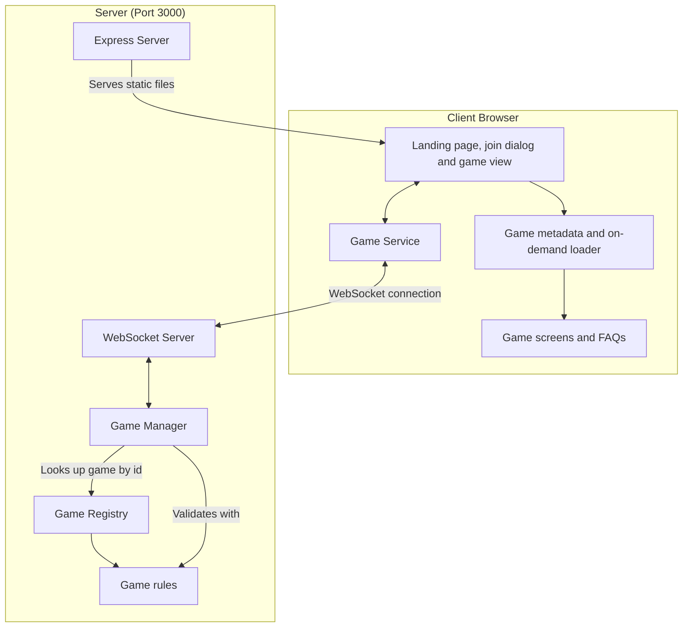

# Multiplayer Tabletop Games Architecture

One Express and WebSocket server hosts every game. The platform handles seating, turn order, undo, and the browser shell. Each game supplies its rules and its screen, and is registered once on the server and once in the browser, where the landing page has only each game's metadata and a game's code downloads when it is opened.



## The split between platform and game

**The platform owns:**

- Express static serving and SPA fallback, the WebSocket server, message parsing and routing, broadcast (`server/server.ts`)
- Every SVG piece and icon and every sound, served from one registry (`server/assets/`, see Assets)
- The in-memory game manager, keyed by game type and game ID (`server/games.ts`)
- Saving every started game to SQLite and loading them back on start (`server/store.ts`)
- Seating in join order up to the game's maximum, with names unique ignoring case, and refusing new names after the game has started (`shared/seating.ts`)
- Holding the seat of a player who disconnects after the first move (refresh, closed tab, lost connection or Back to games), rejoining by the same name with the seat's key, and dismissing a disconnected player by vote
- Turn rotation that skips dismissed players; a disconnected player's turn waits for them
- A heartbeat that closes the sockets of devices that drop off silently, and deleting a game 10 minutes after its last connected player leaves
- House rules: a game declares options (toggles and choices) and may stretch the player count (`stretchedPlayers`), which the host sets as Most players; the host (the first seated player, passed on if they leave) sets them before play, every seated player must agree to the current revision before the first move, and any seat change clears the agreements. Rules are locked once play starts
- Out-of-turn moves for a game that allows them (`allowsOutOfTurn`), refused with "Someone else moved first" when the mover's `moveCount` is stale
  - Used by Catan's special build phase (`games/catan/specialBuild.ts`): the builder whose chance it is builds, buys or clicks Done building while the next player holds the turn
- Undo: the history of states before each move, requests, voting, and restoring the state once every connected player approves
- Calling the game's `toPublicState` for each player before anything is sent to them, so each player gets their own view
- The landing page, join dialog, rejoin button, game view header (Back to games, History, Share, Rules, Settings, theme toggle), Rules dialog and its markdown renderer, house rules panel and the Settings dialog's House rules section, undo vote panel, disconnected players bar, dismiss vote panel, connection hook and service, and the remembered game, in `src/`
- Docker, compose, launcher, CI, lint and TypeScript config

**Each game owns (`games/<id>/`):**

- Its metadata (`info.ts`, with its house rule declarations in `options.ts`, so neither imports rules code), state shape and types (`types.ts`, `index.ts`)
- Its rules: starting state, applying a move, extra non-move actions, who won, what happens when a player is seated or leaves (`rules.ts`)
- Its public view, `toPublicState`, which removes hidden information
- Its screen, read-only history board, move descriptions, FAQ content and styles (`client/`), with SCSS nested under `[data-game="<id>"]`
- Its rules tests
- Its `README.md`, with the rules and controls for players, linked from the main README and sent by the server to the Rules dialog

## Contracts

- `shared/gameDefinition.ts` defines `GameDefinition` and `GameInfo`, which the server uses
- `GameDefinition.finalStandings?(state)` returns the game's `Standing[]` (`{ seat, place, score? }`, place 1 first, ties share a place) ranked by the same quantity that chose `winners`, reading only what is public once the game is over. `shared/standings.ts` has `standingsOf(definition, state)`, which calls it and falls back to `rankStandings(state, compare, score?)` (winners at place 1, everyone else ranked by `compare`, a throwing `finalStandings` logged and replaced by the fallback), and `pointsText` for score text. `shared/types.ts` defines `Standing`, `GameResult` (what `onGameFinished` hears: archive ID, game type and ID, `startedAt`, `finishedAt`, `moveCount`, `standings`, `players`, `abandoned`) and the optional state fields `startedAt`, `finishedAt` and `gameNumber`, so older saved rooms still load; `BasePublicState.standings` is set once the game is over
- `games/registry.ts` lists every `GameDefinition`, and `games/infos.ts` lists every `GameInfo` as `GAME_INFOS`, in the same order, for the browser
- `shared/categories.ts` defines `GameCategory` (every `GameInfo` has one), `CATEGORIES` (the landing page groups, in order) and `groupByCategory`
- `src/clientGames.ts` defines `ClientGame` (`id`, `Screen`, `faq`, `HistoryBoard`, `describeMove`, `animateMove`, `gameLength`, `FinalRound`), `CLIENT_LOADERS` (one `import()` of each game's `client/index.ts`, read only through `loadClientGame`). Each game's landing page icon is a server drawing in `shared/svg/gameIcons.ts`, kept out of the game's chunk
- `shared/houseRules.ts` defines the house rules model: `HouseRule` (`ToggleRule` or `ChoiceRule`, with `offered` for rules that depend on the seat count), `HouseRulesState`, `HouseRulesProposal`, and the pure functions `needsAgreement`, `houseRulesOf`, `houseRule`, `tableLimit`, `minimumToStart`, `afterSeatChange`, `setHouseRules`, `agreeToHouseRules`, `everyoneAgreed`, `describeHouseRules` and `targetScoreRule`. `GameInfo` has the optional `houseRules` and `stretchedPlayers` (the range the host may seat: Most players goes up to its maximum, and play may start at its minimum, a count below `minPlayers` listed as a "Players" house rule), `GameDefinition` has the optional `allowsOutOfTurn` and the timed-rule hooks `deadline`, `onDeadline` and `resumeClock`, and every game state carries `houseRules`
- The house rules each game declares (standard value first; the declarations are in each game's `options.ts`, and the stretched player-count range is `stretchedPlayers` in its `info.ts`):
  - Catan: points to win (10; 8, 12), friendly robber (off), special build phase (off, offered only with 5 or 6 seated); 2 to 6 players (2 play the normal board)
  - Chess: clock (off; 5, 10 or 15 minutes), increment per move (none; 2, 5 or 10 seconds, offered only with a clock)
  - Dominoes: set (double-six; double-nine), doubles open branches (every double; none, starting double only), Chickenfoot (off), trains (off), target score (100 for 2 players, 61 for 3 or 4; 61, 100, 150, 200)
  - Euchre: target score (10; 5, 15)
  - Farkle: target score (10,000; 5,000, 15,000, 20,000); 2 to 10 players
  - Hearts: target score (100; 50, 75, 150), Jack of Diamonds worth minus 10 (off)
  - Mancala: play from the other side when yours is empty (on), avalanche (on, off plays Kalah)
  - Monopoly: Free Parking jackpot (off), $400 for landing exactly on GO (off), auctions (on)
  - Phase 10: phases in any order (off); 2 to 8 players
  - Rack-O: target score (500; 250, 1,000)
  - Rook: target score (500; 300, 1,000), teams at 6 players (two of three; three of two), defending teams score (each its own counters; together, offered only for three teams); 4 to 7 players
  - Scrabble: turn timer (off; 1, 2, 3 or 5 minutes)
  - Spades: target score (500; 250, 300)
  - Splendor: prestige to win (15; 10, 21)
  - UNO: target score (500; 250, 1,000), stack +2 and +4 (off), 7-0 (off), draw until you can play (off), jump-in (off, the out-of-turn move); 2 to 10 players
  - Texas Hold'em and Yahtzee: no rules, 2 to 10 players
  - Every other game declares no house rules and no stretched range
- `shared/messages.ts` defines the WebSocket messages; `shared/types.ts` defines the base state types
- `shared/shuffle.ts` has `shuffle(items, random)`, and `shared/playingCards.ts` the standard deck (`PlayingCard`, `JokerCard`, `DeckCard`, `standardDeck`, `isJoker`, `rankValue`, `cardName`, `sameCard`), for any game to use; `standardDeck` takes `ranks`, `suits` and `jokers` options to build a smaller deck or add jokers
- `shared/tricks.ts` has the trick-taking rules (`canFollow`, `trickWinner`) that take each game's own suit and rank functions, and `describeTrickPlay` for the move description of a played card
- `shared/rounds.ts` has the between-rounds "everyone is ready" step: `acknowledge` and `everyoneReady` work on a game's own state through its `RoundAccess`, for a summary type that is `Acknowledgeable`
- `shared/partnerships.ts` has the four-seat partnership helpers (`FOUR_SEATS`, `nextSeat`, `teamOf`, `teamSeats`, `partnerOf`, `teamNames`, `partnershipBroken`)
- `shared/hands.ts` has `viewHand` (a viewer sees only their own hand), `handCounts` and `mapSeats`
- `shared/dice.ts` has `rollDie` and `rollDice`, which take the game's `Random`
- Every game declares a `category` in its `GameInfo`, which decides its landing page group

Server code (`server/`, `shared/`, and the non-client files of each game) never imports from `src/` or any `games/<id>/client/`.

## Client

1. **React components (`/src/components`)**

   - `GameList.tsx` is the landing page. It owns the filter state (remembered through `loadLandingFilters` and `saveLandingFilters`) and renders `GameFilters.tsx` above the cards: a search box (name and description) and a Filter button. The button reads "Filter (n)" with `activeFilterCount` (picked categories, plus one for a player count; search and sort are not counted) and opens a panel under the row (`useDismiss`: a press outside or Escape closes it and Escape hands focus back to the button; changing a filter leaves it open) holding a sort (by category, or A to Z in one list), category chips, a Players filter (`supportsPlayers`, from the lower of `minPlayers` and the stretched minimum to the higher of `maxPlayers` and the stretched maximum, so it counts the player-count house rule; a card shown only through it, `needsHouseRule`, is marked "<n> with a house rule") and Clear filters when any filter is on. `arrangeGames` (`gameFilters.ts`) applies them; no match shows "No games match these filters" with its own Clear filters, so a filter hidden in the closed panel never empties the list without a way out. Cards sit in a responsive grid (one column on phones, up to four at 1240 px), a section per category (`groupByCategory`) alphabetical within a section
   - `App.tsx` reads `/join/<game type>/<game ID>` once on load (`parseJoinLink`, `src/services/share.ts`), opens that game's join dialog with the ID filled in and the last name from `joinForm`, and replaces the address with `/`; an unknown game type opens the plain list. The landing page, the rejoin button and the dialog use `GAME_INFOS`; the game view is wrapped in `ClientGameGate` (see `/src/games` below), so a refresh straight into a game waits for the game's code
   - `JoinDialog.tsx` asks for a name and game ID, with a Player / Spectator switch (`.join-role-switch`, built from the `JOIN_ROLES` list of `{ role, label, button }`; the submit button reads "Join" or "Watch") and shows server errors inline. After "Game is full" or "Game already in progress" for a player it offers "Watch instead". Opening it starts the game's download (`useClientGame`); its Rules button appears once the code has arrived, and `ClientGameNotice` above the buttons shows "Loading <game>..." or "Could not load <game>" meanwhile. Its Retry saves the form and opens a fresh page at the dialog's join link (or `/` with no game ID yet)
   - `GameView.tsx` is the header (Back to games, History, Share, Rules, Settings, GitHub link, theme toggle) around the game's own `Screen`. At 480 px or less, a rule outside `:where()` in `src/App.scss` hides the header's Share, GitHub link and theme toggle, so the header buttons fit one row (at 360 px or less another rule outside `:where()` narrows their padding and gaps, so the row fits at 320 px in every game, Azul and Quoridor included); `SettingsButton`'s `phoneControls` puts Share and the theme toggle in the Settings dialog instead (`.settings-phone-controls`, shown at that width only). `ThemeToggle` reads the theme from the page's `data-theme`, so the two toggles always agree
   - `ShareButton.tsx` sends the game's `/join/<game>/<game ID>` link through the share sheet, else copies it and shows "Link copied", else shows the link to copy by hand; a cancelled share sheet does nothing
   - `RulesButton.tsx` is the Rules button in the game header and the join dialog. `RulesDialog.tsx` ("<Game> rules", `.modal.rules`) has a Rules / FAQ switch (`.rules-switch`, `aria-pressed`); the body (`.rules-body`) scrolls between the switch and Close, and Escape closes it. The Rules view fetches `/api/rules/<game type>` once per open ("Loading the rules...", or "Could not load the rules" with Retry), parses it with `parseMarkdown` (`src/markdown/parseMarkdown.ts`: headings, paragraphs, nested and numbered lists, pipe tables, fenced code, rules, bold, italic, code spans and links) and renders the tree with `Markdown.tsx` as React elements, so HTML in a README shows as text. The README's first `#` heading is dropped, since the title says it. An `http(s)` link opens in a new tab; a relative path opens that file on GitHub under `games/<id>/`; an `#anchor` or any other scheme shows as plain text. The FAQ view is `FaqList.tsx`, the game's FAQ items in a `.faq` list
   - `SettingsButton.tsx` and `SettingsDialog.tsx` are the gear in both headers and the per-browser preferences dialog (`.settings-button`, `.modal.settings`). Its `children` follow the preferences: in a game, `GameView` passes `HouseRulesSection.tsx`, the read-only list of the game's house rules (`describeHouseRules`, a non-standard value marked "(house rule)", "Standard rules" when there is nothing to list), which every player can open all game. A game with no house rule options and no stretched range shows no section, and the header has no separate House rules button
   - `HouseRulesPanel.tsx` is the lobby form above the game screen before the first move, for a game that `needsAgreement`. Until every seated player has agreed, `GameView` sets `data-awaiting-agreement` on `.game-root`, and a rule in `App.scss` (outside `:where()`) dims everything below the header, the disconnected players bar and the panel to half opacity, since the server refuses a move until then
   - `GameOverDialog.tsx` is the game-over screen every game shows once `isGameOver` is true, for every player: the winner line (`winnerLine` in `gameOver.ts`: "Alice wins", "Alice and Bob win", or "Draw"), "<game> · Game <ID> · <length>" (`lengthText`: the game's `gameLength`, or the move count), the view's `standings` with an ordinal place, " (you)" for the viewer and the score text when the game gives one, the game's `FinalRound` if it has one, then Rematch (only when `canRematch` and a handler are given; `canRematch` is the one place that allows it only for a seat in `activePlayers`), History, See the table and Back to games. The standings scroll inside the dialog. See the table and Escape close it; `GameView` then shows a Game summary button above the board to open it again, and an undo past the end resets it, so the next ending opens it again. `GameView` calls `useHistoryDialog` once, so the header History button and the game-over History open the same dialog, drawn above the game-over screen; Escape or Close in History returns to it
   - `HistoryButton.tsx` (`useHistoryDialog`) fetches the game's steps from `/api/history/<game type>/<game ID>` (always enabled) and `HistoryDialog.tsx` shows them: a range slider over the steps, a label, and the game's read-only `HistoryBoard` for that step. The dialog is fixed at 90% of the window's width and height, so it never resizes between steps, and the board shrinks to fit the space left (`fitScale` in `fitScale.ts`), never enlarged. While the dialog is open the scale only goes down (`nextScale`), so a step with a smaller board never makes it bounce; it is computed again only when the board's box changes size (a window resize). A move label longer than two lines scrolls. Each step has a `historyStep` of `start` (the starting board, labelled "Start of the game"), `move` ("Move k of N: <the game's `describeMove`>") or `end` ("End of the game: <the game status>", drawn without a highlighted move). The slider opens on the latest step. Each step is wrapped in `StepErrorBoundary.tsx`, so a step whose board throws shows "This step could not be shown" and the slider keeps working. When the latest step is a finished game, the dialog offers Download game, which fetches the file from the server (see Game files) and saves it; if that fails it shows "Could not download the game". The live dialog has no "View as" picker and never shows hands. The row under the board is Play/Pause, the slider and a settings gear (`PlaybackSettings.tsx`), one constant-height row that never wraps. With Sounds on, a step forward plays its move, dice and game-over sounds through `useStateSounds` with no viewer, so the turn chime never plays here, and a slider jump or a step back plays nothing. The gear opens a panel above it holding Animations, Sounds (`historySounds`, off by default), Speed (0.5x, 1x, 2x, 4x of `PLAY_STEP_MS`) and, for a file with `views`, View as, whose choice is shown as "Viewing as <name>" under the slider; a press outside closes the panel. Play moves one step every `PLAY_STEP_MS` (1500 ms at 1x, `playback.ts`; `stepDelayMs` divides it by the speed) and stops on the last step. With Animations on, a step forward calls the game's optional `ClientGame.animateMove(change, viewer)` through `useMoveAnimation`; a step the game cannot animate snaps. It shows the history as of opening and changes nothing for other players
   - `OpenSavedGame.tsx` is the landing page's "Open a saved game" button: it reads a `.json` file in the browser, checks it with `parseGameFile` from `shared/gameFile.ts`, shows one plain error if it is not accepted, and otherwise, once `ClientGameGate` has the game's code, opens a `HistoryDialog` titled "Saved game: <game ID>" with that game's `HistoryBoard` and `describeMove` and no Download button. For a version 2 file the dialog has a "View as" picker ("Table only" plus one option per player) and draws each step from that player's `views` entry; a version 1 file has none, so the picker is hidden. Nothing is uploaded and a saved game cannot be played on
   - `ThemeToggle.tsx` switches light and dark; the choice is shared across the site
   - `UndoVote.tsx` shows a running undo vote
   - `RejoinButton.tsx` is the "Back to <game> (<game ID>)" button on the landing page, shown when the remembered game was left with Back to games or a lost connection
   - `PresenceBar.tsx` sits above the game screen while anyone is disconnected or watching: each disconnected player with a Dismiss button (none for a spectator, whose `onDismiss` is null), "Watching: <names>" for the connected spectators, and "Waiting for <name> to reconnect" when it is their turn
   - `SpectatorView.tsx` is what `GameView` shows a spectator instead of the game's `Screen`: the status line, the game's read-only `HistoryBoard` and, when the state has `seatViews` (a game with hidden hands), a button per seated player. A picked seat that has allowed the spectator is drawn by merging its `seatViews` entry into the state and passing that seat as `viewer`; otherwise "Ask to see <name>'s hand" (only while the game is started and not over) becomes "Waiting for <name>" once asked. "Play instead" shows until the first move
   - `HandRequestPrompt.tsx` asks a player about the first open request in their view: "<name> (watching) wants to see your hand" with Allow and "Don't allow"
   - `DismissVote.tsx` shows a running dismiss vote
   - `VotePanel.tsx` is the panel both votes share; only connected players are listed and can vote
   - `PlayingCard.tsx` draws a standard playing card face up, a joker (a `DeckCard`, class `playing-card-joker`), or its back for `card: null`, in three sizes; with `onClick` it is a button. The marks, joker and back are the server's `playing-card`, `playing-card-joker` and `playing-card-back` drawings (`shared/svg/playingCards.ts`) inside it, and it preloads the whole deck on mount. Its default look is in `App.scss`, and a game can retheme it with `--playing-card-face`, `--playing-card-back`, `--playing-card-stripe`, `--playing-card-red`, `--playing-card-black`, `--playing-card-selected` and `--playing-card-highlight`; `drawn` adds the `newly-drawn` class (Go Fish)
   - `Dice.tsx` draws a row of six-sided dice with pips; with `onToggle` each die is a button (for holding dice). The pips are the server's `die/<1-6>` drawing (`shared/svg/dice.ts`), and every face is preloaded on mount; the face is the element's own background. Its default look is in `App.scss`, and a game can retheme it with `--dice-face`, `--dice-pip` and `--dice-selected`
   - `Die`, also exported from `Dice.tsx`, draws a single die
   - `PieceTray.tsx` shows a supply of pieces as a hand (`<section className="piece-tray">` with `label` as its `aria-label`): one button per `TrayPiece` (`id`, `label`, `icon`, optional `count` and `blocked`), named `${label}, ${count} left` (or `label` alone), `aria-pressed` for the `selected` id, disabled with `blocked` as its title, `onTap(id)` on click, and `drag.source(id)` spread on it so it can be dragged onto the board (see `/src/drag/` below); an optional `leading` control (Quoridor's Move) comes before the pieces in `.piece-tray-pieces`. Its default look is the `.piece-tray*` rules in `App.scss`, and a game can retheme it with `--piece-tray-bg`, `--piece-tray-border`, `--piece-tray-text` and `--piece-tray-selected`. Quoridor's Move and walls (its "Your action" box), Connect Four's disc, Carcassonne's meeple, Catan's roads, settlements and cities (also during the player's own special build chance, `trayBlocker` in `games/catan/client/tray.ts`), and Risk's armies use it
   - `RoundSummaryDialog.tsx` is the between-rounds scoring dialog with a Continue button, shared by the round-based games (the last round is shown by the game's `FinalRound` on the game-over screen, which a game builds from the same `RoundRows`); the `result` option replaces the result line under the title (default: the game status) and `listDisconnected` also names disconnected players in the waiting line (the server still waits only for connected players)
   - `DrawAndResign.tsx` is the Offer draw, Accept draw and Decline, and Resign (with Confirm resign) controls for two-player games that use `shared/drawOffer.ts`; the game passes its own buttons, such as Undo, as children
   - `/shared/text.ts` has `plural(count, word, pluralWord?)`
   - `/src/hooks/useEscapeKey.ts` closes the topmost dialog on Escape
   - `/src/animation/useMoveAnimation.ts` lets a game screen animate a move: after a render that added exactly one move (`moveCount` up by one) (unless this player just made it by dropping a piece, see `/src/drag/` below) it calls the game's `animate` with the previous and next state, the root element and `rectOf(key)`, where each `data-anim-key` element was before the move; then it measures them again. The first render, a rejoin and an undo do not animate. `/src/animation/motion.ts` has `slideFrom`, `fadeIn`, `flash` (a brightness pulse), `tumble` (a die's turn and hop) and `ghostSlide` (a copy of something that left the page, slid onto its destination and removed); `slideFrom` divides the distance by the `data-fit-scale` of a scaled board (the History board), so a piece starts from its old place on screen, and `ghostSlide` appends its copy to `.history-board`, outside the scaled content (Web Animations API, `MOVE_DURATION_MS` = 300 ms, none under `prefers-reduced-motion: reduce`); a new animation on an element cancels its running one. `/src/animation/animKeys.ts` has the shared `data-anim-key` names (`handKey`, `seatKey`, `trickKey`). Phase 10 slides cards between the piles, hands and groups, sends a ghost card to a seat when an opponent draws, and flashes a skipped seat. Yahtzee tumbles the dice that were rolled (held dice stay still) and flies the points from the dice to their box as a ghost, since the score sheet scrolls and would hide a box sliding in. Quoridor glides the moved pawn from its old square and fades in a new wall; the History dialog animates only through a game's `animateMove`, when Animations is on
   - `/src/drag/` is the one drag and drop every game uses, on pointer events with no library, for mouse and touch. `useDrag({ canLift, canDrop, onLift?, onDrop, onCancel? })` returns `source(id)`, `dragging` and `over`. A game spreads `{...drag.source(id)}` on each piece; it is `undefined` while `canLift(id)` is false, so a piece that cannot be lifted gets no drag props and a swipe on it still scrolls the page. A drop target is any element (HTML or SVG) with `data-drop="<target id>"`; the innermost one under the pointer is the target. Ids are strings the game chooses. Pressing only records the press (no `preventDefault`, so focus, keys and clicks are untouched); the piece lifts once the pointer moves `DRAG_THRESHOLD_PX` (6 px), and a release before that is a plain tap whose click fires as before. On lift the hook calls `onLift` (a game selects the piece, so its usual highlights show), sets `data-dragging` on the source and shows a floating copy (`.drag-ghost`, from `ghost.ts`), and while moving sets `data-drag-over` on the legal target under the pointer (`canDrop`, read from the latest render). Releasing over a legal target calls `markDropped()` then `onDrop(id, target)`, which a game points at its own click handler for that spot, so the same message goes to the server. Releasing anywhere else, `pointercancel`, Escape, a mouse move with the main button up (it was released outside the window, `releasedUnseen`), the window losing focus, or `canLift(id)` turning false mid-drag (an undo, the turn ending) slides the copy back and calls `onCancel`. The copy keeps the offset from where the piece was pressed, however far the first move jumps. While a piece is held within `EDGE_SCROLL_ZONE_PX` (40 px) of the window's top or bottom, a `requestAnimationFrame` loop scrolls the window toward that edge, faster nearer it, up to `EDGE_SCROLL_MAX_PX` (20 px) a frame (`edgeScrollStep` in `edgeScroll.ts`, with unit tests), and finds the target under the pointer again after each step; it stops at the end of the page, on a drop, a cancel or unmount. So a phone player can drag a wall from Quoridor's tray, low on the page, up to the top rows. Azul's tiles are sources named by place and color (`factory-2-blue`, `center-red`, `games/azul/client/drag.ts`), lifting picks up every tile of that color there, and the player's own pattern lines (`line-<row>`) and floor line (`floor`) are the targets. A second finger, another pointer or a button other than the main one never starts a second press. The click that follows a drag is swallowed. Listeners live on `window` from press to release and are removed on unmount, which also drops a lift. The pure press logic (`startPress`, `movePress`, `endPress`, `releasedUnseen`) is in `dragMachine.ts` with unit tests
   - `/src/drag/swallowClick.ts` has `swallowNextClick()`, a capture phase, once only click blocker cleared on the next tick, used by `useDrag` and by Carcassonne's board pan so ending a drag never also clicks what is under it
   - `/src/drag/recentDrop.ts` has `markDropped()` and `takeDrop()` (true once for a mark made within `DROP_SNAP_MS`, 1000 ms). `useMoveAnimation` calls `takeDrop()` for a one-move change, so the player who dropped a piece sees it stay where they let go instead of sliding in from its old square; everyone else still sees the move animate. Scrabble's `useSlides` and Rummikub's `useLocalSlides` (slides for local changes, like placing a tile or rearranging the rack) also call `takeDrop()` and slides nothing for a change made by a drop; those drops send no move, so it takes the mark before `useMoveAnimation` could
   - `/src/sound/` plays the game sounds, all made with the Web Audio API (no audio files) from the note lists the server sends (`shared/sounds.ts`, `GET /api/sound`; `loadSounds()` fetches them once at startup from `main.tsx`, and every sound is silent until they arrive or if the fetch fails): `turn` (two bell-like sine notes, 660 then 880 Hz), `move` (a 30 ms triangle click), `dice` (six short noise bursts over 250 ms), `gameOver` (a rising four-note triangle arpeggio) and `timer` (a 20 ms 1000 Hz tick). `sounds.ts` is pure: `soundsFor(previous, next, viewer)` plays nothing for the first state (join, rejoin, reload) or for an undo or History jump (the move count is neither equal nor one higher); one move forward plays `dice` if it rolled (`lastMove.type` of roll, attack or blitz) or `move` (plus `dice` when Parchisi rolls its next dice automatically), then `gameOver` when the game just ended (also in place, for a resignation), then `turn` when it just became the viewer's turn with two or more players (never without a viewer, so never in History). `audible` drops everything when muted or at volume 0, and unchecked groups. `synth.ts` creates the one `AudioContext` on the first click or key press (`installAudioUnlock`), does nothing without Web Audio or before that, and exposes `playSounds(names)`, which plays each sound's notes and, for `dice`, its noise bursts, and `useTimerWarning(msLeft, enabled)` plays `timer` once a second in the last 10 seconds of a running timer (`warningSecond` in `timerWarning.ts`, with unit tests). The Chess clock and the Scrabble turn timer call it from their `GameStatus` with `useCountdown`'s time left, enabled only for the player whose time is running. `useStateSounds` runs it from `GameView` on each state change
   - `/src/hooks/useGameConnection.ts` holds the joined game's state and errors from the Game Service, remembers the game, rejoins it after a refresh, and offers it again after Back to games

2. **Game Service (`/src/services/gameService.ts`)**

   - Manages the WebSocket connection
   - Sends joins (and rejoins), moves, game actions, undo and dismiss requests and votes
   - Passes server state updates and errors to the UI

3. **Download (`/src/services/download.ts`)**

   - `downloadJson` saves data as a pretty-printed JSON file through the browser. The file comes from the server (`GET /api/game-file`) and is named by `gameFileName` (`<game type>-<game ID>.json`, unsafe characters replaced by `-`)

4. **Remembered game (`/src/services/session.ts`)**

   - Keeps the most recent game (game type, game ID, name, and whether the player was still in it) in `localStorage` under `lastGame`
   - A page that loads while the player was in the game rejoins it automatically. If the old socket still holds the seat ("<name> is already in this game"), it retries up to 5 times, 1 second apart. Any other error, such as a deleted game or a dismissal, forgets the game and shows the error on the list
   - A link to a different game skips the automatic rejoin and marks the old game as out, so the list offers it as the rejoin button
   - Back to games and a lost connection keep the game but mark the player as out of it, so the list shows the rejoin button instead of rejoining by itself
   - Every storage access may fail (blocked storage); the site then works without remembering the game across page loads

   **Settings (`/src/services/settings.ts`, on `/src/services/storage.ts`)**

   - `storage.ts` has `readJson`, `writeJson` and `removeKey`, which swallow storage errors
   - `historyAnimations` (the History dialog's Animations checkbox, off by default), `historySpeed` (its Speed, 1x by default) and `joinForm` (the name and game ID last used to join, shared by every game, saved when Join is pressed) and `landingFilters` (the landing page's search, sort, categories and players) are kept in `localStorage`
   - `preferences` holds the Settings dialog's choices: `volume` (0 to 1, default 0.5), `muted` (off), `sounds` (turn, move, dice, gameOver, timer, each on), `colorSymbols` (off) and `highlightDrawn` (on). Each field is validated on its own, so a bad value falls back to its default and the rest are kept. `historySounds` (off) is the History dialog's Sounds checkbox
   - `/src/hooks/usePreferences.ts` keeps the preferences in memory after one read: `getPreferences()` for non-React code, `setPreferences(next)` to save and notify, and the default `usePreferences()` hook (`useSyncExternalStore`) for components
   - `/src/hooks/useNewlyDrawn.ts` returns the keys of the cards to outline as newly drawn, for live screens only (the History dialog never highlights). It tracks the previous state and applies the game's `step(previous, next)` (a `DrawnStep`: `add` keys and whether to `clear` the earlier ones) through the pure `nextDrawn` in `newlyDrawn.ts`: exactly one more move applies the step, the same move count keeps the highlight, the first state (a join, a reload or a reconnect), an undo and a History jump clear it. It returns `[]` while `highlightDrawn` is off; slide animations do not depend on it. The game gives those cards the `newly-drawn` class, outlined by the default in `src/App.scss` (`--newly-drawn-outline`). Phase 10, Uno, Skip-Bo, Rummikub, Go Fish and Ticket to Ride each use a `drawnStep` in their `drawn.ts` (Uno also has `markDrawn` to map the drawn cards onto the sorted hand); Uno's highlight also resets when Continue deals a new round, because the hand remounts keyed by the round number (no move is made); Rack-O outlines the held tile from its state alone

5. **Game screens (`/games/<id>/client`)**
   - Each game's board components and screen, receiving the public state, the player's seat and any error
   - Styles are scoped under `[data-game="<id>"]` so palettes never overwrite each other
   - Each game's `client/index.ts`, with everything only it imports (its screen, FAQ, styles and the parts of its rules the screen uses), is its own chunk, named after the game (`assets/<id>-<hash>.js` and `.css`, from `chunkFileNames` and `assetFileNames` in `vite.config.ts`). Code two or more games share, such as `PlayingCard`, `Dice`, `PieceTray` and `useDrag`, is split by Vite into small chunks of its own, each downloaded once, never copied into every game. The landing page downloads none of them

6. **Loading a game's code (`/src/games`)**
   - `loadClientGame(id)` (`loadClientGame.ts`) runs the game's entry in `CLIENT_LOADERS` (`src/clientGames.ts`), one dynamic `import()` per game. Every caller shares one download per game; a failed one is forgotten so the next call tries again, and an unknown id rejects with `Unknown game "<id>"`. `loadedClientGame(id)` returns a game already downloaded, so a screen shows it on its first render
   - `useClientGame(id)` (`useClientGame.ts`) starts the download and returns `{ status, client }`, with `status` `idle` (no id), `loading`, `ready` or `error`
   - `ClientGameGate` (`ClientGameGate.tsx`) renders its `children(client)` once the code has arrived, and `ClientGameNotice` until then: nothing for the first 200 ms, so a fast download shows no flash, then "Loading <game>...", or "Could not load <game>" with Retry. The browser remembers a failed `import()` and never fetches that file again, and a deploy may have replaced it, so Retry opens a fresh page (which also gets the newest `index.html`). The game view (`App.tsx`), the join dialog and the saved-game viewer use it; History in a game uses the client the game view already has

7. **Default styles for the platform pieces (`/src/App.scss`)**
   - The game header (`.game-root`, `.game-header`, `.back-button`, `.history-button`, `.share-button`, `.rules-button`, `.settings-button`, `.theme-toggle`), the Rules dialog (`.overlay`, `.modal`, `.modal.rules`, `.rules-switch`, `.rules-body`, `.markdown`, `.markdown-table`, `.faq`, `.primary-button`), the history dialog (`.modal.history`, `.history-overlay`, `.history-move`, `.history-slider`, `.history-board`, `.history-board-content`, `.history-controls`, `.history-viewer`, `.history-settings-wrapper`, `.history-settings-button`, `.history-settings`), the share button's `.share-wrapper`, `.share-status` and `.share-panel`, the undo vote (`.undo-vote`, `.undo-vote-panel`, `.undo-vote-title`, `.undo-vote-list`, `.undo-vote-actions`), the disconnected players bar (`.presence-bar`, `.presence-list`, `.presence-player`, `.presence-waiting`, `.dismiss-button`), house rules (`.house-rules-panel`, `.house-rules-title`, `.house-rules-host`, `.house-rules-help`, `.house-rules-list`, `.house-rules-agreed`, `.house-rules-actions`, `.house-rules-error`, `.settings-house-rules`, `[data-awaiting-agreement]`), the dismiss vote (`.dismiss-vote`, `.dismiss-vote-panel`, `.dismiss-vote-title`, `.dismiss-vote-list`, `.dismiss-vote-actions`) and the resign and draw controls (`.ending-controls`, `.ending-buttons`, `.draw-offer`, `.draw-offer-title`, `.draw-offer-actions`) have a neutral default look, so a game with no CSS of its own still gets a working header, a Rules overlay and its vote panels
   - Drag and drop: `[data-drag]` (a piece that can be lifted: `touch-action: none`, no text selection, a grab cursor), `[data-dragging]` (the faded piece left behind), `.drag-ghost` (the floating copy) and `[data-drag-over]` (an outline on the legal target under the pointer, recolored with `--drag-over`)
   - The piece tray (`.piece-tray`, `.piece-tray-pieces`, `.piece-tray-piece` with `[aria-pressed="true"]` and `:disabled`, `.piece-tray-count`), rethemed with `--piece-tray-bg`, `--piece-tray-border`, `--piece-tray-text` and `--piece-tray-selected`
   - Every default selector is wrapped in `:where()`, so it has no specificity and any rule in a game's CSS wins. The one exception is `[data-game] .modal.history`, which sets the History dialog's size outside `:where()` so it beats every game's `.modal` rule; games no longer set its width, and a game whose History board takes the width it is given sets a fixed width on its own history root instead
   - A game can retheme the defaults without writing rules by setting these variables on `[data-game="<id>"]`: `--platform-page-bg`, `--platform-text`, `--platform-button-bg`, `--platform-button-hover-bg`, `--platform-button-text`, `--platform-panel-bg`, `--platform-panel-text`, `--platform-backdrop`. Unset ones fall back to the lobby's light or dark palette
   - Native controls are themed by default with no class: every `select` (button colors, options in the panel colors), `input[type="checkbox"]` (a drawn box and tick with `:checked`, `:focus-visible` and `:disabled` states) and text, search or number `input` (panel colors with a button-colored border). They follow the `--platform-*` variables and fall back to the lobby palette, and a game's own control rule wins. A disabled control (a guest's house rules) keeps full-strength text and gets a dashed border; a disabled select drops its arrow and a disabled checkbox stays unfilled with its tick in the button color. A label wrapping a checkbox in the Settings dialog or the History gear panel reads as a button-colored pill. Toggle chips (`.themed-chip`) and sliders (`.themed-range`) stay opt-in classes. Catan and Monopoly style their own selects and skip the ones in the History gear panel
   - Quoridor and Azul style the header, the dialogs and undo vote themselves, so the defaults do not change how those look; the disconnected players bar and the dismiss vote use the defaults

## Color-blind symbols

- `/src/components/colorSymbols.ts` is the table: `COLOR_SYMBOLS` maps each player color to a shape. It has no React, so `node --test` can import it. `shared/svg/symbols.ts` holds each shape's SVG path in a 24 by 24 box (`SHAPE_PATHS`) and serves it as `color-symbol/<shape>`
- `/src/components/ColorSymbol.tsx` shows the shape for a color through `ServerSvg`, as a `<span class="color-symbol color-symbol-<shape>">` (or, given `svgProps`, a nested `<svg>` placed inside a board). It reads `colorSymbols` from `usePreferences()` and renders nothing while the setting is off or the color is not set (`null` or `undefined`), so a game passes its seat color and positions the symbol itself
- Its default look is in `App.scss`: the symbol takes `currentColor` and a 1 px stroke (`--color-symbol-stroke`) so it reads on any fill
- Games told apart by light against dark (Checkers' red against cream) or by a printed symbol get nothing. Quoridor, Carcassonne, Monopoly and Ticket to Ride tell players apart by color alone, so they show their seat colors' shapes (Monopoly's seventh and eighth tokens, brown and slate, have no shape and keep their initial; a claimed Ticket to Ride route shows its owner's shape, not the route color's)

| Color | Symbol | Also covers |
|---|---|---|
| red | circle | |
| blue | square | |
| green | triangle | |
| yellow | star | Splendor gold |
| black | diamond | Risk's and Carcassonne's dark gray seats |
| white | ring | |
| orange | hexagon | |
| pink | heart | |
| purple | cross | |
| cyan | pentagon | |
| gray | none | Ticket to Ride gray routes and Risk neutral armies: "any" or "nobody", told apart by having no symbol |

## Assets

Every SVG that is not a clickable board, and every sound, comes from the server, so the drawing code lives in one place and stays out of the client bundle.

- **Registry.** `server/assets/registry.ts` lists every `SvgAsset` (`name`, `params` names for the gallery, `samples` parameter sets, and `render(params)`, which returns a full `<svg>` document or `null` for parameters it does not draw) in `SVG_ASSETS`; `findSvg(name)` looks one up. A generator file exports its assets next to the data it draws from and is listed in the registry once.
- **Routes** (`server/assets/routes.ts`, mounted before `serveClient`): `GET /api/svg` lists `{ name, params, samples }`; `GET /api/svg/<name>` and `GET /api/svg/<name>/<params...>` answer `image/svg+xml` with `Cache-Control: public, max-age=31536000, immutable` (a URL's drawing never changes). An unknown name is a 404; the wrong number of parameters, or parameters `render` refuses (or throws on), is a 400. `GET /api/sound` lists `SOUNDS` and `GET /api/sound/<name>` answers one sound, or 404 (`server/assets/sounds.ts`).
- **Where the drawing code lives.** `shared/svg/svg.ts` has `el(tag, attrs, ...children)` (attributes and text escaped, `undefined` attributes left out), `escapeText` and `svgDoc(viewBox, attrs, ...children)`, so server code draws without JSX. Platform pieces are in `shared/svg/`: `symbols.ts` (`color-symbol/<shape>`), `icons.ts` (`icon/share`, `icon/github`), `dice.ts` (`die/<1-6>`), `playingCards.ts` (`playing-card/<rank>/<suit>`, `playing-card-joker`, `playing-card-back`), `disc.ts` (`disc`, the round piece) and `cardArt.ts` (`card-art/<solid|stripes|bands>`, a game's own card or tile face). Game pieces are in each game's non-client `games/<id>/svg.ts`: `carcassonne-tile/<type>/<quarter turns>`, `carcassonne-meeple/<seat>/<standing|lying>`, `risk-land`, `tickettoride-land`, `quoridor-wall`, `azul-tile/<kind>/<mark|plain>`, `chess-piece/<color>/<type>`, `checkers-crown`, `uno-card/<color|wild|back>`, `domino/<left>/<right>` and `catan-motif/<terrain>`, `catan-piece/<settlement|city|robber>`. Sounds are `shared/sounds.ts`: `SoundName`, `SoundNote`, `SoundDef` (`name`, `label`, `notes`, and `noise` for the dice rattle: bursts, spacing and length) and `SOUNDS`.
- **Theming.** A drawing paints with the page's CSS: class names the game's SCSS colors (Carcassonne's `cc-*`, Risk's `continent-*`, Catan's `motif-*`), CSS variables with today's colors behind them (`--dice-pip`, `--playing-card-*`, `--player<n>`, `--card-*`, `--tile-*`), `currentColor`, or the shared pieces' own variables: the disc reads `--disc-fill`, `--disc-edge` and `--disc-edge-width`, and card art reads `--art-fill`, `--art-fill-2` to `--art-fill-4` and `--art-stripe`, which each game sets per seat or card class. Light and dark mode and per-game recolors work because the markup is inlined, never an ``.
- **`ServerSvg`** (`src/assets/ServerSvg.tsx`) shows one URL: a `<span class="server-svg ...">` (or, with `inSvg`, a nested `<svg>` placed by `svgProps` inside a board) whose inner HTML is the markup, inlined with `dangerouslySetInnerHTML` because it only ever comes from this site's own `/api/svg`. Before it loads the element is already there, empty, at the size its class gives it, so nothing jumps; if the fetch fails it shows its `title` as visually hidden text. Without a `title` it is `aria-hidden`; the piece's name, click handler, `data-anim-key`, drag props and e2e selectors stay on the wrapper the game draws. `src/assets/svgCache.ts` has `svgUrl(name, ...params)` (each parameter `encodeURIComponent`ed), `loadSvg(url)` (one fetch per URL, a failure not kept so the next try fetches again), `cachedSvg(url)`, `preloadSvgs(urls)` (never rejects) and `subscribeSvgs`; `usePreloadSvgs(urls)` fetches a screen's whole set when it mounts (`PlayingCard`, `Dice`, Carcassonne's, Quoridor's and Catan's boards, Azul's and chess pieces). A piece whose drawing sits behind its own content (an initial, a count, a symbol) gives it the `piece-art` class, which `App.scss` places behind the content and clips to the piece's rounded corners.
- **Galleries.** `/dev/svgs` (`src/dev/SvgGallery.tsx`) shows every asset in `GET /api/svg`, one card per sample with its URL, inside `data-game="<name prefix>"` so a game's variables apply, with the theme toggle to compare light and dark. `/dev/sounds` (`src/dev/SoundGallery.tsx`) lists every sound with a Play button (it follows the Settings volume and mute). `main.tsx` loads them lazily by path; nothing links to them.
- **Left as page markup.** Clickable boards and their parts (Catan hexes, roads and number tokens, the Risk territories and borders, the Ticket to Ride routes and cities, the Carcassonne, Quoridor, chess and checkers squares), text that is the information itself (card ranks and numbers on game cards, Scrabble letters, Rummikub numbers and its joker's smiley, names, counts), Risk's territory cards (text rows), Catan's road tray icon, backgammon's borne-off slabs and Monopoly's houses and hotels (plain bars and squares), and the face-down dominoes stock (a plain colored tile).

## Server

1. **Express and WebSocket server (`/server/server.ts`)**

   - Serves the built React application and handles SPA routing through `serveClient` (`/server/static.ts`). Vite's content-hashed files under `/assets/` are sent with `Cache-Control: public, max-age=31536000, immutable`; every other file (`index.html`, `sw.js`, `manifest.webmanifest`, the icons) and the SPA fallback's `index.html` with `no-cache`, so the browser checks with the server on each load. A path without an extension gets `index.html`, which is how `/join/...` loads (a dot in a game ID is sent as `%2E`, so the path has no extension), sent relative to `dist/` so a checkout under a dot folder (such as `.claude/worktrees/`) still serves it; a missing file with one (`/missing.js`) is a 404
   - `GET /api/rules/<game type>` (`mountRulesRoute`, `/server/rules.ts`) sends that game's `games/<id>/README.md` for the Rules dialog as `text/markdown; charset=utf-8` with `Cache-Control: no-cache`, read on each request. Only ids in the registry are looked up, so any other name (`..%2Fpackage.json` included) is a 404
   - The site installs as an app: `public/manifest.webmanifest` gives its name, colors and icons (`public/icon-*.png`, `public/apple-touch-icon.png`, made once from `favicon.svg`), and `index.html` links it with the `theme-color` meta, which the theme toggle keeps in step with the light or dark theme. `src/main.tsx` registers the hand-written service worker `public/sw.js` in production builds only. The worker precaches `/`, then answers same-origin GETs network first (with `cache: 'no-cache'`), keeping a copy of each good response and falling back to it offline (a page load falls back to the cached `/`). Since `index.html` always comes from the network when it answers, a new deploy's page never asks for an old build's chunks; offline, the cached page opens the games whose chunks were downloaded before, and any other game shows "Could not load <game>". It never touches `/api/` or the WebSocket, never reloads a page, and its versioned cache name (`tabletop-games-v1`) clears older caches on activation
   - Reads `PORT` from the environment, default 3000, and `DATABASE_PATH`, default `data/games.sqlite` under the repo root
   - Routes WebSocket messages to the game manager and broadcasts the results

2. **Game Manager (`/server/games.ts`)**

   - Creates games from the registry, seats players, and locks joining after the first move
   - Applies moves and actions through the game's `GameDefinition`, after the turn checks
   - Keeps each game's undo history and runs unanimous undo votes. An undo calls the game's `onUndo` on the restored state, where a game reshuffles its face-down piles. When the undone move came before a dismissal, the dismissed player is removed from the restored state again through the game's `onPlayerLeft`, so a turn, roll or pending decision they held moves on as it did when they were dismissed
   - Holds disconnected players' seats, gives them back on a rejoin, and runs unanimous dismiss votes
   - Holds each game's full state in memory, written through to SQLite, and sends only the public view
   - Builds a game's history as the starting board, the state after each move and, when the game ended outside a move (resigning, an agreed draw, an end-of-round action, a dismissal), an end step built from the live state
   - Takes a `GameStore` as a parameter, so tests can pass an in-memory one or none, and `ManagerHooks`: `now` (the server clock, default `Date.now`) and `changed(roomId)`, which `server.ts` sets to its per-room `broadcast` so a change no player made reaches every seat, and `onGameFinished(result)`, which hears of each game once as a `GameResult`
   - Stamps each game on every save: `startedAt` when it first starts and `finishedAt` when `isGameOver` first becomes true, which is also when it calls `onGameFinished` (archive ID `<game type>/<game ID>#<gameNumber, default 1>`, the move count, `standingsOf` the final state, and each remaining seat's name; `abandoned: true` when fewer than two players remained, so the platform ended it). An undo keeps both stamps, so a game ended, undone and ended again reports once; a room loaded without them gets them on load, so it never reports. A throwing hook is logged and play continues. Every view carries `startedAt`, `finishedAt` and `gameNumber`, and a finished game's view carries its `standings`
   - Runs timed rules. `applyMove` gets the server time as `now`. A game with a clock gives `deadline(state)` (server ms, or null), `onDeadline(state, now, random)` and `resumeClock(state, now)`. The manager keeps one unref'd timer per room, rescheduled on every save (none once the game is over, and none in a lobby until everyone has agreed and enough players are seated, so a join or leave stops it until the last Agree; open votes and disconnects do not pause it; a timeout that leaves its deadline already past is logged and not run again) and cleared when the room is deleted. When it fires and the deadline has passed, `onDeadline`'s state is recorded as a move (so it can be undone), an open undo vote is canceled since it was for the move before, and the result is saved and broadcast. `resumeClock` runs when the last player agrees to the house rules, after an approved undo, and on every room loaded after a restart, so the time the server was down is never charged. Every live view carries `serverTime` (history steps and game files do not), and `src/hooks/useCountdown.ts` turns a deadline into the milliseconds left on the device's own clock, with `formatClock` for `m:ss`

3. **Game store (`/server/store.ts`)**

   - `openGameStore(file)` opens a SQLite database with Node's built-in `node:sqlite` (no npm package; Node 22 prints an ExperimentalWarning) and creates the `rooms` and `room_steps` tables if missing. `':memory:'` or a path works, and a path's folder is created
   - `GameStore` has `loadAll`, `save(roomId, gameType, state, step?)` and `remove(roomId)`. A `rooms` row is the room ID (`<game type>/<game ID>`), the game type, and the live `state` as JSON. A `room_steps` row is one step of the room's history: the room ID, the step index `idx`, `before` (`history[idx]`, the state before move `idx + 1`) and `after` (`timeline[idx]`, the state right after it), both JSON
   - A save writes the live state and at most one step in one transaction, so its cost does not grow with the length of the game: a move inserts a step, an approved undo deletes the last one, and every other change only rewrites the state. `loadAll` puts `history` and `timeline` back together from the steps, in `idx` order. Removing a room deletes its steps too
   - A room is saved after every change once the game has started (moves, actions, undo and dismiss requests and votes, joins, rejoins and disconnects) and removed when the room is deleted. Lobbies are not saved
   - A store failure is logged and play continues
   - With Docker, `docker-compose.yml` mounts the `game-data` named volume at `/app/data` (the container is read-only otherwise, and the Dockerfile makes `/app/data` writable by the `node` user), so started games survive restarts and rebuilds
   - On start the manager loads every saved room: each active seat is marked disconnected directly, without running any game hook, so the usual rejoin works; open undo and dismiss votes are cleared; the saved status is kept; a game clock restarts through `resumeClock`; and the 10-minute empty-game timer restarts. A room whose state or steps do not parse, have the wrong shape or skip an index, that names a game that no longer exists, or that fails to load for any other reason is logged and deleted with its steps

4. **Game registry (`/games/registry.ts`)**
   - `GAMES` lists the games, alphabetical by name. `games/infos.ts` lists their `GameInfo`s in the same order as `GAME_INFOS` for the browser (a unit test keeps the two in step), each from the game's `info.ts`, which imports no rules code, so the landing page bundles none

## Game files

`shared/gameFile.ts` defines the file a finished game is saved as: `format` (`multiplayer-tabletop-games`), `version` (2), `gameType`, `gameId`, `exportedAt` and `steps`. Each step is the table's view (viewer `null`, no hands) plus `views`, the same step as each seat saw it, keyed by seat number. The server builds the file in `GET /api/game-file/<game type>/<game ID>`, which needs no credentials and answers 404 for an unknown game and 409 "The game is not over yet" until game over. `parseGameFile` accepts a file only when it parses as JSON, the format is right, the version is 1 or 2 (version 1 files have no `views`), `views`, when present, holds valid steps, the game ID is 1 to 20 characters, `steps` is a non-empty array of steps with a valid `historyStep`, and the game type is one the site has; otherwise it returns an error message. Steps are not checked field by field; `StepErrorBoundary` covers a hand-edited step.

Accepted risk: undo is still allowed after game over, so players could download the file, undo the final move and play on knowing every hand. The file is meant for a finished game and the site does not prevent this.

## Spectators

Anyone can join an existing game with `role: 'spectator'` and watch it.

- **State.** `BaseGameState` has three optional fields, so a room saved before spectators loads with none: `spectators` (`{ id, name, tableScreen, allowedSeats }`), `spectatorKeys` (spectator id to secret, like `seatKeys`) and `handRequests` (`{ spectator, seat }`). They are saved with the room. `tableScreen` is always false for now. The manager's `Room` also has `watching`, the ids of the connected spectators, kept only in memory like sockets; after a restart nobody is watching and every `handRequests` is cleared. An approved undo keeps the current three, not the ones from before the move
- **Joining.** A spectator needs an existing game ("Game not found" otherwise). A name that matches a seated player, or a spectator with a different key, in any case, fails with "That name is taken in this game"; one already watching fails with "<name> is already in this game". The same name with the key from `GAME_JOINED` rejoins and keeps its permissions. Departed spectators keep their entry, and `MAX_SPECTATORS` (20) entries is the cap ("Too many people are watching this game"). A spectator's `rejoin` for an unknown name fails with "You are not in this game". Before the first move `SWITCH_TO_PLAYER` drops the spectator's entry and seats the same name the usual way (a new `seatKey`, a new `GAME_JOINED`); after it, it fails with "The game has started; keep watching until the rematch"
- **Views.** `stamp` removes `seatKeys`, `spectatorKeys`, `handRequests`, `spectators` and `seatViews` from every view, history step and game file. The live view adds back `spectators` (only those in `watching`), the `handRequests` its viewer is part of (a player gets those for their seat, a spectator their own) and `serverTime`. `spectatorView(definition, state, spectator)` in `shared/spectators.ts` is the table view (viewer `null`) plus, for a game with `privateSeatView`, `seatViews`: the `privateSeatView` of each seat in the spectator's `allowedSeats` that is still seated. A game without `privateSeatView` sends no `seatViews`, which tells the browser there is nothing to ask for. `games/privateSeatView.test.ts` runs over every game: the table view plus `privateSeatView` must equal the seat's own view (with crafted states for each conditional private field), a game without it must show every seat the table view, a spectator with no permission sees the history view, and a game's `addPlayer` and `resetLobby` carry the spectator fields
- **Hand requests.** `REQUEST_HAND` (seat) from a spectator, `ANSWER_HAND` (spectator id, allow) from a player. A request is refused with "Nothing is hidden in this game" (no `privateSeatView`), "A table screen never asks", "Wait for the game to start" (seat numbers are reused in the lobby, so a permission is never given before they are fixed), "The game is over", "That player is not in this game", "You can already see that hand" or "You already asked". An answer from a player is refused with "No request to answer" unless that spectator has an open request for that player's own seat. Allow adds the seat to `allowedSeats`; either answer removes the request. A request is open only while its seat is seated, its spectator is connected and the game is not over (`openHandRequests`), so a spectator leaving, a dismissal, the game ending and a restart each drop it
- **Refusals.** A spectator's connection may only send `REQUEST_HAND` and `SWITCH_TO_PLAYER`; every other message type gets "Spectators cannot do that". A player sending either of those gets "Only spectators can do that". A spectator never gets an undo, a vote, house rules or a move
- **Messages.** `REQUEST_HAND`, `ANSWER_HAND` and `SWITCH_TO_PLAYER` are in `MESSAGE_TYPES`; `ClientMessage` and `ServerMessage` in `shared/messages.ts` describe them. Each change is broadcast, so every connection gets its own view: `getState(roomId, seat)` for a player and `getSpectatorState(roomId, spectatorId)` for a spectator

## Hidden state

Every state sent to a browser goes through the game's `toPublicState`, which is told the seat it is building the view for (`viewer`). The server builds a separate view for each connected player, so a card game can send each player their own hand and only the size of everyone else's. The history endpoint builds its views with `viewer` set to `null`, which sees no hand. A game file also builds one view per seat, which is how a saved game can show a chosen player's hand. Each game's `HistoryBoard` takes `viewer: Seat | null` and shows that player's hand (Uno, Phase 10, Scrabble, Skip-Bo, Go Fish, Rook, Rummikub, Catan, Ticket to Ride, Risk, Dominoes, Euchre, Hearts, Rack-O, Spades, Texas Hold'em, The Crew) or none for `null`. A game with hidden information also defines `privateSeatView(state, seat)`, the fields of its own `toPublicState(state, false, seat)` that depend on the seat (built with `seatFields` from `shared/spectators.ts`), so a spectator can be shown one seat's hand without a second copy of the rules (see Spectators). A game that hides nothing returns its state as is. Azul removes the bag, the lid and round bookkeeping, so nobody can count what is left in the bag, as in the physical game. Splendor removes the deck order, and shows a card reserved from the top of a deck only to the player who reserved it. Monopoly removes only the order of the Chance and Community Chest decks. Catan shows each player only their own resource and development cards (the others see counts), keeps Victory Point cards out of the points others see until the game ends, removes the development deck order, and shows a stolen card only to the thief and the victim. Carcassonne removes only the order of the tiles still to draw, and shows their count; the tile being placed is public. Ticket to Ride removes both deck orders and the discards, and shows each player only their own train cards, destination tickets and offered tickets (everyone else sees counts) until the final scoring shows every ticket. Risk sends each player their own territory cards and only the number everyone else holds, and removes the deck order and the discards. Texas Hold'em sends each player only their own hole cards and removes the deck; at a showdown the hands still in are shown to everyone, and a player who folded or won uncontested keeps their cards hidden. Dominoes sends each player only their own tiles and removes the boneyard, showing the counts of both. Euchre sends each player only their own hand and removes the kitty, shows the dealer's discard only to the dealer, and keeps the turned card public. Hearts sends each player only their own hand, and shows a pass only to its sender. Rack-O sends each player only their own rack and removes the draw pile, shows its count, and shows a drawn card only to the player holding it. Spades sends each player only their own hand. The Crew sends each player only their own hand, hides the face-down tasks during a commander's decision or while tasks are handed out, and shows a distress pass only to its sender.

## Communication Flow

1. **Joining**

   ```
   Client -> Server: JOIN_GAME (gameType, gameId, playerName, rejoin, seatKey, role)
   Server -> Client: GAME_JOINED (playerNumber, spectatorId, seatKey, gameState) or GAME_ERROR
   Server -> All clients in the game: GAME_STATE
   ```

   Each seat gets a random `seatKey` when it is taken, kept in the game state (and so saved) but stripped from every view. The browser remembers it with the game. A join with a name already seated in the game, ignoring case, takes back that seat if it is held and the join sends its key; a wrong or missing key fails with "That name is taken in this game". A game saved before keys existed gives its seat a key on the first rejoin by name. `role` is `'player'` when missing; `'spectator'` joins as a spectator (see Spectators), and a spectator's `GAME_JOINED` has `playerNumber: null`, a `spectatorId`, and the spectator's key in `seatKey`. `rejoin: true` (sent by the automatic and one-click rejoins) only takes back a held seat; it never creates a game or takes a new seat, and fails with "Game not found", "You are not in this game", "You were removed from this game", "That name is taken in this game" or "<name> is already in this game".

2. **Playing**

   ```
   Client -> Server: MAKE_MOVE (move, moveCount?)
   Server -> All clients in the game: GAME_STATE, or GAME_ERROR to the sender
   ```

   `moveCount` is sent only for an out-of-turn move: the server refuses it with "Someone else moved first" if the count it names is no longer current.

3. **Game actions**

   ```
   Client -> Server: GAME_ACTION (action)
   Server -> All clients in the game: GAME_STATE, or GAME_ERROR to the sender
   ```

   Actions are not turn-bound and are not recorded for undo. Azul uses one to acknowledge the end of a round.

   `shared/drawOffer.ts` holds resigning and draws by agreement for two-player games as actions: `resign`, `offerDraw` and `answerDraw` (`accept`). They work on either player's turn while the game runs, and are refused before the first move, after the game is over and during a vote. The state keeps the offering seat in `drawOffer`; the offer ends when it is answered, or when the game's `applyMove` calls `lapseDrawOffer` for a move by the other player. A game can score a resignation as a draw, as Chess does when the opponent could never checkmate. Chess, Checkers and Connect Four use it; Chess adds its own `claimDraw` action.

4. **Undo**

   ```
   Client -> Server: REQUEST_UNDO
   Each client -> Server: VOTE_UNDO (approve)
   Server -> All clients in the game: GAME_STATE (vote progress, then the restored state or the decline)
   ```

5. **Disconnecting or Back to games**

   ```
   Client disconnects
   Server -> Remaining clients: GAME_STATE (player listed in `disconnected`, or removed before the first move)
   ```

6. **Dismissing**

   ```
   Client -> Server: REQUEST_DISMISS (seat of a disconnected player)
   Each connected client -> Server: VOTE_DISMISS (approve)
   Server -> All clients in the game: GAME_STATE (vote progress, then the dismissal or the decline)
   ```

7. **House rules**

   ```
   Host -> Server: SET_HOUSE_RULES (proposal: values, maxPlayers)
   Each player -> Server: AGREE_HOUSE_RULES (revision)
   Server -> All clients in the game: GAME_STATE (houseRules: host, values, maxPlayers, agreed, revision), or GAME_ERROR to the sender
   ```

   Only the host may change the rules, and only before the first move; every key and value is checked against the game's declarations. Each change, and each join or leave, bumps `revision` and clears `agreed`. An agreement names the revision the player saw and is refused as stale otherwise. For a game that declares rules or a stretched player count, MAKE_MOVE is refused with "Everyone must agree to the house rules first" until every seated player has agreed.

## Single Port

All communication happens over port 3000: HTTP serves the React application and WebSocket carries the games. With Docker, the server still listens on 3000 inside the container and `APP_PORT` picks the host port. The browser builds the WebSocket URL from the page address, so it follows whatever host port is mapped.
