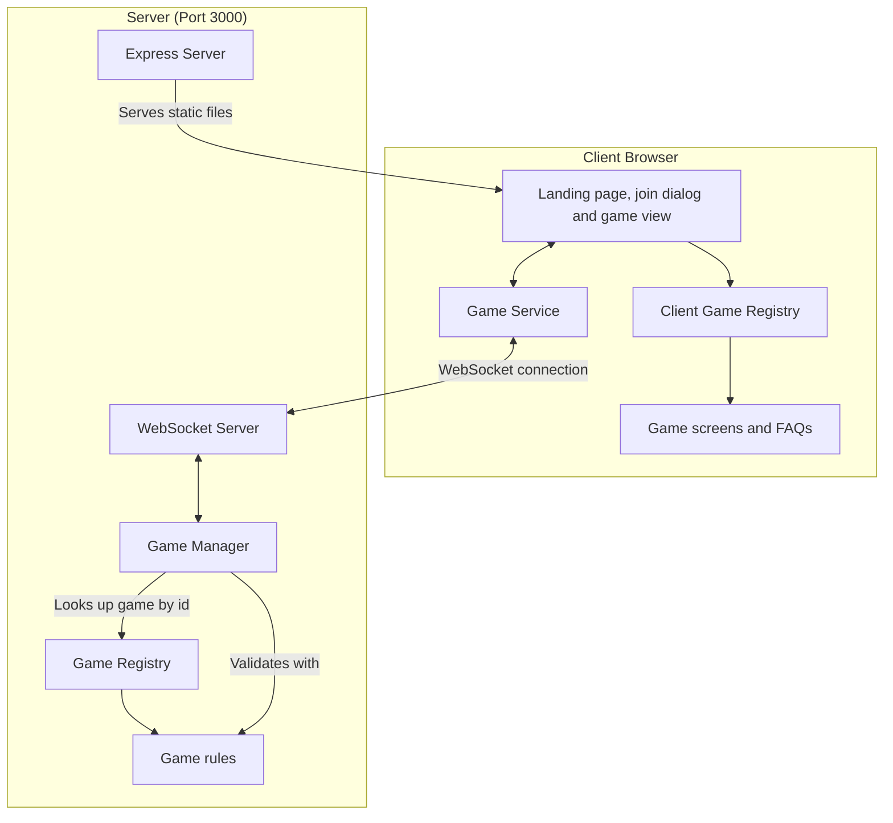

# Multiplayer Tabletop Games Architecture

One Express and WebSocket server hosts every game. The platform handles seating, turn order, undo, and the browser shell. Each game supplies its rules and its screen, and is registered once on the server and once in the browser.



## The split between platform and game

**The platform owns:**

- Express static serving and SPA fallback, the WebSocket server, message parsing and routing, broadcast (`server/server.ts`)
- The in-memory game manager, keyed by game type and game ID (`server/games.ts`)
- Saving every started game to SQLite and loading them back on start (`server/store.ts`)
- Seating in join order up to the game's maximum, with names unique ignoring case, and refusing new names after the game has started (`shared/seating.ts`)
- Holding the seat of a player who disconnects after the first move (refresh, closed tab, lost connection or Back to games), rejoining by the same name with the seat's key, and dismissing a disconnected player by vote
- Turn rotation that skips dismissed players; a disconnected player's turn waits for them
- A heartbeat that closes the sockets of devices that drop off silently, and deleting a game 10 minutes after its last connected player leaves
- Undo: the history of states before each move, requests, voting, and restoring the state once every connected player approves
- Calling the game's `toPublicState` for each player before anything is sent to them, so each player gets their own view
- The landing page, join dialog, rejoin button, game view header (Back to games, FAQ, theme toggle), FAQ dialog, undo vote panel, disconnected players bar, dismiss vote panel, connection hook and service, and the remembered game, in `src/`
- Docker, compose, launcher, CI, lint and TypeScript config

**Each game owns (`games/<id>/`):**

- Its metadata, state shape and types (`types.ts`, `index.ts`)
- Its rules: starting state, applying a move, extra non-move actions, who won, what happens when a player is seated or leaves (`rules.ts`)
- Its public view, `toPublicState`, which removes hidden information
- Its screen, read-only history board, move descriptions, FAQ content, icon and styles (`client/`), with SCSS nested under `[data-game="<id>"]`
- Its rules tests
- Its `README.md`, with the rules and controls for players, linked from the main README

## Contracts

- `shared/gameDefinition.ts` defines `GameDefinition` and `GameInfo`, which the server uses
- `games/registry.ts` lists every `GameDefinition`
- `shared/categories.ts` defines `GameCategory` (every `GameInfo` has one), `CATEGORIES` (the landing page groups, in order) and `groupByCategory`
- `src/clientGames.ts` defines `ClientGame` (`id`, `Screen`, `faq`, `icon`, `HistoryBoard`, `describeMove`, `animateMove`) and lists them in `CLIENT_GAMES`
- `shared/messages.ts` defines the WebSocket messages; `shared/types.ts` defines the base state types
- `shared/shuffle.ts` has `shuffle(items, random)`, and `shared/playingCards.ts` the standard deck (`PlayingCard`, `JokerCard`, `DeckCard`, `standardDeck`, `isJoker`, `rankValue`, `cardName`, `sameCard`), for any game to use; `standardDeck` takes `ranks`, `suits` and `jokers` options to build a smaller deck or add jokers
- `shared/tricks.ts` has the trick-taking rules (`canFollow`, `trickWinner`) that take each game's own suit and rank functions, and `describeTrickPlay` for the move description of a played card
- `shared/rounds.ts` has the between-rounds "everyone is ready" step: `acknowledge` and `everyoneReady` work on a game's own state through its `RoundAccess`, for a summary type that is `Acknowledgeable`
- `shared/partnerships.ts` has the four-seat partnership helpers (`FOUR_SEATS`, `nextSeat`, `teamOf`, `teamSeats`, `partnerOf`, `teamNames`, `partnershipBroken`)
- `shared/hands.ts` has `viewHand` (a viewer sees only their own hand), `handCounts` and `mapSeats`
- `shared/dice.ts` has `rollDie` and `rollDice`, which take the game's `Random`
- Every game declares a `category` in its `GameInfo`, which decides its landing page group

Server code (`server/`, `shared/`, and the non-client files of each game) never imports from `src/` or any `games/<id>/client/`.

## Client

1. **React components (`/src/components`)**

   - `GameList.tsx` is the landing page: one row per game, in a section per category (`groupByCategory`), alphabetical within a section
   - `JoinDialog.tsx` asks for a name and game ID and shows server errors inline; it has an FAQ button
   - `GameView.tsx` is the header (Back to games, History, FAQ, theme toggle) around the game's own `Screen`
   - `FaqButton.tsx` and `FaqDialog.tsx` show a game's FAQ items
   - `SettingsButton.tsx` and `SettingsDialog.tsx` are the gear in both headers and the per-browser preferences dialog (`.settings-button`, `.modal.settings`)
   - `HistoryButton.tsx` fetches the game's steps from `/api/history/<game type>/<game ID>` (always enabled) and `HistoryDialog.tsx` shows them: a range slider over the steps, a label, and the game's read-only `HistoryBoard` for that step. Each step has a `historyStep` of `start` (the starting board, labelled "Start of the game"), `move` ("Move k of N: <the game's `describeMove`>") or `end` ("End of the game: <the game status>", drawn without a highlighted move). The slider opens on the latest step. Each step is wrapped in `StepErrorBoundary.tsx`, so a step whose board throws shows "This step could not be shown" and the slider keeps working. When the latest step is a finished game, the dialog offers Download game, which fetches the file from the server (see Game files) and saves it; if that fails it shows "Could not download the game". The live dialog has no "View as" picker and never shows hands. Below the slider are Play/Pause, an Animations checkbox, a Sounds checkbox (`historySounds`, off by default) and, for a file with `views`, the picker. With Sounds on, a step forward plays its move, dice and game-over sounds through `useStateSounds` with no viewer, so the turn chime never plays here, and a slider jump or a step back plays nothing. Play moves one step every `PLAY_STEP_MS` (1500 ms, `playback.ts`) and stops on the last step. With Animations on, a step forward calls the game's optional `ClientGame.animateMove(change, viewer)` through `useMoveAnimation`; a step the game cannot animate snaps. It shows the history as of opening and changes nothing for other players
   - `OpenSavedGame.tsx` is the landing page's "Open a saved game" button: it reads a `.json` file in the browser, checks it with `parseGameFile` from `shared/gameFile.ts`, shows one plain error if it is not accepted, and otherwise opens a `HistoryDialog` titled "Saved game: <game ID>" with that game's `HistoryBoard` and `describeMove` and no Download button. For a version 2 file the dialog has a "View as" picker ("Table only" plus one option per player) and draws each step from that player's `views` entry; a version 1 file has none, so the picker is hidden. Nothing is uploaded and a saved game cannot be played on
   - `ThemeToggle.tsx` switches light and dark; the choice is shared across the site
   - `UndoVote.tsx` shows a running undo vote
   - `RejoinButton.tsx` is the "Back to <game> (<game ID>)" button on the landing page, shown when the remembered game was left with Back to games or a lost connection
   - `PresenceBar.tsx` sits above the game screen while anyone is disconnected: each disconnected player with a Dismiss button, and "Waiting for <name> to reconnect" when it is their turn
   - `DismissVote.tsx` shows a running dismiss vote
   - `VotePanel.tsx` is the panel both votes share; only connected players are listed and can vote
   - `PlayingCard.tsx` draws a standard playing card face up, a joker (a `DeckCard`, class `playing-card-joker`), or its back for `card: null`, in three sizes; with `onClick` it is a button. Its default look is in `App.scss`, and a game can retheme it with `--playing-card-face`, `--playing-card-back`, `--playing-card-stripe`, `--playing-card-red`, `--playing-card-black`, `--playing-card-selected` and `--playing-card-highlight`
   - `Dice.tsx` draws a row of six-sided dice with pips; with `onToggle` each die is a button (for holding dice). Its default look is in `App.scss`, and a game can retheme it with `--dice-face`, `--dice-pip` and `--dice-selected`
   - `Die`, also exported from `Dice.tsx`, draws a single die
   - `RoundSummaryDialog.tsx` is the end-of-round scoring dialog with a Continue button (or Close when the game is over), shared by the round-based games; the `result` option replaces the result line under the title (default: the game status) and `listDisconnected` also names disconnected players in the waiting line (the server still waits only for connected players)
   - `DrawAndResign.tsx` is the Offer draw, Accept draw and Decline, and Resign (with Confirm resign) controls for two-player games that use `shared/drawOffer.ts`; the game passes its own buttons, such as Undo, as children
   - `/shared/text.ts` has `plural(count, word, pluralWord?)`
   - `/src/hooks/useEscapeKey.ts` closes the topmost dialog on Escape
   - `/src/animation/useMoveAnimation.ts` lets a game screen animate a move: after a render that added exactly one move (`moveCount` up by one) it calls the game's `animate` with the previous and next state, the root element and `rectOf(key)`, where each `data-anim-key` element was before the move; then it measures them again. The first render, a rejoin and an undo do not animate. `/src/animation/motion.ts` has `slideFrom` and `fadeIn` (Web Animations API, `MOVE_DURATION_MS` = 300 ms, none under `prefers-reduced-motion: reduce`); a new animation on an element cancels its running one. `/src/animation/animKeys.ts` has the shared `data-anim-key` names (`handKey`, `seatKey`, `trickKey`). Quoridor glides the moved pawn from its old square and fades in a new wall; the History dialog animates only through a game's `animateMove`, when Animations is on
   - `/src/sound/` plays the game sounds, all made with the Web Audio API (no audio files): `turn` (two bell-like sine notes, 660 then 880 Hz), `move` (a 30 ms triangle click), `dice` (six short noise bursts over 250 ms), `gameOver` (a rising four-note triangle arpeggio) and `timer` (a 20 ms 1000 Hz tick). `sounds.ts` is pure: `soundsFor(previous, next, viewer)` plays nothing for the first state (join, rejoin, reload) or for an undo or History jump (the move count is neither equal nor one higher); one move forward plays `dice` if it rolled (`lastMove.type` of roll, attack or blitz) or `move` (plus `dice` when Parchisi rolls its next dice automatically), then `gameOver` when the game just ended (also in place, for a resignation), then `turn` when it just became the viewer's turn with two or more players (never without a viewer, so never in History). `audible` drops everything when muted or at volume 0, and unchecked groups. `synth.ts` creates the one `AudioContext` on the first click or key press (`installAudioUnlock`), does nothing without Web Audio or before that, and exposes `playSounds(names)`, which is also where the house rules timers call `playSounds(['timer'])` once a second in the last 10 seconds. `useStateSounds` runs it from `GameView` on each state change
   - `/src/hooks/useGameConnection.ts` holds the joined game's state and errors from the Game Service, remembers the game, rejoins it after a refresh, and offers it again after Back to games

2. **Game Service (`/src/services/gameService.ts`)**

   - Manages the WebSocket connection
   - Sends joins (and rejoins), moves, game actions, undo and dismiss requests and votes
   - Passes server state updates and errors to the UI

3. **Download (`/src/services/download.ts`)**

   - `downloadJson` saves data as a pretty-printed JSON file through the browser. The file comes from the server (`GET /api/game-file`) and is named by `gameFileName` (`<game type>-<game ID>.json`, unsafe characters replaced by `-`)

4. **Remembered game (`/src/services/session.ts`)**

   - Keeps the most recent game (game type, game ID, name, and whether the player was still in it) in `localStorage` under `lastGame`
   - A page that loads while the player was in the game rejoins it automatically. If the old socket still holds the seat ("<name> is already in this game"), it retries up to 5 times, 1 second apart. Any other error, such as a deleted game or a dismissal, forgets the game and shows the error on the list
   - Back to games and a lost connection keep the game but mark the player as out of it, so the list shows the rejoin button instead of rejoining by itself
   - Every storage access may fail (blocked storage); the site then works without remembering the game across page loads

   **Settings (`/src/services/settings.ts`, on `/src/services/storage.ts`)**

   - `storage.ts` has `readJson`, `writeJson` and `removeKey`, which swallow storage errors
   - `historyAnimations` (the History dialog's Animations checkbox, off by default) and `joinForm` (the name and game ID last used to join, shared by every game, saved when Join is pressed) are kept in `localStorage`
   - `preferences` holds the Settings dialog's choices: `volume` (0 to 1, default 0.5), `muted` (off), `sounds` (turn, move, dice, gameOver, timer, each on), `colorSymbols` (off) and `highlightDrawn` (on). Each field is validated on its own, so a bad value falls back to its default and the rest are kept. `historySounds` (off) is the History dialog's Sounds checkbox
   - `/src/hooks/usePreferences.ts` keeps the preferences in memory after one read: `getPreferences()` for non-React code, `setPreferences(next)` to save and notify, and the default `usePreferences()` hook (`useSyncExternalStore`) for components

5. **Game screens (`/games/<id>/client`)**
   - Each game's board components and screen, receiving the public state, the player's seat and any error
   - Styles are scoped under `[data-game="<id>"]` so palettes never overwrite each other

6. **Default styles for the platform pieces (`/src/App.scss`)**
   - The game header (`.game-root`, `.game-header`, `.back-button`, `.history-button`, `.faq-button`, `.settings-button`, `.theme-toggle`), the FAQ dialog (`.overlay`, `.modal`, `.faq`, `.primary-button`), the history dialog (`.modal.history`, `.history-move`, `.history-slider`, `.history-board`), the undo vote (`.undo-vote`, `.undo-vote-panel`, `.undo-vote-title`, `.undo-vote-list`, `.undo-vote-actions`), the disconnected players bar (`.presence-bar`, `.presence-list`, `.presence-player`, `.presence-waiting`, `.dismiss-button`) the dismiss vote (`.dismiss-vote`, `.dismiss-vote-panel`, `.dismiss-vote-title`, `.dismiss-vote-list`, `.dismiss-vote-actions`) and the resign and draw controls (`.ending-controls`, `.ending-buttons`, `.draw-offer`, `.draw-offer-title`, `.draw-offer-actions`) have a neutral default look, so a game with no CSS of its own still gets a working header, an FAQ overlay and its vote panels
   - Every default selector is wrapped in `:where()`, so it has no specificity and any rule in a game's CSS wins
   - A game can retheme the defaults without writing rules by setting these variables on `[data-game="<id>"]`: `--platform-page-bg`, `--platform-text`, `--platform-button-bg`, `--platform-button-hover-bg`, `--platform-button-text`, `--platform-panel-bg`, `--platform-panel-text`, `--platform-backdrop`. Unset ones fall back to the lobby's light or dark palette
   - Quoridor and Azul style the header, FAQ dialog and undo vote themselves, so the defaults do not change how those look; the disconnected players bar and the dismiss vote use the defaults

## Server

1. **Express and WebSocket server (`/server/server.ts`)**

   - Serves the built React application and handles SPA routing through `serveClient` (`/server/static.ts`). Vite's content-hashed files under `/assets/` are sent with `Cache-Control: public, max-age=31536000, immutable`; every other file (`index.html`, `sw.js`, `manifest.webmanifest`, the icons) and the SPA fallback's `index.html` with `no-cache`, so the browser checks with the server on each load. A path without an extension gets `index.html`; a missing file with one (`/missing.js`) is a 404
   - The site installs as an app: `public/manifest.webmanifest` gives its name, colors and icons (`public/icon-*.png`, `public/apple-touch-icon.png`, made once from `favicon.svg`), and `index.html` links it with the `theme-color` meta, which the theme toggle keeps in step with the light or dark theme. `src/main.tsx` registers the hand-written service worker `public/sw.js` in production builds only. The worker precaches `/`, then answers same-origin GETs network first (with `cache: 'no-cache'`), keeping a copy of each good response and falling back to it offline (a page load falls back to the cached `/`). It never touches `/api/` or the WebSocket, never reloads a page, and its versioned cache name (`tabletop-games-v1`) clears older caches on activation
   - Reads `PORT` from the environment, default 3000, and `DATABASE_PATH`, default `data/games.sqlite` under the repo root
   - Routes WebSocket messages to the game manager and broadcasts the results

2. **Game Manager (`/server/games.ts`)**

   - Creates games from the registry, seats players, and locks joining after the first move
   - Applies moves and actions through the game's `GameDefinition`, after the turn checks
   - Keeps each game's undo history and runs unanimous undo votes. An undo calls the game's `onUndo` on the restored state, where a game reshuffles its face-down piles. When the undone move came before a dismissal, the dismissed player is removed from the restored state again through the game's `onPlayerLeft`, so a turn, roll or pending decision they held moves on as it did when they were dismissed
   - Holds disconnected players' seats, gives them back on a rejoin, and runs unanimous dismiss votes
   - Holds each game's full state in memory, written through to SQLite, and sends only the public view
   - Builds a game's history as the starting board, the state after each move and, when the game ended outside a move (resigning, an agreed draw, an end-of-round action, a dismissal), an end step built from the live state
   - Takes a `GameStore` as a parameter, so tests can pass an in-memory one or none

3. **Game store (`/server/store.ts`)**

   - `openGameStore(file)` opens a SQLite database with Node's built-in `node:sqlite` (no npm package; Node 22 prints an ExperimentalWarning) and creates the `rooms` and `room_steps` tables if missing. `':memory:'` or a path works, and a path's folder is created
   - `GameStore` has `loadAll`, `save(roomId, gameType, state, step?)` and `remove(roomId)`. A `rooms` row is the room ID (`<game type>/<game ID>`), the game type, and the live `state` as JSON. A `room_steps` row is one step of the room's history: the room ID, the step index `idx`, `before` (`history[idx]`, the state before move `idx + 1`) and `after` (`timeline[idx]`, the state right after it), both JSON
   - A save writes the live state and at most one step in one transaction, so its cost does not grow with the length of the game: a move inserts a step, an approved undo deletes the last one, and every other change only rewrites the state. `loadAll` puts `history` and `timeline` back together from the steps, in `idx` order. Removing a room deletes its steps too
   - A room is saved after every change once the game has started (moves, actions, undo and dismiss requests and votes, joins, rejoins and disconnects) and removed when the room is deleted. Lobbies are not saved
   - A store failure is logged and play continues
   - With Docker, `docker-compose.yml` mounts the `game-data` named volume at `/app/data` (the container is read-only otherwise, and the Dockerfile makes `/app/data` writable by the `node` user), so started games survive restarts and rebuilds
   - On start the manager loads every saved room: each active seat is marked disconnected directly, without running any game hook, so the usual rejoin works; open undo and dismiss votes are cleared; the saved status is kept; and the 10-minute empty-game timer restarts. A room whose state or steps do not parse, have the wrong shape or skip an index, that names a game that no longer exists, or that fails to load for any other reason is logged and deleted with its steps

4. **Game registry (`/games/registry.ts`)**
   - `GAMES` lists the games, alphabetical by name

## Game files

`shared/gameFile.ts` defines the file a finished game is saved as: `format` (`multiplayer-tabletop-games`), `version` (2), `gameType`, `gameId`, `exportedAt` and `steps`. Each step is the table's view (viewer `null`, no hands) plus `views`, the same step as each seat saw it, keyed by seat number. The server builds the file in `GET /api/game-file/<game type>/<game ID>`, which needs no credentials and answers 404 for an unknown game and 409 "The game is not over yet" until game over. `parseGameFile` accepts a file only when it parses as JSON, the format is right, the version is 1 or 2 (version 1 files have no `views`), `views`, when present, holds valid steps, the game ID is 1 to 20 characters, `steps` is a non-empty array of steps with a valid `historyStep`, and the game type is one the site has; otherwise it returns an error message. Steps are not checked field by field; `StepErrorBoundary` covers a hand-edited step.

Accepted risk: undo is still allowed after game over, so players could download the file, undo the final move and play on knowing every hand. The file is meant for a finished game and the site does not prevent this.

## Hidden state

Every state sent to a browser goes through the game's `toPublicState`, which is told the seat it is building the view for (`viewer`). The server builds a separate view for each connected player, so a card game can send each player their own hand and only the size of everyone else's. The history endpoint builds its views with `viewer` set to `null`, which sees no hand. A game file also builds one view per seat, which is how a saved game can show a chosen player's hand. Each game's `HistoryBoard` takes `viewer: Seat | null` and shows that player's hand (Uno, Phase 10, Scrabble, Skip-Bo, Go Fish, Rook, Rummikub, Catan, Ticket to Ride, Risk, Dominoes, Euchre, Hearts, Rack-O, Spades, Texas Hold'em, The Crew) or none for `null`. A game that hides nothing returns its state as is. Azul removes the bag, the lid and round bookkeeping, so nobody can count what is left in the bag, as in the physical game. Splendor removes the deck order, and shows a card reserved from the top of a deck only to the player who reserved it. Monopoly removes only the order of the Chance and Community Chest decks. Catan shows each player only their own resource and development cards (the others see counts), keeps Victory Point cards out of the points others see until the game ends, removes the development deck order, and shows a stolen card only to the thief and the victim. Carcassonne removes only the order of the tiles still to draw, and shows their count; the tile being placed is public. Ticket to Ride removes both deck orders and the discards, and shows each player only their own train cards, destination tickets and offered tickets (everyone else sees counts) until the final scoring shows every ticket. Risk sends each player their own territory cards and only the number everyone else holds, and removes the deck order and the discards. Texas Hold'em sends each player only their own hole cards and removes the deck; at a showdown the hands still in are shown to everyone, and a player who folded or won uncontested keeps their cards hidden. Dominoes sends each player only their own tiles and removes the boneyard, showing the counts of both. Euchre sends each player only their own hand and removes the kitty, shows the dealer's discard only to the dealer, and keeps the turned card public. Hearts sends each player only their own hand, and shows a pass only to its sender. Rack-O sends each player only their own rack and removes the draw pile, shows its count, and shows a drawn card only to the player holding it. Spades sends each player only their own hand. The Crew sends each player only their own hand, hides the face-down tasks during a commander's decision or while tasks are handed out, and shows a distress pass only to its sender.

## Communication Flow

1. **Joining**

   ```
   Client -> Server: JOIN_GAME (gameType, gameId, playerName, rejoin, seatKey)
   Server -> Client: GAME_JOINED (playerNumber, seatKey, gameState) or GAME_ERROR
   Server -> All clients in the game: GAME_STATE
   ```

   Each seat gets a random `seatKey` when it is taken, kept in the game state (and so saved) but stripped from every view. The browser remembers it with the game. A join with a name already seated in the game, ignoring case, takes back that seat if it is held and the join sends its key; a wrong or missing key fails with "That name is taken in this game". A game saved before keys existed gives its seat a key on the first rejoin by name. `rejoin: true` (sent by the automatic and one-click rejoins) only takes back a held seat; it never creates a game or takes a new seat, and fails with "Game not found", "You are not in this game", "You were removed from this game", "That name is taken in this game" or "<name> is already in this game".

2. **Playing**

   ```
   Client -> Server: MAKE_MOVE (move)
   Server -> All clients in the game: GAME_STATE, or GAME_ERROR to the sender
   ```

3. **Game actions**

   ```
   Client -> Server: GAME_ACTION (action)
   Server -> All clients in the game: GAME_STATE, or GAME_ERROR to the sender
   ```

   Actions are not turn-bound and are not recorded for undo. Azul uses one to acknowledge the end of a round.

   `shared/drawOffer.ts` holds resigning and draws by agreement for two-player games as actions: `resign`, `offerDraw` and `answerDraw` (`accept`). They work on either player's turn while the game runs, and are refused before the first move, after the game is over and during a vote. The state keeps the offering seat in `drawOffer`; the offer ends when it is answered, or when the game's `applyMove` calls `lapseDrawOffer` for a move by the other player. A game can score a resignation as a draw, as Chess does when the opponent could never checkmate. Chess, Checkers and Connect Four use it; Chess adds its own `claimDraw` action.

4. **Undo**

   ```
   Client -> Server: REQUEST_UNDO
   Each client -> Server: VOTE_UNDO (approve)
   Server -> All clients in the game: GAME_STATE (vote progress, then the restored state or the decline)
   ```

5. **Disconnecting or Back to games**

   ```
   Client disconnects
   Server -> Remaining clients: GAME_STATE (player listed in `disconnected`, or removed before the first move)
   ```

6. **Dismissing**

   ```
   Client -> Server: REQUEST_DISMISS (seat of a disconnected player)
   Each connected client -> Server: VOTE_DISMISS (approve)
   Server -> All clients in the game: GAME_STATE (vote progress, then the dismissal or the decline)
   ```

## Single Port

All communication happens over port 3000: HTTP serves the React application and WebSocket carries the games. With Docker, the server still listens on 3000 inside the container and `APP_PORT` picks the host port. The browser builds the WebSocket URL from the page address, so it follows whatever host port is mapped.
