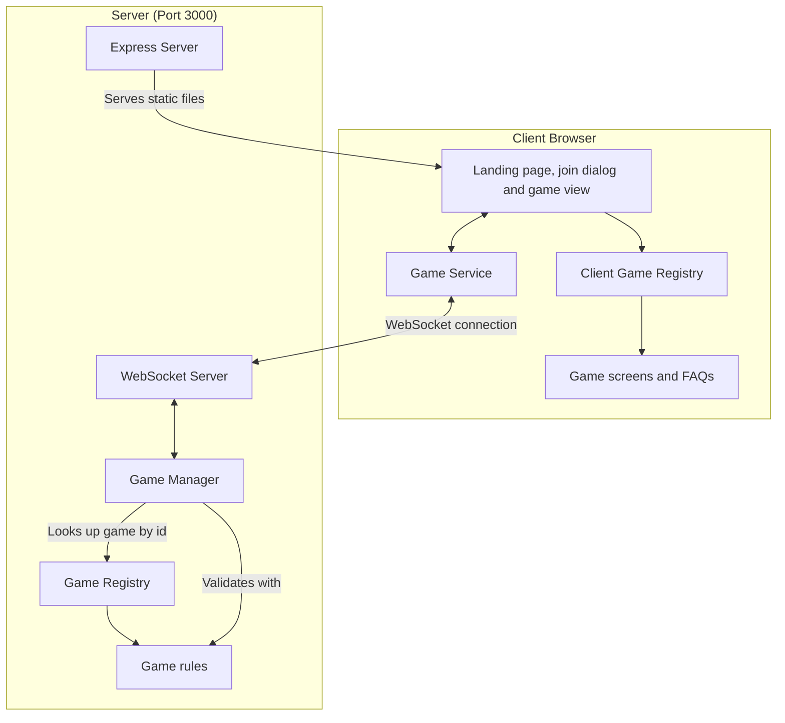

# Multiplayer Tabletop Games Architecture

One Express and WebSocket server hosts every game. The platform handles seating, turn order, undo, and the browser shell. Each game supplies its rules and its screen, and is registered once on the server and once in the browser.



## The split between platform and game

**The platform owns:**

- Express static serving and SPA fallback, the WebSocket server, message parsing and routing, broadcast (`server/server.ts`)
- The in-memory game manager, keyed by game type and game ID (`server/games.ts`)
- Seating in join order up to the game's maximum, refusing joins after the game has started, leaving mid-game, deleting a game when its last player leaves (`shared/seating.ts`)
- Turn rotation that skips players who left
- Undo: the history of states before each move, requests, voting, and restoring the state once every remaining player approves
- Calling the game's `toPublicState` before anything is sent to a browser
- The landing page, join dialog, game view header (Back to games, FAQ, theme toggle), FAQ dialog, undo vote panel, connection hook and service, in `src/`
- Docker, compose, launcher, CI, lint and TypeScript config

**Each game owns (`games/<id>/`):**

- Its metadata, state shape and types (`types.ts`, `index.ts`)
- Its rules: starting state, applying a move, extra non-move actions, who won, what happens when a player is seated or leaves (`rules.ts`)
- Its public view, `toPublicState`, which removes hidden information
- Its screen, FAQ content, icon and styles (`client/`), with CSS scoped under `[data-game="<id>"]`
- Its rules tests

## Contracts

- `shared/gameDefinition.ts` defines `GameDefinition` and `GameInfo`, which the server uses
- `games/registry.ts` lists every `GameDefinition` in landing page order
- `src/clientGames.ts` defines `ClientGame` (`id`, `Screen`, `faq`, `icon`) and lists them in `CLIENT_GAMES`
- `shared/messages.ts` defines the WebSocket messages; `shared/types.ts` defines the base state types

Server code (`server/`, `shared/`, and the non-client files of each game) never imports from `src/` or any `games/<id>/client/`.

## Client

1. **React components (`/src/components`)**

   - `GameList.tsx` is the landing page: one row per game, in registry order
   - `JoinDialog.tsx` asks for a name and game ID and shows server errors inline; it has an FAQ button
   - `GameView.tsx` is the header (Back to games, FAQ, theme toggle) around the game's own `Screen`
   - `FaqButton.tsx` and `FaqDialog.tsx` show a game's FAQ items
   - `ThemeToggle.tsx` switches light and dark; the choice is shared across the site
   - `UndoVote.tsx` shows a running undo vote
   - `/src/hooks/useGameConnection.ts` holds the joined game's state and errors from the Game Service

2. **Game Service (`/src/services/gameService.ts`)**

   - Manages the WebSocket connection
   - Sends joins, moves, game actions, undo requests and undo votes
   - Passes server state updates and errors to the UI

3. **Game screens (`/games/<id>/client`)**
   - Each game's board components and screen, receiving the public state, the player's seat and any error
   - Styles are scoped under `[data-game="<id>"]` so palettes never overwrite each other

## Server

1. **Express and WebSocket server (`/server/server.ts`)**

   - Serves the built React application and handles SPA routing
   - Reads `PORT` from the environment, default 3000
   - Routes WebSocket messages to the game manager and broadcasts the results

2. **Game Manager (`/server/games.ts`)**

   - Creates games from the registry, seats players, and locks joining after the first move
   - Applies moves and actions through the game's `GameDefinition`, after the turn checks
   - Keeps each game's undo history and runs unanimous undo votes
   - Holds each game's full state in memory, and sends only the public view

3. **Game registry (`/games/registry.ts`)**
   - `GAMES` lists the games; `findGame` looks one up by id

## Hidden state

Every state sent to a browser goes through the game's `toPublicState`. A game that hides nothing returns its state as is. Azul removes the bag, the lid and round bookkeeping, so nobody can count what is left in the bag, as in the physical game.

## Communication Flow

1. **Joining**

   ```
   Client -> Server: JOIN_GAME (gameType, gameId, playerName)
   Server -> Client: GAME_JOINED (playerNumber, gameState) or GAME_ERROR
   Server -> All clients in the game: GAME_STATE
   ```

2. **Playing**

   ```
   Client -> Server: MAKE_MOVE (move)
   Server -> All clients in the game: GAME_STATE, or GAME_ERROR to the sender
   ```

3. **Game actions**

   ```
   Client -> Server: GAME_ACTION (action)
   Server -> All clients in the game: GAME_STATE, or GAME_ERROR to the sender
   ```

   Actions are not turn-bound and are not recorded for undo. Azul uses one to acknowledge the end of a round.

4. **Undo**

   ```
   Client -> Server: REQUEST_UNDO
   Each client -> Server: VOTE_UNDO (approve)
   Server -> All clients in the game: GAME_STATE (vote progress, then the restored state or the decline)
   ```

5. **Disconnecting or Back to games**
   ```
   Client disconnects
   Server -> Remaining clients: GAME_STATE (player marked as left)
   ```

## Single Port

All communication happens over port 3000: HTTP serves the React application and WebSocket carries the games. With Docker, the server still listens on 3000 inside the container and `APP_PORT` picks the host port. The browser builds the WebSocket URL from the page address, so it follows whatever host port is mapped.
